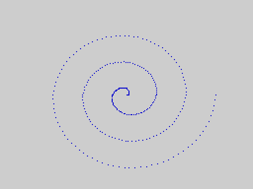

# 2068-Leap V2

**A replacement ROM for the Timex Sinclair 2068**: a full-screen editor, a structured BASIC without line numbers, a whole-program compiler and bytecode VM, floating-point numbers, strings and arrays, AY sound, graphics, sprites and tape storage. It fits in the machine's own 16 KB HOME ROM and 8 KB extension ROM (EXROM) and runs on a stock 48 KB TS2068, instant-on.

[](https://github.com/nchiker/2068-Leap/actions/workflows/check.yml?query=branch%3Av2-development)
[](https://github.com/nchiker/2068-Leap/releases/tag/v2.1.0-emu.1)
[](LICENSE)

| ▶ [**Try V2 in your browser**](https://nchiker.github.io/TSRun/?rom=leap) | ⬇ [**Download V2**](https://github.com/nchiker/2068-Leap/releases/download/v2.1.0-emu.1/2068-Leap-V2-v2.1.0-emu.1.zip) | 📖 [**Read the V2 User Manual**](docs/manual/01_introduction.md) | 🖥 [**Emulator Setup**](docs/EMULATOR_SETUP.md) | 🗄 [**V1 Legacy Version**](#2068-leap-v1--legacy--archived-version) |
|:---:|:---:|:---:|:---:|:---:|

> **Current release: [v2.1.0-emu.1](https://github.com/nchiker/2068-Leap/releases/tag/v2.1.0-emu.1)** (2068-Leap V2 Enhanced, Speed and Package Functions Release) — **emulator-qualified** on ZEsarUX, **not hardware-qualified**: nothing has been tried on a physical TS2068 yet. Much faster BASIC (the improvements of the sibling project 2068-Leap-C, back-ported), package functions, a correctly rounded calculator, errors that show their number, and glyphs for every printable ASCII character. Development continues on this branch, `v2-development`.

2068-Leap is an alternate-history ROM: what the TS2068's own BASIC could have been, built from documented kernel modules instead of the tangled monolith of the original, and designed around the machine's real limits — 24 KB of ROM in two banks and 48 KB of RAM shared with the screen. It is an independent community project, open source under the [MIT License](LICENSE), and is not affiliated with Timex, Sinclair, Amstrad, Fuse, ZEsarUX or the ULAplus project. See also the sibling project [**2068-Leap-Forth**](https://github.com/nchiker/2068-Leap-Forth), a from-scratch Forth on the same hardware kernel.

<table>
<tr>
<td align="center"><br><sub>The full-screen editor</sub></td>
<td align="center"><br><sub>Floating-point graphics</sub></td>
</tr>
<tr>
<td align="center"><br><sub>CIRCLE and FILL (shapes package)</sub></td>
<td align="center"><br><sub>Sprites (sprite package)</sub></td>
</tr>
</table>

*Screenshots taken on the ROM by the manual's automated example suite.*

**Contents:** [What V2 is](#what-v2-is) · [Try it](#try-it) · [Download](#download) · [User manual](#user-manual) · [Emulators](#running-it-in-an-emulator) · [Examples](#examples) · [Packages](#loadable-packages) · [How it works](#how-it-works) · [Status](#status-qualification-and-limitations) · [Building](#building-from-source) · [Documentation](#documentation) · [V1 legacy](#2068-leap-v1--legacy--archived-version) · [Related projects](#related-projects) · [Contributing](#contributing-and-license)

## What V2 is

V2 is the current 2068-Leap system: a complete redesign of the first release (V1, now [archived](#2068-leap-v1--legacy--archived-version)). Implemented and qualified in the release:

- **A full-screen BASIC editor.** Programs are lists of editable lines with no line numbers: insert, replace and delete lines, move with the cursor keys, `LIST`, keywords shown in bold as you type, and a status line.
- **A compiler and a bytecode VM.** `RUN` compiles the whole program to compact bytecode and runs it in the V2 virtual machine; a mistake anywhere is reported before anything runs. The source text is what is stored, listed and saved; the bytecode is rebuilt on every `RUN`.
- **Structured programming.** Labels and `GOTO`, block `IF` / `ELSE` / `ENDIF`, `FOR` / `NEXT` with `STEP`, procedures with parameters that can call themselves (`PROC` / `CALL` / `ENDP`), and one-line functions (`DEF FN`). BREAK stops a running program; runtime errors stop cleanly with a message.
- **Numbers, strings and arrays.** Whole numbers and 5-byte floating-point numbers, converted automatically; maths functions in degrees; names up to 31 characters; strings up to 31 characters with the full set of string functions; arrays of numbers and of strings, which can be saved on their own and kept across runs (the *Array Store*).
- **Sessions.** When a program stops, its variables stay: a statement typed after a colon (`: PRINT total`) runs at once and can inspect or change them.
- **Graphics.** `PLOT`, `LINE`, `POINT`, `INK`, `PAPER`, `BORDER`, `AT` and 21 user-defined characters; from packages, circles and flood fill, rectangles and big pixels, sprites, and the TS2068 video modes (extended-colour mode and ULAplus palettes).
- **Sound.** `BEEP seconds, semitones` (Sinclair's syntax) and `SOUND register, value` on the AY-3-8912 sound chip, a startup chime, and the original loudspeaker through the optional `CBEEP` package.
- **Tape storage.** `SAVE`, `LOAD` and `VERIFY` for programs, single arrays, and whole programs with their variables (`SAVE ... ALL`), in V2's own TS2068-framed tape format.
- **Hardware access.** `PEEK`, `POKE`, `IN`, `OUT` and `USR`.
- **Loadable packages.** Six optional packages on tape add statements without costing ROM space; since v2.1 a package can also add numeric and string functions and can use floating-point numbers (see [below](#loadable-packages)).
- **Fast.** v2.1 runs BASIC much faster than v2.0.x: an empty `FOR` pass takes 827 T-states (was 1,107), floating-point multiplication is about five times faster, and scrolling output prints 24 lines a second (was 14); the calculator rounds correctly and `SIN`, `COS` and `TAN` are more accurate.

V2 is not a compatibility clone of Sinclair BASIC: the differences are listed in the manual's concept [Differences from Sinclair BASIC](docs/manual/04_concepts.md#differences-from-sinclair-basic).

## Try it

**In your browser, no install: [nchiker.github.io/TSRun/?rom=leap](https://nchiker.github.io/TSRun/?rom=leap)** runs the **v2.1.0-emu.1** ROMs (since 2026-10-28) in the [TSRun](https://github.com/josef-jelinek/TSRun) browser emulator (our fork: [nchiker/TSRun](https://github.com/nchiker/TSRun)). Eight test programs (every character, floats and `SIN`/`COS`/`TAN`, loops, strings, arrays and `PROC`, scrolling, an error) give screens byte-identical to ZEsarUX's, and a package tape (`SHAPES`) loads with `LOAD "SHAPES" EXT` once the tape is played; click the page once so the browser allows sound.

The machine starts in the editor. Type each line and press ENTER after it, then type `RUN` on the empty line that follows:

```
x = 5
PRINT x * 2
RUN
```

The screen shows `10`; press a key to return to the editor. A loop with a label:

```
n = 0
again:
n = n + 1
PRINT n
IF n < 3 THEN GOTO again
RUN
```

The [beginner's guide](docs/manual/02_beginners_guide.md) (Part 2 of the manual) starts from here.

## Download

**Recommended: [`2068-Leap-V2-v2.1.0-emu.1.zip`](https://github.com/nchiker/2068-Leap/releases/download/v2.1.0-emu.1/2068-Leap-V2-v2.1.0-emu.1.zip)** from the [v2.1.0-emu.1 release](https://github.com/nchiker/2068-Leap/releases/tag/v2.1.0-emu.1) — the complete V2 distribution. Check it with `sha256sum -c 2068-Leap-V2-v2.1.0-emu.1.zip.sha256` (published beside it), then `sha256sum -c SHA256SUMS` inside.

| In the archive | What it is |
|---|---|
| `roms/leap_v2_home.bin` | 16 KB HOME ROM — SHA-256 `8c3d6c8108b653114ce4fffcd9695ac9883a8068664bffd21524b7ac1d167df0` |
| `roms/leap_v2_exrom.bin` | 8 KB EXROM — SHA-256 `e46e2065ee863f0569c3e47cdc975af0081b4e7227b690977eed4fb7d7020f9d` |
| `roms/leap_v2_zesarux.bin` | HOME + EXROM in one file, for ZEsarUX `--romfile` |
| `roms/leap_v2_exrom.dck` | the EXROM as a Timex ROM cartridge, for EightyOne |
| `packages/` | the six packages, as `.tzx` tapes and binaries (byte-identical to v2.0.2-emu.1; they load on v2.0.x ROMs too) |
| `docs/manual/`, `docs/2068_Leap_V2_Users_Manual.docx`, `.doc` | the user manual as released (Markdown with pictures, Word and Word 97) |
| `docs/` | the release record, language reference, defect register, hardware checklist, package ABI, the emulator guide (and `patches/`, the ZEsarUX patch it needs) |

Earlier releases: [v2.0.2-emu.1](https://github.com/nchiker/2068-Leap/releases/tag/v2.0.2-emu.1) (compiler maintenance), [v2.0.1-emu.1](https://github.com/nchiker/2068-Leap/releases/tag/v2.0.1-emu.1) (sound maintenance) and the first V2 release, [v2.0.0-emu.1](https://github.com/nchiker/2068-Leap/releases/tag/v2.0.0-emu.1); all releases are on the [releases page](https://github.com/nchiker/2068-Leap/releases).

**Development builds (unqualified).** Every push to `v2-development` is built automatically and published as the rolling pre-release [**latest**](https://github.com/nchiker/2068-Leap/releases/tag/latest) ([`2068-Leap-latest.zip`](https://github.com/nchiker/2068-Leap/releases/download/latest/2068-Leap-latest.zip)), and every push and pull request leaves a build artifact on the [Actions](https://github.com/nchiker/2068-Leap/actions) tab. These are **not releases**: they have not been through qualification, and their ROMs can differ from the qualified images.

## User manual

The **2068-Leap V2 User Manual and Language Reference** has seven parts — introduction, a beginner's guide, keywords A–Z, concepts A–Z, the packages, practical programs, and appendices (messages, error codes, character set, limits, memory map, package card, hardware notes). Every one of its 327 examples is an automated test, run on the ROM by `make doc-examples`.

| Format | Link |
|---|---|
| Markdown, with illustrations (read on GitHub) | [**docs/manual/**](docs/manual/01_introduction.md) — [1 Introduction](docs/manual/01_introduction.md) · [2 Beginner's guide](docs/manual/02_beginners_guide.md) · [3 Keywords](docs/manual/03_keywords.md) · [4 Concepts](docs/manual/04_concepts.md) · [5 Packages](docs/manual/05_packages.md) · [6 Examples](docs/manual/06_examples.md) · [Appendices](docs/manual/07_appendices.md) |
| Microsoft Word (`.docx`) | [**Download 2068_Leap_V2_Users_Manual.docx**](https://github.com/nchiker/2068-Leap/raw/v2-development/docs/2068_Leap_V2_Users_Manual.docx) |
| Word 97–2003 (`.doc`) | [**Download 2068_Leap_V2_Users_Manual.doc**](https://github.com/nchiker/2068-Leap/raw/v2-development/docs/2068_Leap_V2_Users_Manual.doc) |

The Word files open in Word or LibreOffice; to fill in the Contents page, update the table of contents (in LibreOffice: Tools → Update → Update All). The compact [**language reference**](docs/V2_LANGUAGE_REFERENCE.md) is the same language without the teaching.

**Which edition?** The manual in this branch describes release v2.1.0-emu.1 (pool 9211 bytes, `FREE()` = 8967 on an empty machine, as in v2.0.2-emu.1; the v2.0.1-emu.1 ROM has 8397 and 8153, and none of v2.1's changes; the browser demo runs v2.1.0-emu.1). It is maintained with the development branch; the manual exactly as released is inside the release archive (`docs/manual/`, the `.docx` and the `.doc`). The Word editions are generated from the Markdown with `make manual-v2` (the `.doc` by LibreOffice, checked against the `.docx`).

## Running it in an emulator

The full guide, with the exact files, settings and limitations, is [**docs/EMULATOR_SETUP.md**](docs/EMULATOR_SETUP.md).

| Emulator | Status | Files | Notes |
|---|---|---|---|
| **ZEsarUX 13.0** | **qualification emulator** | `leap_v2_zesarux.bin` via `--romfile` | needs the [EXROM-mirroring patch](patches/0001-zesarux-mirror-ts2068-exrom.patch): a stock 13.0 shows a blank screen because V2 runs EXROM code from chunk 6 |
| EightyOne 1.41 | courtesy | `leap_v2_home.bin` as the ROM file + the EXROM as a Timex `.dck` cartridge | [step by step](docs/eightyone_setup.md); make the `.dck` with `tools/make_eightyone_dck.sh` |
| Fuse 1.9.1 | courtesy | `leap_v2_home.bin` as ROM 0, `leap_v2_exrom.bin` as ROM 1 | press Play in the tape browser for packages; ULAplus needs ZEsarUX or the [Fuse patch](patches/0001-Add-ULAplus-support-for-Timex-machines.patch) |
| TSRun (browser) | courtesy | built in: [`?rom=leap`](https://nchiker.github.io/TSRun/?rom=leap) | package tapes do not load yet (see above) |

```sh
./zesarux --noconfigfile --machine TS2068 --romfile /absolute/path/roms/leap_v2_zesarux.bin
fuse --machine ts2068 --rom-ts2068-0 roms/leap_v2_home.bin --rom-ts2068-1 roms/leap_v2_exrom.bin
```

## Examples

These come from the manual, where each is run by its test suite. Procedures, recursion and a function:

```
CALL countdown(4)
DEF FN area(r) = 3.14159 * r * r
PRINT FN area(10)
END
PROC countdown(n):
  IF n > 0 THEN
    PRINT n
    CALL countdown(n - 1)
  ENDIF
ENDP
```

A spiral (floating-point `SIN`/`COS` in degrees; y counts down the screen):

```
INK 1
FOR a = 0 TO 1080 STEP 4
  r = a / 12
  x = 128 + INT(r * COS(a))
  y = 96 - INT(r * SIN(a) * 0.9)
  PLOT x, y
NEXT a
```

Circles and a fill, after `LOAD "SHAPES" EXT`:

```
INK 4
CIRCLE 128, 96, 80
INK 2
CIRCLE 128, 96, 50
INK 1
CIRCLE 128, 96, 20
FILL 128, 96
```

Part 6 of the manual, [Practical examples](docs/manual/06_examples.md), has complete programs to type in. The programs in the top-level `demos/` and `examples/` folders are **V1** programs and do not run on V2.

## Loadable packages

Packages are optional statements on tape. Type `LOAD "NAME" EXT` on the editor's empty line and play the tape; the status line shows `LOADED`. One package is in memory at a time (a 1 KB window); loading another replaces it, and `NEW` removes it.

| Package | Load with | Adds |
|---|---|---|
| shapes | `LOAD "SHAPES" EXT` | `CIRCLE`, `FILL` |
| graphics | `LOAD "GRAPHICS" EXT` | `BLOCK`, `FRAME`, `INVERT`, `CPLOT` (rectangles and big pixels) |
| sprite | `LOAD "SPRITE" EXT` | `GRAB`, `SHOW`, `HIDE`, `MOVE` |
| printer | `LOAD "PRINTER" EXT` | `LPRINT`, `LLIST` (ZX Printer or compatible) |
| mode | `LOAD "MODE" EXT` | `MODE` (extended-colour mode), `ULAPLUS`, `PALETTE` |
| cbeep | `LOAD "CBEEP" EXT` | `CBEEP milliseconds, semitones, border` on the loudspeaker |

Details: manual [Part 5](docs/manual/05_packages.md). Writing a package: [PACKAGE_ABI.md](docs/PACKAGE_ABI.md) (ABI 2.1: statements, numeric and string functions, floating-point arguments and results; ABI 2.0 packages still load).

## How it works

```
 HOME ROM (16 KB, always visible)          EXROM (8 KB, paged in at $C000-$DFFF, chunk 6)
 ├─ V2 compiler (source text -> bytecode)  ├─ full-screen editor and command shell
 ├─ V2 VM (bytecode interpreter)           ├─ tape SAVE / LOAD / VERIFY, Array Store
 ├─ kernel: memory, keyboard, screen,      ├─ floating-point calculator (RST $28)
 │  graphics, maths, sound, interrupts,    └─ sound routines, number formatting
 │  banking, package registry
 └─ SAVE ... ALL, sessions
 RAM: system variables · main pool (program text, names, variables, arrays) · bytecode area ·
      fixed tables · 1 KB package window · overflow segment for arrays
```

- The program is kept as **plain source text**; `RUN` compiles it into a separate 4011-byte bytecode area that is rebuilt each time. `LIST`, `SAVE` and the editor always work on the text you typed.
- The HOME ROM holds the compiler, the VM and the hardware kernel; the EXROM holds the editor, the tape routines, the calculator and other code that is not on the hot path, reached through cross-bank calls.
- Both ROMs are nearly full: the release has 313 bytes free in HOME and 111 in the EXROM. Features that do not fit are packages, loaded from tape into a 1 KB RAM window.
- Memory map and limits: manual [Appendix E](docs/manual/07_appendices.md#appendix-e-memory-map) and [Appendix D](docs/manual/07_appendices.md#appendix-d-limits); design: [V2_ARCHITECTURE.md](docs/V2_ARCHITECTURE.md), [RAM_EFFICIENCY_RESULTS.md](docs/RAM_EFFICIENCY_RESULTS.md).

## Status, qualification and limitations

| | |
|---|---|
| **Release** | [v2.1.0-emu.1](https://github.com/nchiker/2068-Leap/releases/tag/v2.1.0-emu.1), 2026-10-27 — Speed and Package Functions Release: much faster BASIC (the back-port of 2068-Leap-C's improvements: an empty `FOR` pass 1,107 → 827 T-states, floating-point multiply about 5× faster, scrolling output 14 → 24 lines a second), a correctly rounded calculator and more accurate `SIN`/`COS`/`TAN`, package functions (numeric and string) and floating-point support for packages (package ABI 2.1; ABI 2.0 packages still load, and the shipped packages also load on v2.0.x ROMs), run-time errors that show their number (`RUNTIME ERROR n`), glyphs for all printable ASCII characters, the ROM's version at power-on (`2068 LEAP V2.1`), several bug fixes, and clean-room replacements for the stock-ROM-derived code. Record: [V2_1_RELEASE_STATUS.md](docs/V2_1_RELEASE_STATUS.md); details: [V2_LEAPC_BACKPORT_PLAN.md](docs/V2_LEAPC_BACKPORT_PLAN.md). Earlier: [v2.0.2-emu.1](https://github.com/nchiker/2068-Leap/releases/tag/v2.0.2-emu.1) (compiler maintenance, [V2_COMPILER_MAINT_RELEASE_STATUS.md](docs/V2_COMPILER_MAINT_RELEASE_STATUS.md)), [v2.0.1-emu.1](https://github.com/nchiker/2068-Leap/releases/tag/v2.0.1-emu.1) (sound maintenance, [V2_MAINT_RELEASE_STATUS.md](docs/V2_MAINT_RELEASE_STATUS.md)), [v2.0.0-emu.1](https://github.com/nchiker/2068-Leap/releases/tag/v2.0.0-emu.1) ([V2_RC_STATUS.md](docs/V2_RC_STATUS.md)). |
| **Qualification** | **Emulator-qualified on ZEsarUX**: the 670-case language corpus (667 pass, 1 known failure (Q-24), 2 not applicable), the editor, tape and package suites and the full `make test` gate (over 1,000 automated cases), plus all 327 manual examples run on the ROM. |
| **Hardware** | **Not tested on a physical TS2068**, cassette recorder, printer, joystick or ULAplus hardware (waived by the owner for this release): see the [hardware checklist](docs/V2_HARDWARE_CHECKLIST.md), whose section 7 lists what changed in v2.1 that a hardware test should look at (the tape receiver above all). Keep backups of programs saved on tape. |
| **Accepted limitations** | strings up to 31 characters; numeric array elements are 16-bit integers; one package at a time; `SAVE ... ALL` variables restore only on the same ROM build; the nine ASCII symbols (brackets, braces, backslash, caret, backquote, bar, tilde) have glyphs since v2.1 but no keys on the keyboard (reach them with `CHR$`). All are in the [defect register](docs/V2_DEFECT_REGISTER.md) and the manual's [limits](docs/manual/07_appendices.md#appendix-d-limits). |
| **Not in V2** | line numbers, `GOSUB` (use `PROC`/`CALL`), V1 tapes (refused with `BAD TAPE VERSION`), V1's `AYREG` extension (use `SOUND`). |

## Building from source

Requires GNU Make, Python 3 and [SjASMPlus 1.23.1](https://github.com/z00m128/sjasmplus/releases/tag/v1.23.1).

```sh
make build          # build/test_basic.bin (HOME), build/exrom.bin, build/ts2068rom_zesarux.bin, build/exrom.dck
make check          # build + source checks + RAM layout guard + smoke builds (what CI runs)
make budget         # exact ROM and RAM margins
make v2-packages    # the six packages: build/v2_package_*.bin and build/extensions/v2_*.tzx
make rc-assets      # the distribution archive: build/2068-Leap-V2-<version>.zip
make test           # full headless regression gate on ZEsarUX (needs the patched ZEsarUX and ts2068-debug)
make doc-examples   # every example of the user manual, run on the ROM
make manual-v2      # regenerate the Word editions (.docx, and .doc via LibreOffice)
```

A local build of this branch is a development build and is labelled as one in its archive. The qualified images are reproducible from the release tag (`git checkout v2.1.0-emu.1 && make build`). Generated ROMs are not committed. Testing, the tools and the emulator used by the suites: [docs/TESTING.md](docs/TESTING.md); runtime debugging uses [ts2068-debug](https://github.com/nchiker/2068-Debug) and the source-level simulator [z80sim](https://github.com/nchiker/z80sim).

**Continuous integration** ([.github/workflows/check.yml](.github/workflows/check.yml)): every push and pull request runs `make check` and `make budget` and builds the archive as a workflow artifact; pushes to `v2-development` update the unqualified [latest](https://github.com/nchiker/2068-Leap/releases/tag/latest) pre-release; a release tag `vX.Y.Z[-suffix]` publishes a numbered release, never replacing assets already on one.

Source layout:

```
rom/       ROM images: v2_home.asm, v2_exrom.asm, the V2 compiler/VM/shell, the packages (v2_package_*.asm)
kernel/    hardware kernel: memory, io, graphics, math, sound, interrupt, bank, storage, editor, extensions
include/   shared constants, RAM layout (v2_layout.inc), package ABI
tools/     build, check, packaging and test tools; tools/qual (qualification), tools/z80sim (simulator)
docs/      V2 documentation: manual/ (the user manual), reference, release records, studies; docs/v1/ = archived V1
tests/     the 102 legacy V1 source fixtures (static checks only)
basic/     retained V1 interpreter source; not linked into V2
```

## Documentation

**Using V2**

- [User manual](docs/manual/01_introduction.md) (download [.docx](https://github.com/nchiker/2068-Leap/raw/v2-development/docs/2068_Leap_V2_Users_Manual.docx), [.doc](https://github.com/nchiker/2068-Leap/raw/v2-development/docs/2068_Leap_V2_Users_Manual.doc)) and [language reference](docs/V2_LANGUAGE_REFERENCE.md)
- [Emulator setup](docs/EMULATOR_SETUP.md) — ZEsarUX, EightyOne, Fuse, TSRun
- [Release record v2.1.0-emu.1](docs/V2_1_RELEASE_STATUS.md) (earlier: [v2.0.2-emu.1](docs/V2_COMPILER_MAINT_RELEASE_STATUS.md), [v2.0.1-emu.1](docs/V2_MAINT_RELEASE_STATUS.md), [v2.0.0-emu.1](docs/V2_RC_STATUS.md)), [defect register](docs/V2_DEFECT_REGISTER.md), [hardware checklist](docs/V2_HARDWARE_CHECKLIST.md), [feature matrix](docs/V2_FEATURE_MATRIX.md)

**Technical**

- [V2 architecture](docs/V2_ARCHITECTURE.md), [language specification](docs/V2_LANGUAGE_SPEC.md), [ROM/RAM budget](docs/V2_ROM_RAM_BUDGET.md), [RAM efficiency results](docs/RAM_EFFICIENCY_RESULTS.md)
- [Package ABI](docs/PACKAGE_ABI.md), [SAVE ... ALL format](docs/V2_SAVE_ALL_FORMAT.md), [sessions](docs/V2_SESSION_VARIABLES.md), [compatibility breaks from V1](docs/COMPATIBILITY_BREAKS.md)
- [Testing and tools](docs/TESTING.md), [qualification study index](docs/V2_QUALIFICATION_STUDY_INDEX.md), [maintenance backlog](docs/V2_MAINTENANCE_BACKLOG.md)

## 2068-Leap V1 — Legacy / Archived Version

**V1 is superseded by V2 for all current development.** V1 (Release 1 Beta) was the first 2068-Leap BASIC; its source, documents, tags and downloads are preserved unchanged:

- **Source:** branch [`main`](https://github.com/nchiker/2068-Leap/tree/main), V1's final state (its [README](https://github.com/nchiker/2068-Leap/blob/main/README.md) was the former front page). The earlier Preview 1 line is branch [`release/v1`](https://github.com/nchiker/2068-Leap/tree/release/v1).
- **Downloads:** [Release 1 Beta, `v1.0.0-beta.1`](https://github.com/nchiker/2068-Leap/releases/tag/v1.0.0-beta.1) (`2068-Leap-Release-1-Beta.zip`) and [Private Preview 1, `v0.1.0-preview.1`](https://github.com/nchiker/2068-Leap/releases/tag/v0.1.0-preview.1).
- **Documents:** the [V1 archive index](docs/v1/README.md) — the V1 user manual, technical overview, emulator setup and extension contract. Do not use them for V2.

V1 programs need changes to run on V2, and V1 tapes are not read by V2.

## Related projects

- [**2068-Leap-Forth**](https://github.com/nchiker/2068-Leap-Forth) — a from-scratch Forth for the TS2068 on the same hardware kernel (also in the browser: [`?rom=leapforth`](https://nchiker.github.io/TSRun/?rom=leapforth)).
- [**TSRun** (our fork)](https://github.com/nchiker/TSRun) — the browser TS2068 emulator behind the online demo, by [Josef Jelínek](https://github.com/josef-jelinek/TSRun).
- [**2068-Debug** (ts2068-debug)](https://github.com/nchiker/2068-Debug) — automated runtime debugging and testing of TS2068 ROMs through ZEsarUX.
- [**z80sim**](https://github.com/nchiker/z80sim) — the Z80 simulator used for source-level tests (vendored in `tools/z80sim`).
- [**z80-skills**](https://github.com/nchiker/z80-skills) — Z80/TS2068 development skills, including the shared three-emulator reference.

## Contributing and license

Bug reports, emulator results and — especially — **real-hardware test reports** are welcome: see [CONTRIBUTING.md](CONTRIBUTING.md) and the [hardware checklist](docs/V2_HARDWARE_CHECKLIST.md). Changes must keep both ROMs within budget and pass `make check`; behaviour changes need tests and documentation.

2068-Leap is released under the [MIT License](LICENSE) ([NOTICE.md](NOTICE.md)). The emulator patches in `patches/` modify GPL-licensed emulators and are distributed under their licences ([patches/README.md](patches/README.md)).
