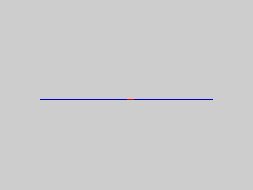
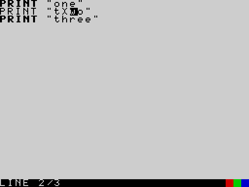
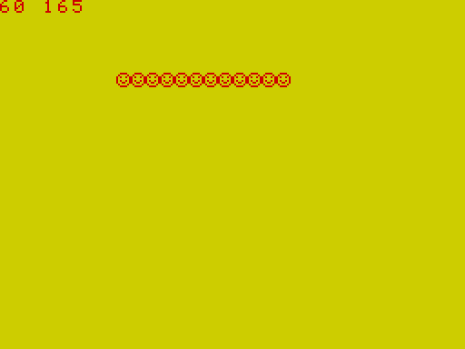
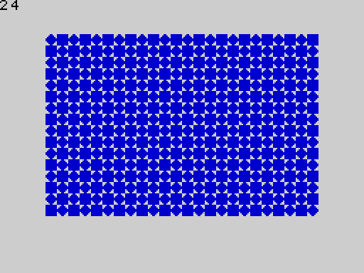
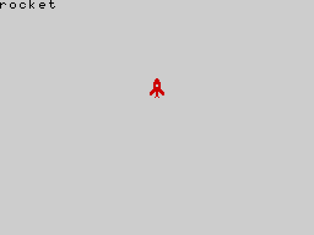
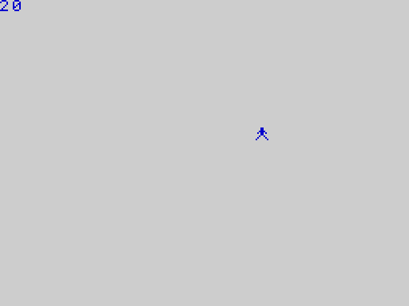
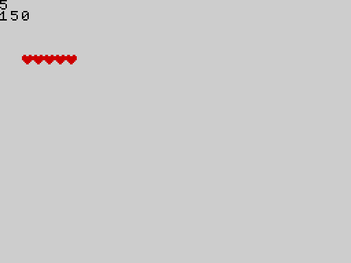

# Part 4 -- Concepts

The ideas behind the language, in alphabetical order. Where a keyword is the natural place to start, the entry points to it in [Part 3](03_keywords.md).

---

## Array Store

The **Array Store** is a 2 KB region of memory (the "overflow" segment, `$E000` to `$E7FF`) that holds arrays **outside the life of the program**. An array in the store survives `RUN`, `CLEAR`, and every edit of the program; only `NEW` (or switching off) empties it.

How an array gets there: `LOAD "name" ARRAY a` reads one array from tape into the store (and `SAVE "name" ARRAY a` writes one from the running program's session). The next time a program does `DIM a(n)` with the **same name and the same size**, that array is not created empty: it **adopts the stored one**, with its contents.

```basic ex=con.store.1
DIM a(4)
a(2) = 9
```
```tape ex=con.store.1
RUN
SAVE "arr" ARRAY a                     [SAVED]
power on
LOAD "arr" ARRAY a                     [LOADED]
store: DIM a(4) ;; PRINT a(2)
RUN
9
```

If the program's `DIM` has a different size or width than the stored array, the program stops with `ARRAY SIZE MISMATCH`:

```basic ex=con.store.2
DIM a(4)
a(2) = 9
```
```tape ex=con.store.2
RUN
SAVE "arr" ARRAY a                     [SAVED]
power on
LOAD "arr" ARRAY a                     [LOADED]
store: DIM a(5) ;; PRINT a(2)
RUN  [ve:65]
```

When the store is nearly full, another array cannot be loaded: here an array of 1018 numbers (2036 bytes) leaves no room for even a one-element array:

```basic ex=con.store.3
DIM big(1018)
DIM s(1)
```
```tape ex=con.store.3
RUN
SAVE "big" ARRAY big                   [SAVED]
SAVE "s" ARRAY s                       [SAVED]
power on
LOAD "big" ARRAY big                   [LOADED]
LOAD "s" ARRAY s                       [ARRAY STORE FULL]
```

Messages specific to arrays and tapes:

| Message | Meaning |
|---|---|
| `ARRAY NOT DIMD` | `SAVE ... ARRAY a` for an array the program has not declared |
| `BAD ARRAY TAPE` | the tape block is not a well-formed array (wrong shape, or damaged) |
| `ARRAY STORE FULL` | the store is full: no room is left for another entry |
| `LOAD FAILED` | the data does not fit in what is left of the store, or the tape is damaged |
| `ARRAY SIZE MISMATCH` | a `DIM` disagrees with the stored array of that name |

The store shares its 2 KB with ordinary arrays that did not fit in the main memory: `FREE(1)` reports what is left.

**See also** DIM, SAVE, LOAD, [Arrays](#arrays), [Memory](#memory).

---

## Arrays

An array is a numbered row of values of one kind, with one name: `a(0)`, `a(1)`, `a(2)`, ... The program declares it with `DIM` before using it.

* **Numeric arrays** (`DIM a(n)`) hold whole numbers from -32768 to 32767. Storing a fraction or a bigger number stops the program with a run-time error. This is a difference from ordinary variables, which accept any number.
* **String arrays** (`DIM a$(n)` or `DIM a$(n, width)`) hold strings of up to 15 characters, or `width - 1` characters if you give a width (up to 32, which allows the full 31).
* The first element is number **0**. `DIM a(5)` makes `a(0)` to `a(4)`.
* The size must be a plain number in the program. There is no `DIM a(n)` with a variable, and no array of two dimensions.
* The index may be any whole-number expression: `a(i + 1)`, `a(a(3) - 7)`. An index outside the array, or a fraction, stops the program with a run-time error.
* `DIMN(a)` gives the size of a numeric array.

```basic ex=con.arrays.1
DIM score(5)
DIM name$(5)
name$(0) = "ADA"
name$(1) = "ALAN"
name$(2) = "GRACE"
score(0) = 90
score(1) = 85
score(2) = 99
best = 0
FOR i = 1 TO 2
  IF score(i) > score(best) THEN
    best = i
  ENDIF
NEXT i
PRINT name$(best); " has the top score, "; score(best)
```
```output ex=con.arrays.1
GRACE has the top score, 99
```

Elements of a new array are 0 (or ""). A numeric array and an ordinary variable may share a name (`x` and `x(1)` are different things).

**Capacity.** Arrays are kept in the main memory, or, if that is too full, in the 2 KB overflow segment; one array has to fit in one or the other. On an empty program the largest numeric array has 4063 elements, the largest 15-character string array 508 elements, and the largest 31-character one 254. Each array also costs a little overhead. See [Limits](07_appendices.md#appendix-d-limits).

**See also** DIM, DIMN, [Array Store](#array-store).

---

## BREAK

BREAK is **CAPS SHIFT + SPACE**. Hold both keys while a program is running and it stops, the status line shows `BREAK`, and the program's variables are **kept** (see [Sessions](#sessions)), so you can look at them and carry on.

```basic ex=con.break.1 break=3000000 err=ve:66
PRINT "counting"
n = 0
top:
n = n + 1
GOTO top
```
```output ex=con.break.1
counting
```

```basic ex=con.break.2 break=3000000
n = 0
top:
n = n + 1
GOTO top
```
```session ex=con.break.2
RUN  [ve:66]
: PRINT n > 0
1
```

BREAK works in tight loops, in `PAUSE` and during a `BEEP`. It does **not** work during a `CBEEP` (the optional loudspeaker package), which switches interrupts off while it sounds, nor while the program waits for a tape signal (`SPACE` aborts a tape operation instead). In the editor, BREAK is ignored; in `LIST`, BREAK at a full page ends the listing.

**See also** STOP, END, [Sessions](#sessions).

---

## Differences from Sinclair BASIC

2068-Leap V2 is a new language that looks like Sinclair BASIC in places; it is not compatible with it.

| | Sinclair BASIC | 2068-Leap V2 |
|---|---|---|
| lines | numbered | **not** numbered; labels are the jump targets |
| `LET` | `LET x = 1` | `x = 1` (`LET` is an error) |
| subroutines | `GOSUB`/`RETURN` | `PROC`/`CALL`/`ENDP`, one parameter, recursive |
| one-line `IF` | `IF a THEN PRINT` | block `IF ... THEN` ... `ENDIF`; one line only for `THEN GOTO label` |
| `ELSEIF` | -- | none: `ELSE` and a nested `IF` |
| `FOR` | integer or float | same; also `EXIT FOR`; a bare `NEXT` |
| names | one letter for numbers | up to 31 letters and digits; no underscore |
| strings | `a$(2 TO 4)`, any length | `MID$`; at most 31 characters |
| arrays | many dimensions, any size by variable | one dimension; fixed size; whole numbers only (numeric) |
| `READ`/`DATA`/`RESTORE` | yes | none |
| `PRINT AT`, `PRINT INK` | items inside `PRINT` | separate statements `AT`, `TAB`, `INK`... |
| `INT` | rounds down (`INT -3.5` = -4) | truncates toward zero (`INT(-3.5)` = -3) |
| functions | `SIN x`, `LEN a$` | always with brackets: `SIN(x)`, `LEN(a$)`, `PI()`, `INKEY$()` |
| trigonometry | radians | **degrees** (`RAD`, `DEG` convert) |
| `DIV`, `MOD` | operators | functions: `MOD(a, b)` |
| powers | `^` | none |
| `AND`, `OR`, `NOT` | `AND`/`OR` on numbers give a value | logical only, 0 or 1; short-circuit |
| number display | up to 8 digits and exponent (`1E+10`) | whole numbers plain; others with 4 decimals; no exponent |
| coordinates | `PLOT 0,0` bottom left | `PLOT 0,0` **top** left |
| `BEEP` | seconds and semitones, on the loudspeaker | seconds and semitones, on the AY sound chip; fractional semitones cut off; the loudspeaker with the `CBEEP` package |
| `USR` | result in BC | result in HL |
| `CLEAR` | clears and sets RAMTOP | clears variables only |
| `CONTINUE` | yes | none: `: GOTO label` restarts at a label |
| `RUN` | line-by-line | whole program compiled first; mistakes reported before anything happens |
| tapes | Sinclair tapes | V2 tapes; Sinclair and V1 tapes are refused |
| characters | full set | nine characters have no glyph (see [Appendix C](07_appendices.md#appendix-c-the-character-set)); 21 [user-defined characters](#user-defined-characters), defined by `POKE` at 61824, printed with `CHR$(144)` to `CHR$(164)`; no `USR "a"` |

---

## Errors

There are two kinds.

**Compile errors** are found by `RUN` (or by an immediate statement) **before anything runs**. The status line shows the message, and when you press a key the cursor goes to the line where the mistake was found. Nothing has been executed, so there is nothing to undo.

```keys ex=con.err.1
PRINT "one"
PRINT 2 +
PRINT "three"
RUN
```
```screen ex=con.err.1
PRINT "one"
PRINT 2 +
PRINT "three"
RUN
...
SYNTAX ERROR 3
```

**Run-time errors** happen while the program is running: dividing by zero, an array index out of range, a number too big, a bad argument. The program stops, the screen shows the message on the status line, and the program's variables are kept.

```basic ex=con.err.2 err=ve:5
PRINT "before"
PRINT 1 / 0
PRINT "after"
```
```output ex=con.err.2
before
```

The screen shows only the **message** (`RUNTIME ERROR`), not a number; of the compile errors, only `SYNTAX ERROR` adds its number, because many different mistakes share that message. The numbers are listed in [Appendix B](07_appendices.md#appendix-b-error-codes) for the curious.

The messages you can meet are in [Appendix A](07_appendices.md#appendix-a-messages). The commonest:

| Message | Usual cause |
|---|---|
| `SYNTAX ERROR n` | a statement is not written correctly, or uses a name that does not exist (a package statement without its package); `n` is the error code |
| `UNEXPECTED TOKEN` | something that cannot go there: a stray `ENDIF`, a missing `:`, an unterminated string |
| `NAME TOO LONG` | a name of more than 31 characters |
| `NESTING TOO DEEP` | too many brackets, `IF`s or loops inside each other |
| `TOO MANY VARIABLES` | more than 251 numeric, 251 string or 255 array names |
| `OUT OF MEMORY` | the program, its variables and arrays do not fit |
| `RUNTIME ERROR` | division by zero, index out of range, bad argument, number too big ... |
| `STACK OVERFLOW` | expressions or procedure calls nested too deeply |
| `BREAK` | you pressed CAPS SHIFT + SPACE |

---

## Expressions

An expression is a calculation that gives a number or a string. In order of **precedence** -- what is worked out first -- an expression is made of:

1. brackets and function calls: `(a + b)`, `ABS(x)`, `FN f(x)`, `a(i)`
2. unary minus: `-x`
3. `*` and `/`
4. `+` and `-`
5. the comparisons `=` `<>` `<` `>` `<=` `>=`
6. `NOT`
7. `AND`
8. `OR`

Operators of the same rank are worked out left to right: `10 - 2 - 3` is 5 and `100 / 10 / 5` is 2.

```basic ex=con.expr.1
PRINT 1 + 2 * 3
PRINT (1 + 2) * 3
PRINT -2 * 3
PRINT 10 - 2 - 3
PRINT 2 + 3 > 4
PRINT NOT 1 = 2
PRINT 1 = 1 AND 2 = 2
```
```output ex=con.expr.1
7
9
-6
5
1
1
1
```

`+` also joins strings (see [Strings](#strings)). There is no operator for powers: multiply, or use a loop. There is no `MOD` or `DIV` operator: they are functions.

---

## Input

There are three ways for a program to read from the keyboard.

* `INPUT x` stops and waits for a whole line, shown as it is typed, ended with ENTER. A number variable reads a number (anything that does not start like one gives 0); a string variable reads up to 31 characters.
* `INKEY$()` looks at the keyboard *now* and returns the key being held or "". It never waits.
* `PAUSE 0` waits for any key and throws it away.

`INPUT` is for questions and forms; `INKEY$()` is for games and menus that must go on while no key is pressed. The joysticks are read with `STICK`.

```basic ex=con.input.1 keys="Ada\n7\n"
INPUT "Name? "; n$
INPUT "Age? "; age
PRINT n$; " will be "; age + 1; " next year"
```
```output ex=con.input.1
Name? Ada
Age? 7
Ada will be 8 next year
```

**See also** INPUT, INKEY$, STICK, VAL.

---

## Labels

A label is a line made of a name and a colon:

```
again:
```

It marks a place in the program that `GOTO` (and `IF ... THEN GOTO`) can go to. It must be on a line of its own. A label's name follows the rules for [Names](#names), cannot be a keyword, and cannot be used for two places in one program (a duplicate label is a compile error).

Procedures and functions have names too, and `CALL` and `FN` find them wherever they are in the program -- before or after the call.

**See also** GOTO, PROC, [Names](#names).

---

## Memory

This concept explains where your program and its data live, what `FREE()` tells you, and what things cost. Every figure was measured on the release.

### How a program is stored and compiled

Your program is kept as **plain text**: the lines exactly as you typed them. Each line costs its length in characters plus **3 bytes** (a 2-byte length in front and an end mark behind), and that includes any spaces you indented it with. That text is the program: `LIST` shows it, `SAVE` writes it to tape, `LLIST` prints it, and the editor works on it. It is never replaced by anything.

When you type `RUN` (or an immediate statement after a colon), V2 **compiles** the text. It reads the whole program, checks it, and writes a second, compact version made of **bytecode**: one-byte instruction codes with small operands (a variable is a one-byte number, a small whole number one byte, a jump two bytes, a fractional number five bytes, a string constant its characters). The bytecode is then run. It lives in a **separate area of its own** (4011 bytes, addresses 42581 to 46591), **not** in the main memory pool and **not** counted by `FREE()`. It is built again at every `RUN`, thrown away when you edit, and never saved: tapes hold only the text. Because the text is kept, `LIST` always shows your program as you wrote it; nothing is reconstructed from the bytecode, and there is no way to get the compiled form back out.

So a line's cost has two parts, which you must not confuse: **the text** (length + 3, in the pool, always) and **the code** (a few bytes in the code area, only while compiled). The code is usually *smaller* than the text. Here is a small program and what the compiler makes of it:

```basic ex=mem.compile.1 code=27 source=73
total = 0
FOR i = 1 TO 10
total = total + i
NEXT i
PRINT total
```
```output ex=mem.compile.1
55
```

| Line (text bytes: length + 3) | Compiled to | Code bytes |
|---|---|---|
| `total = 0` (12) | push 0, store in variable 0 | 4 |
| `FOR i = 1 TO 10` (18) | push 1 (start), push 10 (limit), push 1 (step), start the loop on variable 1 | 10 |
| `total = total + i` (20) | add variable 1 to variable 0 in place (one instruction) | 3 |
| `NEXT i` (9) | next of variable 1: add the step, go round again | 4 |
| (after the loop) | drop the loop's frame | 1 |
| `PRINT total` (14) | load `total`, print the number, new line | 4 |
| (end of program) | halt | 1 |
| **Total** | **73 bytes of text** | **27 bytes of code** |

Typical figures: a small assignment such as `x = 1` is 4 bytes of code; `x = x + 1`, `x = x - 1` and `x = x + y` are 3 (one instruction adds in place); `x = 1.5` is 7 (a fractional number takes five bytes); `x = 40000` is 8; `PRINT "hello"` is 9 (the five letters are in the code); a label or a `REM` takes none; `PROC` 8 and `DEF FN` 10. The code area holds 4011 bytes, which is about a thousand lines of `x = 1`: that is the **second limit** on program size (the program stops compiling with `OUT OF MEMORY` when the code does not fit). The first limit, usually reached sooner, is the pool.

### The main memory pool

The program text, the names, the variables and the arrays all share one **pool** of 9211 bytes (addresses 33370 to 42580). On an empty machine, with a one-line program that prints `FREE()`, it is divided like this:

| What | Bytes | Notes |
|---|---|---|
| program text | 15 | this one line: `PRINT FREE()` is 12 characters + 3 |
| table of names | 0 | one record for every name in the program (below); empty here |
| gap kept for typed statements | 81 | room for the new names an immediate statement may create (see [Sessions](#sessions)) |
| **free** | **8967** | what `FREE()` reports |
| run-time tables for the variables | 148 | slots for every variable, plus 4 spare number slots and 4 spare string slots that expressions use for their intermediate results |

From the bottom of the pool upward: the program text, then the table of names, then the 81-byte gap, then the **arrays** as they are created by `DIM`. From the top downward: the run-time tables (carved when the program starts, sized exactly for the variables the compiler found), and below them the **control stack**, which holds one frame for every active procedure call and every active `FOR` loop. The free space is the gap between the top of the arrays and the control stack: arrays grow into it from below and the stack grows into it from above.

### What `FREE()` measures

`FREE()` is the size of that free gap in bytes: the room left for **arrays** and for **procedure calls and loops** to come. It does not include the code area, the overflow segment (`FREE(1)`, 2048 bytes at its own address; see [Arrays](#arrays) and the [Array Store](#array-store)), or the variables' tables, which were already taken out when the program started. Because the tables are sized when the program starts, **a variable costs memory from the beginning of the run**, even if the program has not got to the line that uses it. What changes while the program runs is:

* `DIM` takes the space for the array, and `CLEAR` gives it back;
* every procedure call and every `FOR` loop that is still going takes **12 bytes** of the same space until it ends: a program that calls itself 600 times deep uses over 7000 bytes. This is why recursion has a limit.

```basic ex=mem.free.1
PRINT FREE()
DIM a(100)
PRINT FREE()
DIM n$(5)
PRINT FREE()
CLEAR
PRINT FREE()
```
```output ex=mem.free.1
8870
8667
8583
8870
```

(`DIM a(100)` took 203 bytes: 200 for the hundred two-byte elements and 3 for its description. `DIM n$(5)` took 84: five 16-byte elements and 4. `CLEAR` gave both back. The first figure is 8870 rather than 8967 because this program's own text and names are in the pool too.)

```basic ex=mem.free.2
CALL deeper(3)
END
PROC deeper(n):
PRINT FREE()
IF n > 0 THEN
CALL deeper(n - 1)
ENDIF
ENDP
```
```output ex=mem.free.2
8836
8824
8812
8800
```

(Each level of the procedure costs 12 bytes while it is active.)

### What things cost

| Item | Cost, in bytes of pool |
|---|---|
| a line of program text | its length + 3 (a `REM` and the spaces you indent with cost exactly as much as code) |
| the program's **first** use of a number name (whole or fractional) | **12 + the length of the name**: 4 + the name in the table of names, 3 + 5 in the run-time tables |
| each further use of the same name | nothing (the code area takes a byte or two) |
| a string name | **36 + the length of the name**: the name, and a 32-byte slot (31 characters and a length) |
| a label, or a `PROC` or `DEF FN` name | **7 + the length of the name** (a `PROC` or `DEF FN` also has its parameter, which is a number name) |
| a numeric array `DIM a(n)` | **2 per element**, plus about 11 + the length of the name |
| a string array `DIM a$(n)` | **16 per element** (the width, with a width), plus about 13 + the length of the name |
| a procedure call, or a `FOR` loop, while active | 12 (taken from the free gap, returned at the end) |
| numbers and string constants in the program | nothing in the pool (they are in the code area) |
| the 4 + 4 spare slots, and the 81-byte gap | 148 + 81, always |
| a package | nothing (below) |

A name's cost is paid **once per name**, not once per use, and a longer name costs one byte more per character: a 31-character name is 31 bytes dearer than a one-character one. Whole numbers and fractional numbers cost the same (every number name has both kinds of slot).

### Packages and memory

A package is loaded into a 1 KB window of its own (addresses 62464 to 63487) which is not part of the pool: **loading a package does not reduce `FREE()`**. The same program prints the same figure with and without a package loaded:

*With the shapes package loaded (`LOAD "SHAPES" EXT`):*

```basic ex=mem.pkg.1 pkg=shapes
PRINT FREE()
```
```output ex=mem.pkg.1
8967
```

### Making the best use of memory

* **Arrays are cheaper than variables.** A number variable costs at least 13 bytes; an array element costs 2. If you have many similar values, put them in an array and use a loop. A string variable costs at least 37 bytes, a string array element 16.
* **Use fewer, shorter names** where memory is tight; reuse a variable instead of a new name for something you have finished with. (Reuse costs nothing; a new name costs 12 or more.)
* **Text costs memory.** A remark line is 3 + its length, and so are blank-looking lines and indentation: a long program that is nearly out of memory is helped by removing comments and indentation, or by shortening them.
* **Put repeated code in a procedure**: it is text once and a few bytes of code at each `CALL`.
* **Give back arrays you have finished with** with `CLEAR` (it also clears the variables, so keep what you need elsewhere first), and keep arrays as small as they need to be: string arrays are 16 bytes an element even when the strings are short; a width of 8 (`DIM a$(n, 8)`) makes them half the size.
* **Remember what runs out first.** The pool (about 9 KB of text, names and data) normally runs out before the 4 KB code area; a program of about 900 short `PRINT` lines does not run, because its text fills the pool. If the pool is the problem the message is `OUT OF MEMORY` when you `RUN`; if the code area is, it is `OUT OF MEMORY` when the compiler runs out of room.
* **Recursion is limited by the 12 bytes a level**: a procedure that calls itself needs 12 bytes of free space for every level.
* If a program needs more space for **arrays**, remember the 2 KB overflow segment: a numeric array that does not fit in the pool is placed there if it fits there (see [Arrays](#arrays)).

For the figures of every limit see [Appendix D](07_appendices.md#appendix-d-limits), and for the address map of the whole machine [Appendix E](07_appendices.md#appendix-e-memory-map). `FREE()` and `FREE(1)` are described under [FREE](03_keywords.md#free).

---

## Names

Variables, arrays, labels, procedures and functions all have names, which follow the same rules:

* letters and digits only, starting with a letter. **No underscore** and no other symbol: `my_var` is an error, `myvar` and `my2` are fine;
* up to **31** characters (a longer name is `NAME TOO LONG`);
* capitals and small letters are the same: `Score`, `SCORE` and `score` are one name;
* a name ending in `$` is a string: `name$` is not the same variable as `name`;
* a name must not be a keyword (`print = 3`, `abs = 3` and `out:` are errors). Names that only *begin* with a keyword are fine: `tomato`, `format`, `to1`.

A number variable, a string variable and an array can have the same letters: `x`, `x$` and `x(1)` are three different things. A variable needs no declaration and starts as 0 or "".

```basic ex=con.names.1
tomato = 2
to1 = 3
longername = 4
Score = 5
PRINT tomato + to1 + longername + score
```
```output ex=con.names.1
14
```

---

## Numbers

V2 has two kinds of number.

* **Whole numbers** from -32768 to 32767 are exact.
* **Floating-point numbers** hold everything else -- fractions, larger numbers, the results that overflow the whole numbers -- with about **9 significant digits**, up to about 1.7 x 10^38.

You rarely need to care which is which: arithmetic promotes automatically. A whole-number result that would overflow becomes floating-point, and any calculation involving a fraction is floating-point.

```basic ex=con.num.1
x = 32767
PRINT x + 1
PRINT x * 2
y = -32768
PRINT y - 1
PRINT 200 * 200
```
```output ex=con.num.1
32768.0000
65534.0000
-32769.0000
40000.0000
```

How they are **shown**: a whole number is shown plainly; every other number is shown with four decimal places, rounded (so a number in the whole-number range that has a fractional part, and any number outside it, show `.0000` or a fraction). There is no exponent notation: the biggest number shows as a 39-digit string, the smallest nonzero shows as 0.0000.

```basic ex=con.num.2
PRINT 6 / 2
PRINT 7 / 2
PRINT 1 / 3
PRINT 100000 / 3
PRINT 65535
PRINT 3000000000000
PRINT 0.00004
```
```output ex=con.num.2
3
3.5000
0.3333
33333.3333
65535.0000
3000000000000.0000
0.0000
```

Notes on floating point:

* Decimal fractions are held in binary, so a value is the *nearest* binary number: `2.99995` shows as `2.9999` and `0.00005` as `0.0000`.
* A result larger than about 1.7 x 10^38 stops the program with a run-time error; a **literal** that big is a compile error. A result smaller than the smallest number becomes 0.
* Numbers from 32768 to 65535 written in a program are floating-point numbers, but can still be used as addresses (`POKE 65000, 1`).
* There are no hexadecimal numbers and no `1E3` notation: write the digits.
* `INT` truncates toward zero; `DIV` and `MOD` truncate too.
* Two numbers of different kinds compare by value: `5 = 5.0` is true.

```basic ex=con.num.3 err=ve:67
x = 100000
FOR i = 1 TO 10
  x = x * x
  PRINT "x has grown"
NEXT i
```
```output ex=con.num.3
x has grown
x has grown
```

(`x` is 10^5, then 10^10, then 10^20; the third squaring would give 10^40, which is beyond about 1.7 x 10^38, so the program stops there with a run-time error.)

**See also** PRINT, INT, DIV, MOD, STR$, VAL.

---

## Procedures

A procedure is a named piece of program, defined once with `PROC` ... `ENDP` and run from anywhere with `CALL`. It takes one value (its **parameter**), which is a copy: changing it inside does not change anything outside. Everything else in the program -- variables, arrays -- is shared.

Procedures can call other procedures and themselves. The rule of thumb for writing a recursive procedure: first ask whether the answer is simple (`IF n > 1`); if not, call yourself with a smaller problem.

```basic ex=con.proc.1
CALL hanoi(3)
END
PROC hanoi(n):
  IF n > 0 THEN
    CALL hanoi(n - 1)
    PRINT "move disc "; n
    CALL hanoi(n - 1)
  ENDIF
ENDP
```
```output ex=con.proc.1
move disc 1
move disc 2
move disc 1
move disc 3
move disc 1
move disc 2
move disc 1
```

For one-line calculations that give a value, use `DEF FN`. A procedure does not give a value back; use a variable.

**Limits.** A recursion can go about 670 calls deep before the program stops with `STACK OVERFLOW`. A procedure always takes exactly one parameter.

**Known limitation.** `CALL` of an ordinary label (not a `PROC`) is not rejected: it jumps there and runs on without returning (accepted defect Q-24). Always `CALL` real procedures.

**See also** PROC, CALL, ENDP, DEF FN.

---

## Programs

A V2 program is a list of **lines**, written in the full-screen editor. A line holds one or more **statements**, separated by `:`, and is at most 127 characters; long lines wrap on the screen. There are no line numbers: the order of the lines is the order of the program.

* A line that consists of a name and a colon is a **label**.
* `REM` starts a comment.
* The program runs from its first line and stops at `END`, at `STOP`, at its last line, on an error or on BREAK. `PROC` ... `ENDP` blocks and `DEF FN` lines in its path are skipped, so put them at the end, after an `END`.
* `RUN` **compiles** the whole program to a compact code first and then runs the code. A mistake anywhere is reported before anything happens.

```basic ex=con.prog.1
REM a tiny program
total = 0
FOR i = 1 TO 5 : total = total + i : NEXT i
PRINT "sum 1 to 5 is "; total
```
```output ex=con.prog.1
sum 1 to 5 is 15
```

**See also** [The editor](#the-editor), RUN, LIST, [Labels](#labels).

---

## Screen

The text screen is 32 columns by 23 rows, with the 24th row (row 23) reserved for the editor's status line and messages. Text starts at the top left, wraps at column 31 and **scrolls up** when it passes the last row.

**Colours.** The screen is divided into 768 cells of 8 x 8 pixels (32 x 24). Each cell has *one* ink colour and *one* paper colour, with optional bright and flash, taken together as its **attribute** (`ATTR`). Printing a character or setting a pixel with `PLOT` or `LINE` gives its cell the colours that are current (`INK`, `PAPER`, `BRIGHT`, `FLASH`, `INVERSE`, `OVER`), so a cell can only show the last colours drawn in it: this is "colour clash". Here a long blue line is crossed by a short red one. The red line colours the cell where they cross, so the blue line **turns red for the width of that cell** (eight pixels), although only the red line was drawn there:

```basic ex=con.screen.1 shot=colour_clash
INK 1
LINE 40, 100 TO 215, 100
INK 2
LINE 128, 60 TO 128, 140
```



`CLS` clears the screen to the current colours and puts the printing position at the top left; `BORDER` sets the border.

**Graphics coordinates.** The pixel screen is 256 across (0 to 255, from the left) by 192 down (0 to 191, **from the top**). Off-screen coordinates are moved to the edge.

**Character cells and sprites.** `AT row, col` addresses cells (row 0 to 22 for text); the sprite package uses cells too.

**Other modes.** The TS2068 has an extended-colour video mode (the mode package's `MODE 1`), in which each row of eight pixels has its own colours and the colour clash above disappears vertically, and the ULAplus palette; see [Part 5](05_packages.md#the-mode-package).

**See also** PRINT, AT, TAB, CLS, INK, PAPER, PLOT, LINE, POINT, ATTR, BORDER.

---

## Sessions

When a program stops -- at its end, at `END` or `STOP`, on BREAK or on an error -- its **variables are kept**. That kept set is the **session**. It lets you ask the program questions and change things, using **immediate statements**: statements typed on the editor's empty last line after a colon.

```basic ex=con.sess.1
x = 5
y$ = "hi"
```
```session ex=con.sess.1
RUN
: PRINT x
5
: PRINT y$ + "!"
hi!
: x = x + 2
: PRINT x
7
```

An immediate statement may use every variable, array, procedure and function of the program. It may create new variables (they start at 0 or ""), `DIM` new arrays and call the program's procedures:

```basic ex=con.sess.2
g = 1
END
PROC add(n):
  g = g + n
ENDP
```
```session ex=con.sess.2
RUN
: CALL add(4)
: PRINT g
5
: z = 40
: PRINT z + g
45
```

`: GOTO label` starts the program at that label **with the variables as they are** (it does not continue where the program stopped: loops and procedure calls that were in progress are gone).

```basic ex=con.sess.3
n = 0
top:
n = n + 1
PRINT n
IF n < 3 THEN GOTO top
END
more:
PRINT n * 10
```
```session ex=con.sess.3
RUN
1
2
3
: GOTO more
30
: GOTO top
4
: PRINT n
4
```

What starts and ends a session:

| Event | Ordinary variables | Array Store |
|---|---|---|
| `RUN` | start **fresh** (0 and "") | kept |
| the program ends, `STOP`, BREAK, an error | **kept**: they are the session | kept |
| an immediate statement | runs in the session | kept |
| `CLEAR` (or `: CLEAR`) | set to 0 and "" | kept |
| **any edit** of the program | the session **ends** | kept |
| `NEW` | session ends, program cleared | emptied |
| `LOAD "name"` of a program | session ends | kept |
| `LOAD ... ARRAY` | session ends | changed |
| `LOAD ... EXT` (a package) | session ends | kept |
| `LOAD` of a `SAVE ... ALL` tape | the saved session becomes the current one | replaced by the saved one |

```basic ex=con.sess.4
x = 5
```
```session ex=con.sess.4
RUN
: PRINT x
5
EDIT
: PRINT x
0
```

(`EDIT` stands for "change the program in any way": the variables are gone.)

Things an immediate statement cannot do: define a label, a procedure or a function (a compile error -- they would vanish with the statement). A compile error in an immediate statement leaves the session unchanged. About ten short new names fit in a session; beyond that the statement is refused with `OUT OF MEMORY`.

If there has been no `RUN` since the last edit, the first immediate statement compiles the stored program and starts a fresh session for it: `: x = 3` and then `: PRINT x` shows 3 even before any `RUN`.

```basic ex=con.sess.5
PRINT "hello"
```
```session ex=con.sess.5
: x = 3
: PRINT x
3
NEW
: PRINT x
0
```

**See also** RUN, CLEAR, GOTO, SAVE (`ALL`), [Tapes](#tapes).

---

## Sound

There are two ways to make sound.

**`BEEP`** plays one note on the AY-3-8912 sound chip's channel A and waits until it ends: `BEEP seconds, semitones`, with the pitch counted from middle C as on the Spectrum. A short tune -- the start of a C major scale, a quarter of a second a note, then the top note held:

```basic ex=con.sound.1
DIM s(5)
s(0) = 0
s(1) = 2
s(2) = 4
s(3) = 5
s(4) = 7
FOR i = 0 TO 4
  BEEP 0.25, s(i)
NEXT i
BEEP 1, s(4)
PRINT s(4)
```
```output ex=con.sound.1
7
```

BREAK stops a long `BEEP`. Afterwards channel A is silent; channels B and C are not touched, so they can play their own notes, set with `SOUND`, while `BEEP` plays a tune on A.

**`SOUND`** writes to the AY-3-8912 sound chip, which has three tone channels and a noise generator that keep playing on their own:

```basic ex=con.sound.2
SOUND 7, 62
SOUND 1, 1
SOUND 8, 10
PAUSE 50
SOUND 8, 0
PRINT "done"
```
```output ex=con.sound.2
done
```

The TS2068's **loudspeaker** -- the beeper of the Spectrum -- is not used by the ROM's `BEEP`. The optional **cbeep** package (see [Part 5](05_packages.md#the-cbeep-package)) adds `CBEEP milliseconds, semitones, border` for it; it switches interrupts off while it sounds.

**See also** BEEP, SOUND, PAUSE, CBEEP.

---

## Speed

V2 compiles the program before it runs it, so it is much faster than an interpreter that reads the text again every time. Here is what things cost on the release, measured in the emulator by `tools/qual/manual_measure.py` (T-states of the Z80, which runs at about 3.5 MHz, so a million T-states is about 0.29 seconds). Each figure is what one extra statement adds to a loop; the loop's own `FOR`/`NEXT` pass costs 827 T-states, about 4200 passes a second.

| Statement in the loop | Adds (T-states) | About, per second |
|---|---|---|
| `a = i` | 1 040 | 3 400 |
| `a = i * 2 + 1` (whole numbers) | 3 700 | 950 |
| `a = a * 1.0001` (floating point) | 11 500 | 300 |
| `t(3) = i : x = t(3)` (array store and load) | 3 700 | 930 |
| `a$ = LEFT$(a$ + "x", 20)` | 8 400 | 420 |
| `PLOT 100, 100` | 2 500 | 1 400 |
| `CALL p(1)` (an empty procedure) | 3 500 | 990 |
| `AT 5, 0 : PRINT 7;` | 5 200 | 670 |
| `PRINT 7` when the screen **scrolls** | 224 000 | 16 |

Things to take from the table:

* **Whole-number arithmetic is much faster than floating point** -- about three times here. Use whole numbers for counters, indices and scaled values (work in hundredths instead of fractions of a unit).
* **Scrolling is expensive**: moving the whole screen up one line costs about 218 000 T-states, 62 milliseconds. A program that prints line after line to a full screen is limited to about 16 lines a second; one that prints at fixed positions with `AT` is not.
* `PAUSE n` and `BEEP` count display frames (69 888 T-states each in the emulator, 1/60 second on a TS2068): `PAUSE 100` took 6 985 733 T-states, `BEEP 1, 0` 60 frames.
* Compilation itself takes a moment for a long program; `RUN` then starts.

---

## Strings

A string is a piece of text of **0 to 31 characters**. String variables end in `$`. String constants are written in double quotes and may not themselves contain a double quote.

* `+` joins strings. A result longer than 31 characters is **cut to 31**: no error.
* All six comparisons work on strings (`=` `<>` `<` `>` `<=` `>=`), character by character, using the character codes; capital letters come before small ones (`"B" < "a"`), and a string that is the start of another comes first (`"ab" < "abc"`).
* The functions: `LEN`, `CODE`, `VAL`, `CHR$`, `STR$`, `UPPER$`, `LOWER$`, `LEFT$`, `RIGHT$`, `MID$`. A string constant longer than 31 characters is a compile error.
* A string and a number cannot be mixed in an expression: `"a" + 1` is a compile error; use `STR$`.
* There is no `a$(2 TO 4)` slicing: use `MID$`.

```basic ex=con.str.1
a$ = "HELLO WORLD"
PRINT LEFT$(a$, 5)
PRINT RIGHT$(a$, 5)
PRINT MID$(a$, 7, 3)
PRINT LOWER$(a$)
PRINT "abc" < "abd"
PRINT "B" < "a"
PRINT "ab" < "abc"
b$ = a$ + " AND " + a$ + " AND " + a$
PRINT LEN(b$)
PRINT b$
```
```output ex=con.str.1
HELLO
WORLD
WOR
hello world
1
1
1
31
HELLO WORLD AND HELLO WORLD AND
```

**See also** the string functions in [Part 3](03_keywords.md), [Arrays](#arrays) for string arrays.

---

## Tapes

`SAVE`, `LOAD` and `VERIFY` are commands, typed on the editor's empty last line. The name is up to 10 characters.

| Command | Does |
|---|---|
| `SAVE "name"` | writes the program |
| `SAVE "name" ALL` | writes the program **and** its session (variables, arrays) **and** the Array Store |
| `SAVE "name" ARRAY a` | writes one array |
| `SAVE "name" EXT` | writes the loaded package |
| `LOAD "name"` | reads a program (and the session, if it was saved with `ALL`) |
| `LOAD ""` | reads the next program on the tape, whatever its name |
| `LOAD "name" ARRAY a` | reads an array into the Array Store |
| `LOAD "name" EXT` | reads a package |
| `VERIFY "name"` | compares the tape with memory |

A program saved with `SAVE "name"` comes back **without** variables; one saved with `ALL` comes back with them, so you can stop work and carry on:

```basic ex=con.tape.1
x = 5
y$ = "hello"
z = 2.5
```
```tape ex=con.tape.1
RUN
: x = x + 1
SAVE "demo" ALL                        [SAVED]
power on
LOAD "demo"                            [LOADED]
: PRINT x
6
: PRINT y$
hello
: PRINT z
2.5000
```

```basic ex=con.tape.2
PRINT "hello"
x = 7
```
```tape ex=con.tape.2
RUN
hello
SAVE "prog"                            [SAVED]
power on
LOAD "prog"                            [LOADED]
: PRINT x
0
```

`VERIFY` checks that what is on tape matches what is in memory:

```basic ex=con.tape.3
PRINT "hello"
x = 7
```
```tape ex=con.tape.3
SAVE "prog"                            [SAVED]
power on
store: PRINT "hello" ;; x = 7
VERIFY "prog"                          [VERIFIED]
```

```basic ex=con.tape.4
PRINT "hello"
x = 7
```
```tape ex=con.tape.4
SAVE "prog"                            [SAVED]
power on
store: PRINT "hello" ;; x = 8
VERIFY "prog"                          [VERIFY FAILED]
```

**The `ALL` tape.** `SAVE ... ALL`, `LOAD` and `VERIFY` of an ALL tape take **about 2.4 seconds** to start (the machine first works out a check number that identifies this ROM and the loaded package). The variables of an ALL tape come back only

* on the **same ROM version** that wrote it, and
* with the **same package** loaded (or none), loaded **before** the ALL tape.

Otherwise the program loads but the variables do not, and the message is `NO VARIABLES`. A damaged tape gives `LOAD FAILED`. If a very large program plus its overflow arrays cannot be laid out for saving, `SAVE ... ALL` says `OUT OF MEMORY` -- `SAVE "name"` still works.

**Tape compatibility.** A tape written by this version cannot be loaded by earlier V2 ROMs, and V1 and stock Spectrum tapes are refused with `BAD TAPE VERSION`.

**Messages:** `SAVED`, `LOADED`, `VERIFIED`, `VERIFY FAILED`, `LOAD FAILED`, `NO VARIABLES`, `BAD TAPE VERSION`, `ABORTED` (SPACE pressed during a tape operation), `NO PACKAGE` (`SAVE ... EXT` with no package loaded), `OUT OF MEMORY`, and the array messages under [Array Store](#array-store).

Tapes are read and written through the ordinary tape port. All tape tests were run on the emulator, through its real tape input; nothing was tried on a real cassette recorder.

---

## The editor

When the machine is switched on you are in the editor: an empty program, with a status line at the bottom (row 23) that says `LINE n/m` -- the cursor is on line *n*, and the program has *m* lines -- and three small coloured squares at its right end.

The program is a list of lines. You type a line and press ENTER to store it. Keywords such as `PRINT` and `FOR` are shown in **bold** as soon as they are recognised.

| Key | What it does |
|---|---|
| letters, digits, symbols | insert at the cursor |
| ENTER | store the line (as it now reads) and go to the next one |
| CAPS SHIFT + 5 (left arrow) | cursor left |
| CAPS SHIFT + 8 (right arrow) | cursor right |
| CAPS SHIFT + 6 (down) | the next line |
| CAPS SHIFT + 7 (up) | the previous line |
| CAPS SHIFT + 0 (DELETE) | delete the character before the cursor |
| CAPS SHIFT + 1 | delete the whole line |
| CAPS SHIFT + ENTER | insert a blank line |
| CAPS SHIFT + SPACE (BREAK) | stops a running program (ignored in the editor) |

Moving up or down puts the cursor at the **start** of the line it arrives on. You cannot move below the empty line after the last program line -- the **last line** -- and you cannot go above line 1.

A long line wraps onto the next screen rows, at a space where it can. The line the cursor is on is always shown whole, so when it would run into the status line, the lines above it move up. When its last row is full -- 32 characters -- the line gets one more, empty, row while you edit it: the cursor after its last character is shown there.

The commands `RUN`, `LIST`, `NEW`, `SAVE`, `LOAD`, `VERIFY`, and the immediate statements (`: statement`) are usually typed on that empty last line, but ENTER carries out a command on any line: typed over a program line, the command runs and the line keeps its text. Here the text of line 1 is deleted and `RUN` typed in its place; after the run (a key returns to the editor) line 1 still reads `x = 5`:

```keys ex=con.edit.5
x = 5
PRINT x * 2
{UP}{UP}{RIGHT}{RIGHT}{RIGHT}{RIGHT}{RIGHT}{DEL}{DEL}{DEL}{DEL}{DEL}RUN
{ANY}\
```
```screen ex=con.edit.5
x = 5
PRINT x * 2
...
LINE 1/2
```

Here three lines are typed. Pressing up moves to the previous line, and a letter is inserted there; the status line shows where the cursor is:

```keys ex=con.edit.1 shot=editor_lines
PRINT "one"
PRINT "two"
PRINT "three"
{UP}{UP}{RIGHT}{RIGHT}{RIGHT}{RIGHT}{RIGHT}{RIGHT}{RIGHT}{RIGHT}X\
```
```screen ex=con.edit.1
PRINT "one"
PRINT "tXwo"
PRINT "three"
...
LINE 2/3
```



Deleting characters and lines, and inserting a blank line:

```keys ex=con.edit.2
PRINT "one"
PRINT "two"
PRINT "three"
{UP}{DELLINE}
```
```screen ex=con.edit.2
PRINT "one"
PRINT "two"
...
LINE 3/2
```

(Deleting the line the cursor was on leaves the cursor on the empty last line.)

```keys ex=con.edit.3
ABC{LEFT}{LEFT}{DEL}\
```
```screen ex=con.edit.3
BC
...
LINE 1/0
```

When `RUN` finds a compile error, the message appears on the status line. Press a key, and the cursor is on the line with the mistake:

```keys ex=con.edit.4
PRINT 1
PRINT 2 +
PRINT 3
RUN
```
```screen ex=con.edit.4
PRINT 1
PRINT 2 +
PRINT 3
RUN
...
SYNTAX ERROR 3
```

Any change to the program -- storing a line, deleting a line, `LOAD`, `NEW` -- **ends the variable session** (see [Sessions](#sessions)).

`LIST` shows the program from its first line, 23 lines at a time: when the screen fills, it waits for a key before showing the next page; BREAK at a full page stops the listing. At the end it waits for a key and returns to the editor.

---

## Truth and comparisons

The comparisons `=`, `<>`, `<`, `>`, `<=`, `>=` give **1** when they are true and **0** when they are false, for numbers and for strings. Wherever a condition is needed (`IF`, `AND`, `OR`, `NOT`), any number other than 0 counts as true -- including fractions and negative numbers -- and 0 as false. `AND`, `OR` and `NOT` give 1 or 0.

```basic ex=con.truth.1
PRINT 5 > 3
PRINT 5 < 3
PRINT 3 <= 3
PRINT 3 <> 3
IF 2.5 THEN
  PRINT "2.5 is true"
ENDIF
IF 0 THEN
  PRINT "never"
ELSE
  PRINT "0 is false"
ENDIF
```
```output ex=con.truth.1
1
0
1
0
2.5 is true
0 is false
```

`AND` and `OR` **short-circuit**: the right-hand side is not worked out if the left-hand side has already decided the answer. That makes a guard like `y <> 0 AND 10 / y > 1` safe. See AND and OR.

---

## User-defined characters

V2 has **21 user-defined characters** (UDGs), as the Spectrum does: character codes **144 to 164**. Each is an 8 x 8 picture that you design yourself and then print like any letter with `PRINT CHR$(144)`. The pictures live in a table of 168 bytes (8 bytes for each of the 21 characters) at **address 61824** (`$F180`); there is no statement to define one: you **`POKE`** the eight bytes.

* **The picture.** Each of the eight bytes is one row of the character, from the top row down. A byte is eight pixels: the bit values 128, 64, 32, 16, 8, 4, 2, 1 are the pixels from left to right, so a row `..####..` is 16 + 8 + 4 + 2 = 60. (The `#` pixels are ink, the `.` pixels paper.)
* **The address.** Character code *c* (144 to 164) has its eight bytes at `61824 + (c - 144) * 8`. Character 144 is at 61824 to 61831, 145 at 61832 to 61839, and so on up to 164 at 61992 to 61999. (On the Spectrum the letters A to U name the same 21 characters; here you use their codes, and `USR "a"` does not exist.)
* **Printing.** `PRINT CHR$(144)` prints character 144 in the current colours at the printing position, exactly like a letter: it follows `INK`, `PAPER`, `BRIGHT`, `FLASH`, `OVER` and `INVERSE`. It may be put in a string (`a$ = CHR$(144) + CHR$(145)`), and strings of it can be joined, measured and compared like any other. There is no way to *type* a user-defined character on the keyboard into a program, so always write it as `CHR$(code)`.

The easiest way to design a character is to draw it with `#` and `.`, and let the program work out the bytes. Here a smiling face is drawn as eight strings, and a loop turns each one into a number and pokes it:

```basic ex=udg.face.1 shot=udg_face rows=2
DIM g$(8, 9)
g$(0) = "..####.."
g$(1) = ".#....#."
g$(2) = "#.#..#.#"
g$(3) = "#......#"
g$(4) = "#.#..#.#"
g$(5) = "#..##..#"
g$(6) = ".#....#."
g$(7) = "..####.."
FOR r = 0 TO 7
  v = 0
  FOR c = 1 TO 8
    v = v * 2
    IF MID$(g$(r), c, 1) = "#" THEN
      v = v + 1
    ENDIF
  NEXT c
  POKE 61824 + r, v
NEXT r
INK 2
PAPER 6
CLS
AT 0, 0
PRINT PEEK(61824); " "; PEEK(61826)
AT 5, 8
FOR i = 1 TO 12
  PRINT CHR$(144);
NEXT i
```
```output ex=udg.face.1
60 165
```



(Row 0, `..####..`, is 60; row 2, `#.#..#.#`, is 165. The face is character 144, printed twelve times in red on yellow.)

A character can be redefined at any time, and each of the 21 can be different. This program makes two characters, a solid square (144) and a diamond (145), by poking the byte values directly, and prints a pattern with them:

```basic ex=udg.two.1 shot=udg_pattern rows=1
FOR r = 0 TO 7
  POKE 61824 + r, 255
NEXT r
POKE 61832, 24
POKE 61833, 60
POKE 61834, 126
POKE 61835, 255
POKE 61836, 255
POKE 61837, 126
POKE 61838, 60
POKE 61839, 24
INK 1
CLS
FOR row = 3 TO 18
  FOR col = 4 TO 27
    AT row, col
    IF MOD(row + col, 2) = 0 THEN
      PRINT CHR$(144);
    ELSE
      PRINT CHR$(145);
    ENDIF
  NEXT col
NEXT row
AT 0, 0
INK 0
PRINT PEEK(61832)
```
```output ex=udg.two.1
24
```



### Using them

Defining a character is only half of the job; here is what they are good for, with a program for each.

**1. A reusable way to define them.** Designing in `#` and `.` is so much easier than working out numbers that it is worth turning into a procedure once. This `PROC` defines character *c* from eight strings kept in the array `g$` (rows 0 to 7). Put it at the end of any program that uses UDGs:

```
PROC defchar(c):
  FOR r = 0 TO 7
    v = 0
    FOR k = 1 TO 8
      v = v * 2
      IF MID$(g$(r), k, 1) = "#" THEN
        v = v + 1
      ENDIF
    NEXT k
    POKE 61824 + (c - 144) * 8 + r, v
  NEXT r
ENDP
```

**2. Pictures bigger than one character.** One character is only 8 x 8 dots. A bigger picture is several characters side by side, printed in the right places. This program draws a 16 x 16 rocket from four characters (144 and 145 on the top row, 146 and 147 below), cutting the picture into four quarters:

```basic ex=udg.rocket.1 shot=udg_rocket rows=1
DIM p$(16, 17)
DIM g$(8, 9)
p$(0) = ".......##......."
p$(1) = "......####......"
p$(2) = "......####......"
p$(3) = ".....######....."
p$(4) = ".....######....."
p$(5) = ".....##..##....."
p$(6) = ".....##..##....."
p$(7) = ".....######....."
p$(8) = ".....######....."
p$(9) = "....########...."
p$(10) = "...##########..."
p$(11) = "..####.##.####.."
p$(12) = "..###..##..###.."
p$(13) = "..##...##...##.."
p$(14) = ".......##......."
p$(15) = "......#..#......"
FOR q = 0 TO 3
  FOR r = 0 TO 7
    g$(r) = MID$(p$(DIV(q, 2) * 8 + r), MOD(q, 2) * 8 + 1, 8)
  NEXT r
  CALL defchar(144 + q)
NEXT q
INK 2
CLS
AT 8, 15
PRINT CHR$(144); CHR$(145)
AT 9, 15
PRINT CHR$(146); CHR$(147)
AT 0, 0
INK 0
PRINT "rocket"
END
PROC defchar(c):
  FOR r = 0 TO 7
    v = 0
    FOR k = 1 TO 8
      v = v * 2
      IF MID$(g$(r), k, 1) = "#" THEN
        v = v + 1
      ENDIF
    NEXT k
    POKE 61824 + (c - 144) * 8 + r, v
  NEXT r
ENDP
```
```output ex=udg.rocket.1
rocket
```



(The four characters must touch, so they are printed with `AT` on two neighbouring rows, with a semicolon at the end of the first so the cursor does not move to the next line before the second `AT`.)

**3. Moving pictures.** Redefine a character, or switch between two, and the picture on the screen changes. Here two characters are two poses of a figure (148 and 149), and the program shows one pose after the other while it moves the figure across the screen. With `OVER 1` in force, printing a character draws it, and printing the same character again in the same place erases it, so each pose is drawn, held for a moment with `PAUSE`, and erased before the next one appears a column further on:

```basic ex=udg.walk.1 shot=udg_walk rows=1
DIM g$(8, 9)
g$(0) = "...##..."
g$(1) = "...##..."
g$(2) = "..####.."
g$(3) = ".#.##.#."
g$(4) = "...##..."
g$(5) = "..#..#.."
g$(6) = ".#....#."
g$(7) = "#......#"
CALL defchar(148)
g$(0) = "...##..."
g$(1) = "...##..."
g$(2) = "..####.."
g$(3) = "..#.##.."
g$(4) = "...##..."
g$(5) = "...##..."
g$(6) = "...##..."
g$(7) = "..#..#.."
CALL defchar(149)
INK 1
CLS
x = 0
FOR n = 1 TO 20
  pose = 148 + MOD(n, 2)
  AT 10, x
  OVER 1
  PRINT CHR$(pose);
  PAUSE 3
  AT 10, x
  PRINT CHR$(pose);
  OVER 0
  x = x + 1
NEXT n
AT 10, x
PRINT CHR$(148);
AT 0, 0
PRINT x
END
PROC defchar(c):
  FOR r = 0 TO 7
    v = 0
    FOR k = 1 TO 8
      v = v * 2
      IF MID$(g$(r), k, 1) = "#" THEN
        v = v + 1
      ENDIF
    NEXT k
    POKE 61824 + (c - 144) * 8 + r, v
  NEXT r
ENDP
```
```output ex=udg.walk.1
20
```



**4. Characters in strings.** A user-defined character is a character like any other, so a **string** can hold a whole row of them. This builds a status line of lives -- one heart character for each life left -- and a bar of the same character to show a level:

```basic ex=udg.string.1 shot=udg_hearts rows=3
DIM g$(8, 9)
g$(0) = ".##..##."
g$(1) = "########"
g$(2) = "########"
g$(3) = "########"
g$(4) = ".######."
g$(5) = "..####.."
g$(6) = "...##..."
g$(7) = "........"
CALL defchar(150)
heart$ = CHR$(150)
lives$ = ""
FOR i = 1 TO 5
  lives$ = lives$ + heart$
NEXT i
INK 2
CLS
AT 5, 2
PRINT lives$
INK 0
AT 0, 0
PRINT LEN(lives$)
PRINT CODE(lives$)
END
PROC defchar(c):
  FOR r = 0 TO 7
    v = 0
    FOR k = 1 TO 8
      v = v * 2
      IF MID$(g$(r), k, 1) = "#" THEN
        v = v + 1
      ENDIF
    NEXT k
    POKE 61824 + (c - 144) * 8 + r, v
  NEXT r
ENDP
```
```output ex=udg.string.1
5
150
```



(`LEN` counts five characters and `CODE` gives 150, the code of the heart.)

**What they survive.** The table is ordinary memory that nothing in V2 clears, so a user-defined character stays defined when you `RUN` again, `CLEAR`, `CLS`, `NEW`, change the video mode (the `MODE` statement) or `LOAD` another program; it is **not** saved on tape (not even by `SAVE ... ALL`), and it is lost when the machine is switched off. The table is **not set to zero when the machine starts** (on the emulator it is; on real hardware the memory may hold anything), so a program should define every character it uses, at its start. An undefined character prints as a blank.

```basic ex=udg.keep.1
FOR r = 0 TO 7
  POKE 61824 + r, 255
NEXT r
PRINT "defined"
```
```tape ex=udg.keep.1
store: CLS ;; AT 5, 0 ;; PRINT CHR$(144); ;; AT 0, 0 ;; PRINT POINT(0, 40); POINT(7, 47)
SAVE "show"                            [SAVED]
power on
store: FOR r = 0 TO 7 ;; POKE 61824 + r, 255 ;; NEXT r
RUN
LOAD "show"                            [LOADED]
RUN
11
...
```

(The first program defines character 144 as a solid square. Then another program is loaded from tape with `LOAD` and run: the square is still defined, so it prints, and both corner pixels are set.)

**Differences from stock TS2068 and Sinclair BASIC.**

| | Sinclair / stock TS2068 BASIC | 2068-Leap V2 |
|---|---|---|
| number of user characters | 21 (`A` to `U` in graphics mode) | 21, codes 144 to 164 |
| defining one | `POKE USR "a" + n, value` | `POKE 61824 + (code - 144) * 8 + n, value` |
| typing one | graphics mode (`G`) and a letter key | not possible: use `CHR$(code)` |
| `USR "a"` | address of the character | not available: `USR` takes only a number |
| contents when switched on | the machine's own copy of the letters A to U | **not set**: define what you use |
| redefining the ordinary letters | by changing `CHARS` | not possible: the letters (codes 32 to 127) are in the ROM |
| the 16 block graphics (128 to 143) | typed in graphics mode | printed with `CHR$(128)` to `CHR$(143)`; they cannot be redefined |

**See also** CHR$, POKE, PEEK, [Appendix C](07_appendices.md#appendix-c-the-character-set), [Screen](#screen).
