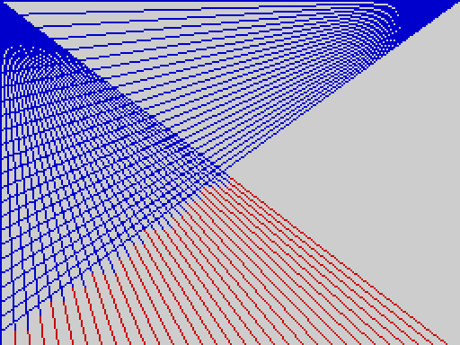
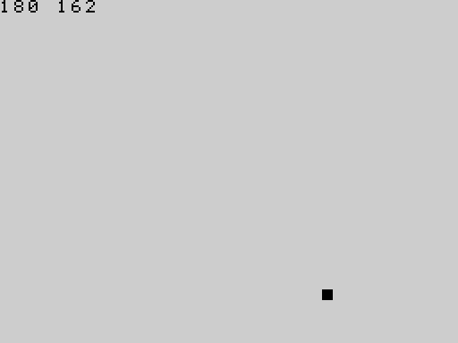
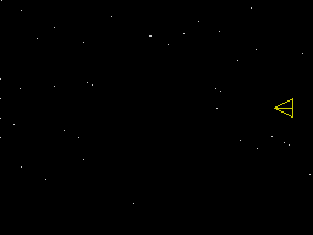

# Part 6 -- Practical examples

Complete programs, each of which does something useful or amusing and each of which has been run on the release (the output shown is exactly what appeared on the screen). Type one in, `RUN` it, then change it: that is the best way to learn.

For the programs that read the keyboard, the keys that were typed are shown in the heading of each example.

---

## 1. A multiplication table

Two nested loops, and `;` to keep the numbers on a row. `TAB` lines the columns up.

```basic ex=prog.table.1
FOR row = 1 TO 5
  FOR col = 1 TO 5
    TAB (col - 1) * 4
    PRINT row * col;
  NEXT col
  PRINT
NEXT row
```
```output ex=prog.table.1
1   2   3   4   5
2   4   6   8   10
3   6   9   12  15
4   8   12  16  20
5   10  15  20  25
```

(`TAB` is a statement, so each number is placed by its own `TAB`. The `PRINT` by itself ends the row.)

## 2. Prime numbers

The sieve of Eratosthenes with an array: cross out the multiples of each number, and what is left is prime.

```basic ex=prog.primes.1
DIM crossed(30)
FOR n = 2 TO 29
  IF crossed(n) = 0 THEN
    PRINT n;
    PRINT " ";
    FOR m = n * 2 TO 29 STEP n
      crossed(m) = 1
    NEXT m
  ENDIF
NEXT n
```
```output ex=prog.primes.1
2 3 5 7 11 13 17 19 23 29
```

(The numbers are printed on one row. A longer row would wrap at the 32nd column.)

## 3. Fibonacci numbers

Each number is the sum of the two before it. A loop does it with two variables.

```basic ex=prog.fib.1
a = 0
b = 1
FOR i = 1 TO 12
  PRINT a; " ";
  t = a + b
  a = b
  b = t
NEXT i
PRINT
```
```output ex=prog.fib.1
0 1 1 2 3 5 8 13 21 34 55 89
```

The same sequence by recursion -- elegant, but much slower for big numbers, because it works every number out from scratch:

```basic ex=prog.fib.2
DIM hold(20)
x = 0
FOR i = 0 TO 11
  CALL fib(i)
  PRINT x; " ";
NEXT i
PRINT
END
PROC fib(n):
  IF n < 2 THEN
    x = n
  ELSE
    CALL fib(n - 1)
    hold(n) = x
    CALL fib(n - 2)
    x = x + hold(n)
  ENDIF
ENDP
```
```output ex=prog.fib.2
0 1 1 2 3 5 8 13 21 34 55 89
```

A procedure cannot return a value, so it leaves its answer in the variable `x`. The partial result of the first call has to be kept somewhere that the second call cannot overwrite: **a plain variable would be shared by every level of the recursion and spoiled by the deeper calls**, so the program keeps it in the array element `hold(n)`; each active level has its own `n`, and so its own element.

## 4. Sorting

A bubble sort. Passes through the array swap neighbours that are out of order until a pass makes no swap.

```basic ex=prog.sort.1
DIM d(8)
d(0) = 34
d(1) = 7
d(2) = 23
d(3) = 32
d(4) = 5
d(5) = 62
d(6) = 12
d(7) = 48
swapped = 1
WHILEDONE:
IF swapped = 0 THEN GOTO finished
swapped = 0
FOR i = 0 TO 6
  IF d(i) > d(i + 1) THEN
    t = d(i)
    d(i) = d(i + 1)
    d(i + 1) = t
    swapped = 1
  ENDIF
NEXT i
GOTO WHILEDONE
finished:
FOR i = 0 TO 7
  PRINT d(i); " ";
NEXT i
PRINT
```
```output ex=prog.sort.1
5 7 12 23 32 34 48 62
```

(There is no `WHILE`: a label and `IF ... THEN GOTO` make the loop.)

Strings sort the same way, because the comparison operators work on them:

```basic ex=prog.sort.2
DIM n$(5, 12)
n$(0) = "PEAR"
n$(1) = "APPLE"
n$(2) = "FIG"
n$(3) = "CHERRY"
n$(4) = "BANANA"
FOR i = 0 TO 3
  FOR j = 0 TO 3 - i
    IF n$(j) > n$(j + 1) THEN
      t$ = n$(j)
      n$(j) = n$(j + 1)
      n$(j + 1) = t$
    ENDIF
  NEXT j
NEXT i
FOR i = 0 TO 4
  PRINT n$(i)
NEXT i
```
```output ex=prog.sort.2
APPLE
BANANA
CHERRY
FIG
PEAR
```

## 5. A temperature table

Numbers with fractions print with four decimals, so a table of Fahrenheit values looks like this:

```basic ex=prog.temp.1
PRINT "C       F"
FOR c = 36 TO 40
  TAB 0
  PRINT c;
  TAB 8
  PRINT c * 9 / 5 + 32
NEXT c
```
```output ex=prog.temp.1
C       F
36      96.8000
37      98.6000
38      100.4000
39      102.2000
40      104
```

(The last value is exactly 104, a whole number, so it is shown without decimals.)

## 6. Counting in binary

`DIV` and `MOD` take a number to pieces. This program builds a string of binary digits by repeatedly taking the remainder after dividing by 2:

```basic ex=prog.binary.1
DIM v(4)
v(0) = 5
v(1) = 10
v(2) = 255
v(3) = 1000
FOR k = 0 TO 3
  PRINT v(k); " is ";
  CALL bin(v(k))
  PRINT
NEXT k
END
PROC bin(n):
  IF n > 1 THEN
    CALL bin(DIV(n, 2))
  ENDIF
  PRINT MOD(n, 2);
ENDP
```
```output ex=prog.binary.1
5 is 101
10 is 1010
255 is 11111111
1000 is 1111101000
```

(The procedure prints the digits of the number divided by two first, and then its own last digit: that is what puts the digits in the right order.)

## 7. A secret code

A Caesar cipher: each capital letter is moved along the alphabet by three places. `CODE` gives a letter's number and `CHR$` turns a number back into a letter; `MOD` makes the alphabet wrap.

```basic ex=prog.caesar.1
msg$ = "HELLO WORLD"
out$ = ""
FOR i = 1 TO LEN(msg$)
  ch$ = MID$(msg$, i, 1)
  k = CODE(ch$)
  IF k >= 65 AND k <= 90 THEN
    k = MOD(k - 65 + 3, 26) + 65
  ENDIF
  out$ = out$ + CHR$(k)
NEXT i
PRINT msg$
PRINT out$
```
```output ex=prog.caesar.1
HELLO WORLD
KHOOR ZRUOG
```

## 8. Guess the number

The computer thinks of a number from 1 to 100 and you guess. (`RANDOMISE 7` makes the number the same every time so that this page shows the same game; remove that line to play a different game each time -- or give `RANDOMISE` a number that changes.) The guesses typed here are 50, 25, 5, 3 and 4.

```basic ex=prog.guess.1 keys="50\n25\n5\n3\n4\n"
RANDOMISE 7
secret = RND(100) + 1
tries = 0
again:
INPUT "Guess? "; g
tries = tries + 1
IF g < secret THEN
  PRINT "Too low"
  GOTO again
ENDIF
IF g > secret THEN
  PRINT "Too high"
  GOTO again
ENDIF
PRINT "Got it in "; tries; " tries"
```
```output ex=prog.guess.1
Guess? 50
Too high
Guess? 25
Too high
Guess? 5
Too high
Guess? 3
Too low
Guess? 4
Got it in 5 tries
```

## 9. A menu

`INPUT` into a string, then decisions on what was typed:

```basic ex=prog.menu.1 keys="2\n9\n3\n"
total = 0
menu:
PRINT "1 add ten  2 add one  3 quit"
INPUT c$
IF c$ = "1" THEN
  total = total + 10
ENDIF
IF c$ = "2" THEN
  total = total + 1
ENDIF
IF c$ = "3" THEN
  PRINT "total "; total
  END
ENDIF
GOTO menu
```
```output ex=prog.menu.1
1 add ten  2 add one  3 quit
2
1 add ten  2 add one  3 quit
9
1 add ten  2 add one  3 quit
3
total 1
```

## 10. Drawing: a spiral

`SIN` and `COS` use degrees, so a loop over an angle gives a circle; make the radius grow as the angle does and you get a spiral. Remember that y counts *down* the screen.

```basic ex=prog.spiral.1 shot=spiral
INK 1
FOR a = 0 TO 1080 STEP 4
  r = a / 12
  x = 128 + INT(r * COS(a))
  y = 96 - INT(r * SIN(a) * 0.9)
  PLOT x, y
NEXT a
```


## 11. Drawing: lines

Lines from a point on one edge to a moving point on another make a pattern that looks curved:

```basic ex=prog.lines.1 shot=lines_fan
INK 2
FOR i = 0 TO 255 STEP 8
  LINE 0, 0 TO i, 191
NEXT i
INK 1
FOR i = 0 TO 191 STEP 8
  LINE 255, 0 TO 0, i
NEXT i
```



## 12. A bouncing ball

`OVER 1` draws and erases with the same statement. Plot the ball, pause, plot the same place again to rub it out, move it, and repeat. The picture is the last frame.

```basic ex=prog.ball.1 shot=ball rows=1
OVER 1
x = 20
y = 30
dx = 5
dy = 3
FOR frame = 1 TO 60
  CALL ball(0)
  PAUSE 1
  CALL ball(0)
  x = x + dx
  y = y + dy
  IF x < 5 OR x > 245 THEN
    dx = 0 - dx
  ENDIF
  IF y < 5 OR y > 185 THEN
    dy = 0 - dy
  ENDIF
NEXT frame
OVER 0
CALL ball(0)
PRINT x; " "; y
END
PROC ball(n):
  FOR r = 0 TO 5
    LINE x, y + r TO x + 5, y + r
  NEXT r
ENDP
```
```output ex=prog.ball.1
180 162
```



(The numbers printed are the final position; the small square in the picture is the ball. A procedure draws it, so the same code both draws and rubs out.)

## 13. A sprite on a background

With the **sprite** package loaded (`LOAD "SPRITE" EXT`): draw a small ship from character cells, grab it, and fly it over a starry background without disturbing the stars.

*With the sprite package loaded (`LOAD "SPRITE" EXT`):*

```basic ex=prog.ship.1 pkg=sprite shot=ship
INK 6
PAPER 0
CLS
LINE 16, 24 TO 31, 16
LINE 31, 16 TO 31, 31
LINE 31, 31 TO 16, 24
LINE 16, 24 TO 31, 24
GRAB 0, 2, 2, 2, 2
INK 7
PAPER 0
CLS
RANDOMISE 3
FOR i = 1 TO 40
  PLOT RND(256), RND(176)
NEXT i
SHOW 0, 10, 0
FOR c = 1 TO 28
  MOVE 0, 10, c
  PAUSE 2
NEXT c
```



## 14. Save a high score

A program that keeps a table of scores and can be put away and brought back with `SAVE ... ALL`: the variables travel with the program. Typed after the program has run once:

```basic ex=prog.hiscore.1
hi = 0
name$ = "NOBODY"
PROC record(s):
  IF s > hi THEN
    hi = s
    name$ = "ADA"
  ENDIF
ENDP
```
```tape ex=prog.hiscore.1
RUN
: CALL record(120)
: CALL record(80)
: PRINT hi
120
SAVE "scores" ALL                      [SAVED]
power on
LOAD "scores"                          [LOADED]
: PRINT name$
ADA
: PRINT hi
120
```
