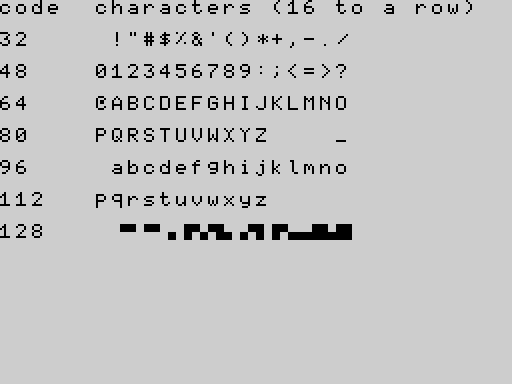

# Appendices

## Appendix A: Messages

What the status line (the bottom row of the screen) can say. The program or command that caused it is described in [Part 3](03_keywords.md) and [Part 4](04_concepts.md).

### Compile messages (nothing ran)

| Message | Meaning |
|---|---|
| `SYNTAX ERROR n` | the statement is not written correctly: something is missing, in the wrong place, or is not a known statement (including a package statement whose package is not loaded). When you press a key the cursor goes to the line. Most compile errors show this message; the number `n` is the error code, which [Appendix B](#appendix-b-error-codes) explains |
| `UNEXPECTED TOKEN` | something that cannot go here: a stray `ELSE`, `ENDIF`, `ENDP`, `THEN`, `TO`, a closing bracket; two values side by side; an unterminated string; a character that is not part of the language (`'`, `?`, `_`); a number literal beyond about 1.7 x 10^38 |
| `NAME TOO LONG` | a name of more than 31 characters |
| `NESTING TOO DEEP` | brackets, `IF` blocks or loops nested too deeply |
| `TOO MANY VARIABLES` | more than 251 different number names, 251 string names or 255 array names |
| `OUT OF MEMORY` | the program is too big for the compiler's tables or its code area |

### Run-time messages (the program stopped)

| Message | Meaning |
|---|---|
| `RUNTIME ERROR` | a statement failed while the program ran: division by zero, an array index outside the array, a number stored in a numeric array that is not a whole number or is out of range, `NEXT` without its loop, a bad argument (`CHR$(256)`, `SQR(-1)`, `STICK(3)`, `PEEK(65536)`), a result too big (beyond about 1.7 x 10^38), a package argument out of range |
| `STACK OVERFLOW` | procedures called themselves too deeply, or an expression nested too deeply |
| `OUT OF MEMORY` | an array is too big for the memory left |
| `ARRAY SIZE MISMATCH` | a `DIM` differs from the stored array of the same name |
| `BREAK` | you pressed CAPS SHIFT + SPACE |

### Editor and tape messages

| Message | Meaning |
|---|---|
| `PROGRAM FULL` | the line you just entered does not fit in the memory for programs; it was not stored |
| `SAVED`, `LOADED`, `VERIFIED` | the tape command worked |
| `VERIFY FAILED` | the tape and memory differ (or the tape could not be read) |
| `LOAD FAILED` | no matching tape was found, it was damaged, or the data does not fit |
| `NO VARIABLES` | a `SAVE ... ALL` tape was loaded but its variables could not be used (different ROM version or different package) |
| `BAD TAPE VERSION` | the tape is from V1, a stock Spectrum or a ROM with an incompatible format |
| `ABORTED` | SPACE was pressed during a tape operation |
| `NO PACKAGE` | `SAVE "name" EXT` with no package loaded |
| `ARRAY NOT DIMD` | `SAVE ... ARRAY a` for an array the program does not declare |
| `BAD ARRAY TAPE` | the tape block is not a valid array |
| `ARRAY STORE FULL` | no room is left in the Array Store |
| `LINE n/m` | not an error: the editor's status line (cursor line *n* of *m*) |

The `PROGRAM FULL` message is covered by the release qualification (defect RC-2), not by an example of this manual: it needs a nearly full program memory.

---

## Appendix B: Error codes

The status line shows messages; only `SYNTAX ERROR` adds its number (`SYNTAX ERROR 3`). Inside the system every error has a number, which appears in the test suites, in the defect register and in the source. They are listed here, with a program that causes each; every program below is run by `make doc-examples` and must stop with exactly that code.

### Compile errors

Compile errors have **no** effect on anything: nothing ran. The message column is the status line.

| Code | Message | Cause |
|---|---|---|
| 1 | `TOO MANY VARIABLES` | more than 251 number names (252nd) |
| 2 | `SYNTAX ERROR` | an identifier at the start of a statement not followed by `=` (also: an unknown word, `LET`, `GOSUB`, a package statement without its package) |
| 3 | `SYNTAX ERROR` | an expression could not start where it did (`PRINT 1 +`, `PRINT )`, `x = `) |
| 7 | `SYNTAX ERROR` | `GOTO` to a label that does not exist |
| 8 | `SYNTAX ERROR` | `IF` without `THEN` |
| 9 | `SYNTAX ERROR` | an `IF` block missing its `ELSE` or `ENDIF` |
| 10 | `SYNTAX ERROR` | no loop variable after `FOR` |
| 11 | `SYNTAX ERROR` | `FOR` without `TO` |
| 12 | `SYNTAX ERROR` | no label name after `GOTO` |
| 13, 14, 15 | `SYNTAX ERROR` | `CALL`: no procedure name; no `(`; no `)` |
| 16 | `SYNTAX ERROR` | `PROC` without `ENDP` |
| 17, 18, 19, 20 | `SYNTAX ERROR` | `PROC`: no name; no `(`; no parameter; no `)` |
| 22 | `SYNTAX ERROR` | no comma in a two-argument statement (`PLOT 1 2`, `BEEP 1`, `POKE`, `SOUND`, `OUT`, `AT`) |
| 23, 24, 25 | `SYNTAX ERROR` | `LINE`: no comma after x0; no `TO`; no comma after x1 |
| 28 | `SYNTAX ERROR` | a package statement with the wrong number of arguments |
| 29, 30, 31 | `SYNTAX ERROR` | a built-in function: no `(`; no comma between arguments; no `)` |
| 32 | `SYNTAX ERROR` | `DIM` with no name; also `LPRINT` without the printer package |
| 33 | `SYNTAX ERROR` | `DIM a` without `(` |
| 34 | `SYNTAX ERROR` | the `DIM` size (or width) is not a plain number |
| 35 | `SYNTAX ERROR` | `DIM` size of 0 |
| 37 | `SYNTAX ERROR` | `DIM` with no `)` (also: a second dimension) |
| 38 | `SYNTAX ERROR` | an array declared twice |
| 41 | `SYNTAX ERROR` | an array index with no `)` |
| 42 | `SYNTAX ERROR` | an assignment to an array that was never `DIM`'d |
| 43 | `SYNTAX ERROR` | `INPUT` with no variable name |
| 44 | `SYNTAX ERROR` | `EXIT` not followed by `FOR` |
| 46, 47, 48 | `SYNTAX ERROR` | `DIMN`: no `(`; not a numeric array name; no `)` |
| 49, 50, 51, 52, 53, 54 | `SYNTAX ERROR` | `DEF FN`: no `FN`; no name; no `(`; no parameter; no `)`; no `=` |
| 56 | `SYNTAX ERROR` | `NEXT` for another variable (or no loop open) |
| 57 | `SYNTAX ERROR` | a label or procedure defined twice |
| 60 | `NESTING TOO DEEP` | nesting too deep |
| 61 | `NAME TOO LONG` | a name of more than 31 characters |
| 63 | `SYNTAX ERROR` | `EXIT FOR` outside a loop |
| 64 | `UNEXPECTED TOKEN` | a token that cannot go here (see Appendix A); also a literal beyond the number range |
| 65 | `SYNTAX ERROR` | a `FOR` with no `NEXT` |
| 66 | `SYNTAX ERROR` | a bracketed expression with no `)` |
| 70 | `SYNTAX ERROR` | a string literal longer than 31 characters |
| 71 | `SYNTAX ERROR` | an immediate statement tried to define a label, procedure or function |

```errors ex=app.cerr
ce 2 | x 5
ce 3 | PRINT 1 +
ce 7 | GOTO nowhere
ce 8 | IF 1 PRINT 2
ce 9 | IF 1 THEN ;; PRINT 1
ce 10 | FOR = 1 TO 2
ce 11 | FOR i = 1 5
ce 12 | GOTO 5
ce 13 | CALL 5
ce 14 | CALL foo
ce 15 | PROC p(n): ;; ENDP ;; CALL p(1
ce 16 | PROC p(n): ;; PRINT n
ce 17 | PROC
ce 18 | PROC p
ce 19 | PROC p()
ce 20 | PROC p(n
ce 22 | PLOT 1 2
ce 23 | LINE 1 TO 2,3
ce 24 | LINE 1,2 3,4
ce 25 | LINE 1,2 TO 3 4
ce 28 pkg=shapes | CIRCLE 1,2
ce 29 | PRINT ABS 5
ce 30 | PRINT MOD(1 2)
ce 31 | PRINT ABS(1
ce 32 | DIM
ce 33 | DIM a
ce 34 | DIM a(n)
ce 35 | DIM a(0)
ce 37 | DIM a(5
ce 38 | DIM a(3) ;; DIM a(4)
ce 41 | DIM a(3) ;; PRINT a(1
ce 42 | a(1) = 5
ce 43 | INPUT 5
ce 44 | EXIT 5
ce 46 | PRINT DIMN a
ce 47 | PRINT DIMN(5)
ce 48 | DIM a(2) ;; PRINT DIMN(a
ce 49 | DEF 5
ce 50 | DEF FN 5
ce 51 | DEF FN f x
ce 52 | DEF FN f(
ce 53 | DEF FN f(x
ce 54 | DEF FN f(x) 5
ce 56 | FOR i = 1 TO 2 ;; NEXT j
ce 57 | a: ;; a:
ce 61 | pppppppppppppppppppppppppppppppp = 1
ce 63 | EXIT FOR
ce 64 | PRINT 1 2
ce 65 | FOR i = 1 TO 2
ce 66 | PRINT (1 + 2
ce 70 | PRINT "AAAAAAAAAAAAAAAAAAAAAAAAAAAAAAAAA"
ce 1 | @repeat 252 v{i} = 1
ce 39 | @repeat 256 DIM a{i}(1)
ce 60 | @repeat 300 IF 1 THEN
```

Codes that no program produces: 21 (the colon after a `PROC` parameter list is optional), 26 and 27 (retired), 36 (a `DIM` that is too big is reported when it runs, as `OUT OF MEMORY`), 40, 45 and the rest of the table's gaps. Codes 5, 6, 55 and 62 are "out of compile memory" (message `OUT OF MEMORY`): the label table, the table of forward references, the code area and the compiler's workspace; see [Limits](#appendix-d-limits).

An immediate statement that defines a label (code 71):

```basic ex=app.imm.1
x = 1
```
```session ex=app.imm.1
RUN
: here: PRINT 2  [ce:71]
: PROC p(n): PRINT n : ENDP  [ce:71]
: PRINT x
1
```

### Run-time errors

| Code | Message | Cause |
|---|---|---|
| 2, 6 | `STACK OVERFLOW` | recursion (6) or expression nesting (2) too deep |
| 5 | `RUNTIME ERROR` | division by zero (`/`, `DIV`, `MOD`), `TAN(90)` |
| 7 | `RUNTIME ERROR` | `NEXT` or return with no frame: jumping into a loop; a loop ended by `CLEAR` |
| 8 | `RUNTIME ERROR` | `SOUND` register 17 or more |
| 10 | `RUNTIME ERROR` | array index outside the array |
| 11 | `RUNTIME ERROR` | a fraction or out-of-range number stored in a numeric array, or used as an index |
| 15 | `RUNTIME ERROR` | argument out of range: `CHR$`, `STICK`, `SQR` of a negative number, an address of 65536 or more, `BEEP` seconds negative or over 273 or semitones outside -60 to 69 |
| 64 | `OUT OF MEMORY` | an array does not fit |
| 65 | `ARRAY SIZE MISMATCH` | `DIM` differs from a stored array |
| 66 | `BREAK` | CAPS SHIFT + SPACE |
| 67 | `RUNTIME ERROR` | a result beyond about 1.7 x 10^38 |
| 12 to 14 | `RUNTIME ERROR` | mode package: bad `MODE`, `ULAPLUS`, `PALETTE` |
| 15 to 20 | `RUNTIME ERROR` | sprite package (see [Part 5](05_packages.md#errors)) |
| 15 | `RUNTIME ERROR` | cbeep package: `CBEEP` out of range |

```errors ex=app.verr
ve 5 | PRINT 1 / 0
ve 5 | PRINT TAN(90)
ve 5 | PRINT DIV(1, 0)
ve 7 | GOTO inside ;; FOR i = 1 TO 3 ;; inside: ;; PRINT i ;; NEXT i
ve 10 | DIM a(5) ;; PRINT a(5)
ve 11 | DIM a(5) ;; a(2) = 1.5
ve 15 | PRINT CHR$(256)
ve 15 | PRINT SQR(-1)
ve 15 | PRINT STICK(3)
ve 15 | PRINT PEEK(65536)
ve 15 | BEEP 1, 70
ve 15 | BEEP -1, 0
ve 8 | SOUND 17, 1
ve 64 | DIM a(5000)
ve 67 | PRINT 100000 * 100000 * 100000 * 100000 * 100000 * 100000 * 100000 * 100000
ve 6 | CALL r(5000) ;; END ;; PROC r(n): ;; IF n > 0 THEN ;; CALL r(n - 1) ;; ENDIF ;; ENDP
ve 12 pkg=mode | MODE 2
ve 13 pkg=mode | ULAPLUS 2
ve 14 pkg=mode | PALETTE 64, 0
ve 15 pkg=sprite | GRAB 8, 0, 0, 1, 1
ve 16 pkg=sprite | GRAB 0, 0, 0, 5, 1
ve 17 pkg=sprite | SHOW 0, 1, 1
ve 18 pkg=sprite | GRAB 0, 0, 0, 1, 1 ;; SHOW 0, 0, 0 ;; SHOW 0, 1, 1
ve 19 pkg=sprite | HIDE 0
ve 20 pkg=sprite | GRAB 0, 23, 31, 2, 2
ve 15 pkg=cbeep | CBEEP 100, 70, 7
ve 15 pkg=cbeep | CBEEP 32767, 69, 7
```

---

## Appendix C: The character set

Characters are the standard Spectrum-family set for codes **32 to 127**, plus 16 **block graphics** for codes **128 to 143**, and 21 **user-defined characters** for codes **144 to 164** that you design yourself (see [User-defined characters](04_concepts.md#user-defined-characters)): they are blank until you `POKE` a picture into them. Nothing is drawn for codes 0 to 31 or 165 to 255. `PRINT CHR$(n)` prints character *n*; `CODE` gives the code of a character.

```basic ex=app.chars.1 shot=charset
CLS
PRINT "code  characters (16 to a row)"
FOR r = 0 TO 6
  AT 2 + r * 2, 0
  PRINT 32 + r * 16;
  FOR c = 0 TO 15
    AT 2 + r * 2, 6 + c
    PRINT CHR$(32 + r * 16 + c);
  NEXT c
NEXT r
```



**Nine characters have no picture.** The font of the release has no glyph for `[` `\` `]` `^` `` ` `` `{` `|` `}` `~` (codes 91, 92, 93, 94, 96, 123, 124, 125 and 126): they print as a blank. They can be typed, kept in strings, compared and passed to `CODE`; they just cannot be seen. (An accepted limitation of the release, Q-26.)

```basic ex=app.chars.2
PRINT "a[\]^`{|}~b"
PRINT LEN("a[\]^`{|}~b")
PRINT CODE("[")
```
```output ex=app.chars.2
a         b
11
91
```

**Block graphics.** Codes 128 to 143 are 2 x 2 blocks: each bit of (*code* - 128) is one quarter. Bit 0 is the top right, bit 1 the top left, bit 2 the bottom right, bit 3 the bottom left. The program prints the four quarters of each (1 = filled), in the order top left, top right, bottom left, bottom right:

```basic ex=app.chars.3
DIM s$(16, 16)
FOR c = 128 TO 143
  CLS
  AT 12, 0
  PRINT CHR$(c);
  a = POINT(0, 96)
  b = POINT(7, 96)
  d = POINT(0, 103)
  e = POINT(7, 103)
  s$(c - 128) = STR$(c) + " " + STR$(a) + STR$(b) + STR$(d) + STR$(e)
NEXT c
CLS
FOR i = 0 TO 15
  PRINT s$(i)
NEXT i
```
```output ex=app.chars.3
128 0000
129 0100
130 1000
131 1100
132 0001
133 0101
134 1001
135 1101
136 0010
137 0110
138 1010
139 1110
140 0011
141 0111
142 1011
143 1111
```

---

## Appendix D: Limits

All figures were measured on the release with an otherwise empty program, unless said otherwise.

| What | Limit |
|---|---|
| characters in a program line | 127 (the editor refuses more) |
| characters in a name | 31 |
| characters in a string | 31 (a longer constant is a compile error; a longer join is cut) |
| characters in an `INPUT` of a number | 20 |
| characters in a tape name | 10 |
| number names (different number variables) | 251 |
| string names | 251; but each costs memory, and about 170 one-character strings fit in a program that does nothing else |
| array names | 255 |
| size of one numeric array | up to 16383 in the program, but memory allows 4063 on an empty program |
| size of one string array | 508 elements of 15 characters, or 254 of 31 (empty program) |
| dimensions of an array | 1 |
| whole numbers | -32768 to 32767 (arrays hold only these) |
| floating-point numbers | magnitude up to about 1.7 x 10^38, about 9 significant digits |
| labels in a program | about 440 |
| forward `GOTO`s waiting for their label at the same time | 274 |
| nested brackets | 105 |
| nested `IF` blocks | 211 |
| nested `FOR` loops | 141 |
| operands nested in `1+(1+(1+(...` | about 40 |
| `EXIT FOR` statements in one loop | at least 261 |
| depth of recursion of a one-parameter procedure | 739 |
| program text | about 8.9 KB: the pool is 9211 bytes, shared with names, variables and arrays; 896 lines of `PRINT n` is the most that runs (897 lines fill the pool: `OUT OF MEMORY` at `RUN`) |
| free main memory on an empty machine | 8967 bytes (`FREE()`); 2048 in the overflow segment (`FREE(1)`) |
| bytes of compiled program (the code area, separate from the pool) | 4011; 1000 lines of `x = 1` fit, 1010 do not (`OUT OF MEMORY` while compiling) |
| procedure calls and `FOR` loops active at once | 12 bytes of the free gap each (739 deep recursion with an empty program) |
| session variables created by immediate statements | about ten short names |
| sprite slots | 8 |
| sprite size | 1 to 4 by 1 to 4 character cells |
| text screen | 32 columns by 23 rows (row 23 is the status line) |
| graphics screen | 256 by 192 pixels |
| `CPLOT` grid | 64 by 48 |
| `SOUND` registers | 0 to 16 |
| `PAUSE` | up to 65535 frames |
| `BEEP` | 0 to 273 seconds, in whole frames; semitones -60 to 69 (below -39 plays -39) |
| `CBEEP` (package) | 0 to 32767 milliseconds, at most 65535 waves; semitones -60 to 69 |

Most of these are limits of **memory** and move with what else the program uses; the compiler's own tables (names, labels, forward references) are fixed. The nesting limits are those of the compiler's and the machine's stacks: a program that needs more than that stops with `NESTING TOO DEEP`, `STACK OVERFLOW` or `OUT OF MEMORY`.


---

## Appendix E: Memory map

For `PEEK`, `POKE`, `USR`, `IN` and `OUT`. Addresses are decimal with hexadecimal in brackets. **Nothing in this appendix has been checked on a physical TS2068** (see [Appendix G](#appendix-g-hardware-notes)).

| Addresses | Size | Contents |
|---|---|---|
| 0 - 16383 (`$0000`-`$3FFF`) | 16 KB | the HOME ROM |
| 16384 - 22527 (`$4000`-`$57FF`) | 6144 | the display: pixels |
| 22528 - 23295 (`$5800`-`$5AFF`) | 768 | the display: colour attributes (one per 8 x 8 cell) |
| **23296 - 24575** (`$5B00`-`$5FFF`) | **1280** | **not used by V2 -- free for your own data and machine code** |
| 24576 - 30719 (`$6000`-`$77FF`) | 6144 | the second display file: used by `MODE 1` (extended-colour mode) as 8 x 1 colour attributes, one byte for every eight pixels of every scan line; free otherwise |
| **30720 - 32767** (`$7800`-`$7FFF`) | **2048** | **not used by V2 -- free** |
| 32768 - 33369 (`$8000`-`$8259`) | 602 | system variables (editor, tape, calculator, graphics): do not touch |
| 33370 - 42580 (`$825A`-`$A654`) | 9211 | the **main memory pool**: program text, variables, arrays (`FREE()`) |
| 42581 - 46591 (`$A655`-`$B5FF`) | 4011 | the compiled program |
| 46592 - 49151 (`$B600`-`$BFFF`) | 2560 | the system's fixed tables and registers, and the compiler's workspace |
| 49152 - 57343 (`$C000`-`$DFFF`) | 8 KB | RAM under the EXROM: while a program runs the EXROM is switched in and this RAM is **not visible**; the FILL work area lives here; do not use |
| 57344 - 59391 (`$E000`-`$E7FF`) | 2048 | the overflow segment: the Array Store and arrays that did not fit |
| 59392 - 61695 (`$E800`-`$F0FF`) | 2304 | sprite images and saved backgrounds (the sprite package) |
| 61696 - 61823 (`$F100`-`$F17F`) | 128 | reserved by the system (unused by this release): do not touch |
| **61824 - 61991** (`$F180`-`$F227`) | **168** | **the user-defined characters**: 8 bytes for each of the codes 144 to 164; yours to `POKE` (see [User-defined characters](04_concepts.md#user-defined-characters)) |
| 61992 - 62419 (`$F228`-`$F3D2`) | 428 | the editor's line buffer, the listing buffer, string and function workspace: do not touch |
| 62420 - 62463 (`$F3D3`-`$F3FF`) | 45 | unused |
| 62464 - 63487 (`$F400`-`$F7FF`) | 1024 | the **package window**: a loaded package lives here |
| 63488 - 65279 (`$F800`-`$FEFF`) | 1792 | the machine stack grows down into this from `$FF00`; keep off it |
| 65280 - 65535 (`$FF00`-`$FFFF`) | 256 | above the stack's start |

Rules for your own machine code (`USR`):

* Put it in `$5B00`-`$5FFF` (23296 to 24575), or `$7800`-`$7FFF`. Those are the two blocks that no part of the V2 system uses. Do not place it in the main pool, which belongs to the program.
* Enter with the address in HL; return with `RET` and the result in HL; any register may be destroyed; leave interrupts enabled; do not use more than a few dozen bytes of stack.

Ports used by the system (`IN`/`OUT`): `$FE` (254) keyboard, speaker, border and tape; `$F5`/`$F6` (245/246) the AY sound chip's register and data ports; `$F4` (244) the memory bank select; `$FF` (255) the video mode and EXROM select; `$FB` (251) the printer. Changing a port the system keeps a copy of (`$FE`, `$FF`) with `OUT` can confuse the system.

---

## Appendix F: Package reference card

| Package | `LOAD "..." EXT` | Statement | Arguments |
|---|---|---|---|
| mode | `MODE` | `MODE m` | *m* 0 or 1 |
| | | `ULAPLUS u` | *u* 0 or 1 |
| | | `PALETTE i, v` | *i* 0-63, *v* 0-255 |
| sprite | `SPRITE` | `GRAB s, r, c, w, h` | slot 0-7; row 0-23; col 0-31; width, height 1-4 cells |
| | | `SHOW s, r, c` | slot; row; col |
| | | `MOVE s, r, c` | slot; row; col |
| | | `HIDE s` | slot |
| printer | `PRINTER` | `LPRINT x` | one number or string |
| | | `LLIST` | -- |
| shapes | `SHAPES` | `CIRCLE x, y, r` | centre 0-255, 0-191; radius in pixels |
| | | `FILL x, y` | a pixel inside the area |
| graphics | `GRAPHICS` | `CPLOT x, y` | x 0-63, y 0-47 |
| | | `BLOCK x0, y0, x1, y1` | pixel corners |
| | | `FRAME x0, y0, x1, y1` | pixel corners |
| | | `INVERT x0, y0, x1, y1` | pixel corners |
| cbeep | `CBEEP` | `CBEEP ms, s, b` | 0-32767 milliseconds; semitones -60 to 69; border colour 0-7 |

One package at a time; `NEW` unloads it; a statement of a package that is not loaded is a compile error.

---

## Appendix G: Hardware notes

Everything in this manual was verified in the **ZEsarUX emulator**: on the accepted release ROMs (tag `v2.0.0-emu.1`), and, for the maintenance release's sound changes (`BEEP`, `SOUND`, `PAUSE`, the cbeep package), on its candidate ROMs; the memory figures on the `v2-development` ROM of the RAM-efficiency change, whose memory layout `v2.0.2-emu.1` has unchanged. **Nothing was tried on a physical TS2068**, a real cassette recorder, a ZX Printer, a joystick, ULAplus hardware or a Dock/EXROM cartridge. In particular:

* the sound (`BEEP`, `SOUND`, `CBEEP`) was measured by reading the sound chip's registers back, counting instructions and port writes, and from the emulator's recorded audio; it was never listened to on a TS2068 (the startup chime included);
* `BEEP` and `PAUSE` count display frames: 1/60 second on a TS2068 is the design figure, the emulator interrupts 50 times a second (not measured on hardware);
* tape timing was exercised only through the emulator's tape input; the identity-check pause of about 2.4 seconds on `SAVE ... ALL`, `LOAD` and `VERIFY` of an ALL tape has not been timed on real hardware;
* the printer package, the joysticks, `MODE 1`, ULAplus and the keyboard-matrix details are as the source states, not as seen on a machine;
* the hardware checklist for the release is `docs/V2_HARDWARE_CHECKLIST.md`.

---

## Appendix H: Keyword index

| Group | Keywords |
|---|---|
| **Program structure** | `REM`, `END`, `STOP`, `GOTO`, `IF` `THEN` `ELSE` `ENDIF`, `FOR` `TO` `STEP` `NEXT` `EXIT FOR`, `PROC` `ENDP` `CALL`, `DEF FN` `FN`, `CLEAR` |
| **Values and variables** | `DIM`, `DIMN`, `FREE` |
| **Numbers** | `ABS`, `SGN`, `INT`, `DIV`, `MOD`, `SQR`, `SIN`, `COS`, `TAN`, `PI`, `RAD`, `DEG`, `RND`, `RANDOMISE` |
| **Strings** | `LEN`, `CODE`, `VAL`, `CHR$`, `STR$`, `UPPER$`, `LOWER$`, `LEFT$`, `RIGHT$`, `MID$` |
| **Logic** | `AND`, `OR`, `NOT` |
| **Screen and text** | `PRINT`, `AT`, `TAB`, `CLS`, `INK`, `PAPER`, `BRIGHT`, `FLASH`, `INVERSE`, `OVER`, `BORDER`, `ATTR` |
| **Graphics** | `PLOT`, `LINE`, `POINT` |
| **Sound** | `BEEP`, `SOUND` |
| **Input** | `INPUT`, `INKEY$`, `STICK`, `PAUSE` |
| **The machine** | `PEEK`, `POKE`, `USR`, `IN`, `OUT` |
| **Commands** | `RUN`, `LIST`, `NEW`, `SAVE`, `LOAD`, `VERIFY` (with `ALL`, `ARRAY`, `EXT`) |
| **Package: mode** | `MODE`, `ULAPLUS`, `PALETTE` |
| **Package: sprite** | `GRAB`, `SHOW`, `HIDE`, `MOVE` |
| **Package: printer** | `LPRINT`, `LLIST` |
| **Package: shapes** | `CIRCLE`, `FILL` |
| **Package: graphics** | `CPLOT`, `BLOCK`, `FRAME`, `INVERT` |
| **Package: cbeep** | `CBEEP` |

---

## Appendix I: How this manual was checked

* Every example marked with an output block, a picture, a transcript or an error code in this manual is a test. `make doc-examples` runs them all on the ROM image built from the same tree (the release, `v2.0.0-emu.1`; the `BEEP`, `SOUND`, `PAUSE` and `CBEEP` examples on the maintenance candidate; this development edition on the `v2-development` ROM) (`tools/qual/manual_run.py`; the parser is `tools/qual/manual_examples.py`): programs are stored and run; `LIST`, `RUN`, `NEW` and the editor keys are typed through the real keyboard path; `SAVE` is captured at the tape transport and `LOAD` / `VERIFY` run the real tape receiver on a synthesised signal; packages are loaded with `LOAD "NAME" EXT` through that same receiver; BREAK is pressed in the emulated keyboard matrix; pictures are rendered from screen memory and compared with the committed images.
* This suite is **separate** from the 1010-case release baseline (`make test`, `make qual`, `tools/qual/corpus.py`), which it does not touch and whose totals it does not change.
* Facts that are not examples (limits, timings) were measured with `tools/qual/manual_measure.py` and the commands recorded in `docs/V2_DOCUMENTATION_FINDINGS.md`, which also lists what in the earlier documents turned out to be wrong.
