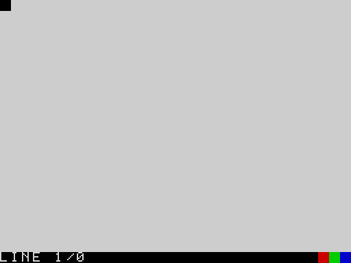
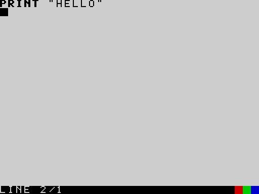
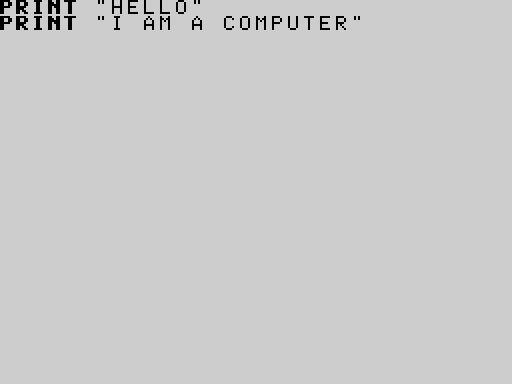
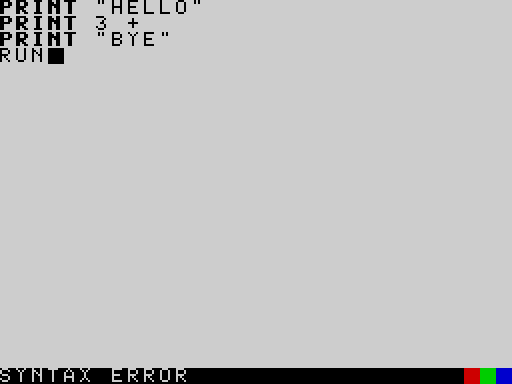
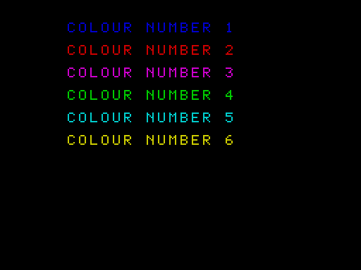
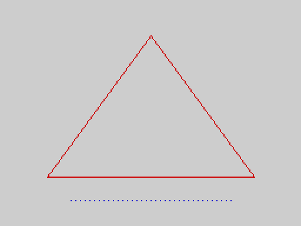
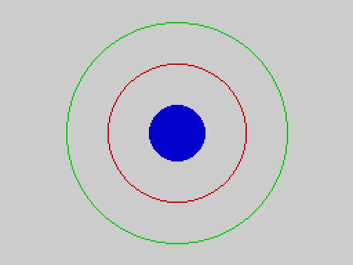

# Part 2 -- Beginner's guide

This part teaches the language from nothing, one small step at a time. You do not need to have programmed before. Read it with the machine in front of you, and type in every example; each one has been run on the real V2 ROM, and what you see on your screen should be exactly what is printed here.

Each chapter is short. If you already know BASIC, read Chapter 1 for the editor and skim the rest; the [Keywords](03_keywords.md) and [Concepts](04_concepts.md) parts are the reference.

## Chapter 1 -- Switching on

Switch on the machine. The screen is empty except for one line at the bottom:

```keys ex=guide.boot shot=boot_screen
```
```screen ex=guide.boot
...
LINE 1/0
```



You are in the **editor**. It is where you write programs. The bottom row is the **status line**: it says `LINE 1/0`, meaning "you are on line 1, and the program has 0 lines so far". The three little coloured squares at its right are only decoration. Everything above the status line is for your program and for what it prints.

There are no line numbers in 2068-Leap V2. A program is simply a list of lines, one under the other, and it runs from the top to the bottom.

## Chapter 2 -- Your first program

Type the following line exactly as shown, and press **ENTER**:

```
PRINT "HELLO"
```

`PRINT` is a **statement**: an instruction. It shows something on the screen. What you want shown goes after it; between double quotes it is **text** and is shown just as you typed it. When you press ENTER the line is **stored** as part of the program, the word `PRINT` turns bold to show that the machine knows it, and the cursor moves to the next, empty line:

```keys ex=guide.first.1 shot=first_line
PRINT "HELLO"
```
```screen ex=guide.first.1
PRINT "HELLO"
...
LINE 2/1
```



The status line now says `LINE 2/1`: you are on line 2, and the program has 1 line. The empty line you are on is the **last line**. That is where you type **commands**. Type

```
RUN
```

and press ENTER. The machine reads the whole program, checks it, and carries it out:

```keys ex=guide.first.2 shot=first_run
PRINT "HELLO"
RUN
```
```screen ex=guide.first.2
HELLO
```


`HELLO` appears. The screen now belongs to the program. Press any key, and you are back in the editor with your program on the screen, ready to change or add to:

```keys ex=guide.first.3
PRINT "HELLO"
RUN
{ANY}
```
```screen ex=guide.first.3
PRINT "HELLO"
...
LINE 2/1
```

(The command `RUN` you typed is gone: it was a command, not part of the program, and the last line is empty again, ready for the next command.)

A program may have as many lines as you like. Add a second line, and `RUN` again:

```basic ex=guide.first.4
PRINT "HELLO"
PRINT "I AM A COMPUTER"
```
```output ex=guide.first.4
HELLO
I AM A COMPUTER
```

The command `LIST` shows your program from the top, one line to a row, with the keywords in bold:

```keys ex=guide.first.5 shot=list_screen
PRINT "HELLO"
PRINT "I AM A COMPUTER"
LIST
```
```screen ex=guide.first.5
PRINT "HELLO"
PRINT "I AM A COMPUTER"
```



A long program does not fit on the screen: `LIST` shows 23 lines at a time and waits for a key before the next page. Press **BREAK** (CAPS SHIFT and SPACE together) to stop the listing.

To start again with an empty program, type `NEW`. There is no warning, and no way back:

```keys ex=guide.first.6
PRINT "HELLO"
NEW
```
```screen ex=guide.first.6
...
LINE 1/0
```

## Chapter 3 -- Correcting mistakes

Everybody makes mistakes. The editor has keys to put them right. Hold **CAPS SHIFT** and press:

| Keys | Effect |
|---|---|
| 5 | cursor left |
| 8 | cursor right |
| 6 | down to the next line |
| 7 | up to the previous line |
| 0 (DELETE) | delete the character before the cursor |
| 1 | delete the whole line the cursor is on |
| ENTER | insert a blank line |

Characters you type are inserted where the cursor is. Moving up or down puts the cursor at the start of the line it arrives on. ENTER stores the line as it now reads.

Suppose you meant to write `PRINT "TWO"` but typed `PRINT "TWWO"`. Move up to the line, move right to the extra W, and delete it:

```keys ex=guide.fix.1
PRINT "ONE"
PRINT "TWWO"
PRINT "THREE"
{UP}{UP}{RIGHT}{RIGHT}{RIGHT}{RIGHT}{RIGHT}{RIGHT}{RIGHT}{RIGHT}{RIGHT}{DEL}\
```
```screen ex=guide.fix.1
PRINT "ONE"
PRINT "TWO"
PRINT "THREE"
...
LINE 2/3
```

(Nine presses of "cursor right" bring the cursor just after the second `W`; DELETE then removes that `W`.)

What if the machine does not understand a line? Type this, with a deliberate mistake:

```keys ex=guide.fix.2 shot=syntax_error
PRINT "HELLO"
PRINT 3 +
PRINT "BYE"
RUN
```
```screen ex=guide.fix.2
PRINT "HELLO"
PRINT 3 +
PRINT "BYE"
RUN
...
SYNTAX ERROR
```



`RUN` first looks at the *whole* program. It found something it could not understand -- `3 +` with nothing to add -- so **nothing ran at all** (not even the first `PRINT`), and the status line says `SYNTAX ERROR`. Press a key and the cursor goes to the line with the mistake (line 2):

```keys ex=guide.fix.3
PRINT "HELLO"
PRINT 3 +
PRINT "BYE"
RUN
{ANY}\
```
```screen ex=guide.fix.3
PRINT "HELLO"
PRINT 3 +
PRINT "BYE"
...
LINE 2/3
```

Fix it and `RUN` again. You cannot do damage by making a mistake: the worst that happens is a message.

The messages are explained in [Appendix A](07_appendices.md#appendix-a-messages).

## Chapter 4 -- Numbers

The machine can calculate. `PRINT` shows the answer to a sum as well as text:

```basic ex=guide.num.1
PRINT 2 + 3
PRINT 10 - 4
PRINT 6 * 7
PRINT 20 / 4
```
```output ex=guide.num.1
5
6
42
5
```

`+` adds, `-` subtracts, `*` multiplies and `/` divides. Multiplication and division are done before addition and subtraction, as in school; use brackets to change that:

```basic ex=guide.num.2
PRINT 2 + 3 * 4
PRINT (2 + 3) * 4
```
```output ex=guide.num.2
14
20
```

Whole numbers are shown as they are. If the answer has a fraction, it is shown with four decimal places:

```basic ex=guide.num.3
PRINT 7 / 2
PRINT 1 / 3
PRINT 22 / 7
```
```output ex=guide.num.3
3.5000
0.3333
3.1429
```

To remember a number for later, give it a **name** with `=`. Such a named place is called a **variable**; you do not have to prepare it first:

```basic ex=guide.num.4
price = 12
quantity = 3
total = price * quantity
PRINT total
```
```output ex=guide.num.4
36
```

A variable can change. This is the whole point: the same line can do different things at different times.

```basic ex=guide.num.5
score = 10
score = score + 5
score = score * 2
PRINT score
```
```output ex=guide.num.5
30
```

(`score = score + 5` does not say that something is equal to itself plus five -- which would be silly. It says: take what `score` is now, add five, and keep that in `score`.)

A name is made of letters and digits, starts with a letter, and can be up to 31 characters long. Capital and small letters are the same. There is no underscore. You cannot use a **keyword** (`PRINT`, `FOR`, ...) as a name.

The machine has built-in **functions** that give you numbers: `ABS`, `SQR` (square root), `SIN`, `INT`, `RND` (a random number) and others. A function's argument goes in brackets, always -- even when there is no argument (`PI()`):

```basic ex=guide.num.6
PRINT SQR(144)
PRINT ABS(-9)
PRINT INT(3.99)
PRINT PI()
```
```output ex=guide.num.6
12.0000
9
3
3.1416
```

(`SQR` always gives a fraction-style answer, so it prints `12.0000`.)

How the machine keeps numbers -- and why `30000 * 3` prints `90000.0000` -- is explained in the concept [Numbers](04_concepts.md#numbers).

## Chapter 5 -- Words

Text in double quotes is a **string**. A string variable has a `$` at the end of its name. A string can hold up to 31 characters.

```basic ex=guide.str.1
name$ = "ADA"
PRINT "HELLO, "; name$
```
```output ex=guide.str.1
HELLO, ADA
```

The semicolon in `PRINT` joins things with nothing between them; a comma puts the next thing in the second half of the line:

```basic ex=guide.str.2
PRINT "NAME", "SCORE"
PRINT "ADA", 120
PRINT "ALAN", 95
```
```output ex=guide.str.2
NAME            SCORE
ADA             120
ALAN            95
```

`+` joins two strings together:

```basic ex=guide.str.3
a$ = "SUN"
b$ = "SHINE"
PRINT a$ + b$
PRINT LEN(a$ + b$)
```
```output ex=guide.str.3
SUNSHINE
8
```

`LEN` counts the characters. `LEFT$`, `RIGHT$` and `MID$` take pieces out of a string:

```basic ex=guide.str.4
w$ = "SUNSHINE"
PRINT LEFT$(w$, 3)
PRINT RIGHT$(w$, 5)
PRINT MID$(w$, 4, 2)
```
```output ex=guide.str.4
SUN
SHINE
SH
```

(`MID$(w$, 4, 2)` is "two characters, starting at the 4th". The first character is number 1.)

You cannot add a number to a string (`"A" + 1` is an error). `STR$` turns a number into text and `VAL` turns text into a number:

```basic ex=guide.str.5
PRINT "YOU HAVE " + STR$(3) + " MESSAGES"
PRINT VAL("40") + 2
```
```output ex=guide.str.5
YOU HAVE 3 MESSAGES
42
```

## Chapter 6 -- Making decisions

A program becomes interesting when it can choose. `IF` does that. The statements between `THEN` and `ENDIF` are carried out **only if** the condition is true:

```basic ex=guide.if.1
age = 15
IF age >= 13 THEN
  PRINT "TEENAGER"
ENDIF
PRINT "DONE"
```
```output ex=guide.if.1
TEENAGER
DONE
```

Change `age` to 9 and `TEENAGER` is skipped. The comparisons are `=` (equal), `<>` (not equal), `<`, `>`, `<=` (less than or equal) and `>=`. They work on numbers and on strings.

`ELSE` gives the other choice:

```basic ex=guide.if.2
age = 9
IF age >= 13 THEN
  PRINT "TEENAGER"
ELSE
  PRINT "NOT YET"
ENDIF
```
```output ex=guide.if.2
NOT YET
```

Conditions can be combined with `AND`, `OR` and `NOT`:

```basic ex=guide.if.3
temp = 22
IF temp > 15 AND temp < 25 THEN
  PRINT "PLEASANT"
ENDIF
```
```output ex=guide.if.3
PLEASANT
```

An `IF` can contain another `IF`, to pick between more than two things (there is no `ELSEIF`):

```basic ex=guide.if.4
mark = 72
IF mark >= 80 THEN
  PRINT "A"
ELSE
  IF mark >= 60 THEN
    PRINT "B"
  ELSE
    PRINT "C"
  ENDIF
ENDIF
```
```output ex=guide.if.4
B
```

Always close an `IF` with `ENDIF`. Putting a statement on the same line as `THEN` (`IF x THEN PRINT "A"`) is an error: the only one-line form is `IF ... THEN GOTO label`, which comes in Chapter 8.

## Chapter 7 -- Doing things again

Computers are good at boring repetition. `FOR` ... `NEXT` repeats the lines between them:

```basic ex=guide.for.1
FOR i = 1 TO 5
  PRINT i
NEXT i
```
```output ex=guide.for.1
1
2
3
4
5
```

The variable `i` counts, 1 up to 5. You can use it inside the loop:

```basic ex=guide.for.2
FOR n = 1 TO 5
  PRINT n; " times 7 is "; n * 7
NEXT n
```
```output ex=guide.for.2
1 times 7 is 7
2 times 7 is 14
3 times 7 is 21
4 times 7 is 28
5 times 7 is 35
```

`STEP` changes the amount counted each time, and may be negative, to count down:

```basic ex=guide.for.3
FOR i = 10 TO 0 STEP -5
  PRINT i
NEXT i
PRINT "LIFT OFF"
```
```output ex=guide.for.3
10
5
0
LIFT OFF
```

Loops can be put inside loops:

```basic ex=guide.for.4
FOR row = 1 TO 3
  FOR col = 1 TO 4
    PRINT "*";
  NEXT col
  PRINT
NEXT row
```
```output ex=guide.for.4
****
****
****
```

(A `PRINT` that ends in `;` stays on the same line; a plain `PRINT` ends the line.)

## Chapter 8 -- Labels, jumps and remarks

A **label** is a line with just a name and a colon. `GOTO` jumps to it. This makes a loop that goes on until a condition is met:

```basic ex=guide.goto.1
n = 0
again:
n = n + 1
PRINT n
IF n < 3 THEN GOTO again
PRINT "FINISHED"
```
```output ex=guide.goto.1
1
2
3
FINISHED
```

`IF ... THEN GOTO label` is the one-line form of `IF`. Use `FOR` when you know how many times; use a label when you do not.

`REM` starts a **remark**, a note for people. The machine ignores everything after it on the line. Remarks make programs easier to understand later:

```basic ex=guide.goto.2
REM compute the area of a rectangle
width = 8
height = 5
PRINT width * height : REM the answer is 40
```
```output ex=guide.goto.2
40
```

Several statements can share a line if they are separated by `:`.

`END` stops the program early; `STOP` does too. If you reach the last line, the program stops anyway.

## Chapter 9 -- Procedures and functions

When a piece of a program is needed several times, give it a name. A **procedure** is defined with `PROC` and `ENDP` and used with `CALL`. It receives one number, its **parameter**:

```basic ex=guide.proc.1
CALL stars(3)
CALL stars(7)
CALL stars(1)
END
PROC stars(n):
  FOR i = 1 TO n
    PRINT "*";
  NEXT i
  PRINT
ENDP
```
```output ex=guide.proc.1
***
*******
*
```

Put procedures after an `END`, so the program does not run into them. A procedure can call itself, which is the neat way to do something that is made of smaller copies of itself:

```basic ex=guide.proc.2
CALL countdown(4)
END
PROC countdown(n):
  IF n > 0 THEN
    PRINT n
    CALL countdown(n - 1)
  ENDIF
ENDP
```
```output ex=guide.proc.2
4
3
2
1
```

For a one-line calculation that gives back a value, define a **function** with `DEF FN`:

```basic ex=guide.proc.3
DEF FN double(x) = x * 2
DEF FN area(r) = 3.14159 * r * r
PRINT FN double(21)
PRINT FN area(10)
```
```output ex=guide.proc.3
42
314.1590
```

## Chapter 10 -- Lists of things

A variable holds one thing. An **array** holds a numbered row of them. You tell the machine the size with `DIM`, and then use a number in brackets to pick one. The numbering starts from **0**:

```basic ex=guide.arr.1
DIM temps(5)
temps(0) = 18
temps(1) = 21
temps(2) = 19
temps(3) = 25
temps(4) = 23
total = 0
FOR i = 0 TO 4
  total = total + temps(i)
NEXT i
PRINT "AVERAGE "; total / 5
```
```output ex=guide.arr.1
AVERAGE 21.2000
```

`DIM temps(5)` makes five places: `temps(0)` to `temps(4)`. The size must be a plain number. Names that end in `$` make arrays of strings, up to 15 characters each:

```basic ex=guide.arr.2
DIM day$(3)
day$(0) = "MON"
day$(1) = "TUE"
day$(2) = "WED"
FOR i = 0 TO 2
  PRINT day$(i)
NEXT i
```
```output ex=guide.arr.2
MON
TUE
WED
```

Numeric arrays keep whole numbers only (from -32768 to 32767). Storing 1.5 in one, or using a place that does not exist (`temps(5)` above), stops the program with a message.

## Chapter 11 -- Asking questions

`INPUT` waits for you to type something and press ENTER:

```basic ex=guide.input.1 keys="Sam\n12\n"
INPUT "What is your name? "; n$
INPUT "How old are you? "; age
PRINT "Next year "; n$; " will be "; age + 1
```
```output ex=guide.input.1
What is your name? Sam
How old are you? 12
Next year Sam will be 13
```

(Here `Sam` and `12` were typed at the two questions.) Put a `$` on the variable if you want text; leave it off for a number. If you type something that is not a number where a number is wanted, you get 0.

## Chapter 12 -- The screen

The text screen is 32 columns by 23 rows. `AT row, column` moves where the next `PRINT` starts; `TAB column` moves along the current row. Row 0, column 0 is the top left. `CLS` clears the screen.

```basic ex=guide.screen.1
CLS
AT 5, 10
PRINT "MIDDLE"
AT 0, 0
PRINT "TOP LEFT"
AT 8, 20
PRINT "LOWER"
```
```output ex=guide.screen.1
TOP LEFT


          MIDDLE


                    LOWER
```

**Colour.** `INK` sets the colour of the writing, `PAPER` the background, and `BORDER` the border: the numbers are 0 black, 1 blue, 2 red, 3 magenta, 4 green, 5 cyan, 6 yellow, 7 white. `BRIGHT 1` and `FLASH 1` make colours brighter or flashing. After changing `PAPER`, use `CLS` to paint the whole screen with it.

```basic ex=guide.screen.2 shot=colours
BORDER 1
PAPER 0
INK 7
CLS
FOR c = 1 TO 6
  INK c
  AT c * 2, 6
  PRINT "COLOUR NUMBER "; c
NEXT c
```



**Drawing.** The drawing screen is 256 dots across and 192 down. `PLOT x, y` puts down one dot; `x` runs from 0 at the left and `y` from 0 **at the top**. `LINE x1, y1 TO x2, y2` draws a straight line.

```basic ex=guide.screen.3 shot=first_drawing
INK 2
LINE 40, 150 TO 128, 30
LINE 128, 30 TO 216, 150
LINE 216, 150 TO 40, 150
INK 1
FOR x = 60 TO 196 STEP 4
  PLOT x, 170
NEXT x
```



Further shapes -- circles, filled areas, rectangles -- come from the packages (Chapter 15).

## Chapter 13 -- Sound

`BEEP duration, pitch` makes a note on the loudspeaker. Both numbers are plain counts: the duration is how many waves, the pitch is a delay (a bigger pitch gives a lower note). Try this short rising scale:

```basic ex=guide.sound.1
FOR p = 200 TO 100 STEP -20
  BEEP 80, p
NEXT p
PRINT "DONE"
```
```output ex=guide.sound.1
DONE
```

`SOUND` programs the three-voice sound chip. See the keywords [BEEP](03_keywords.md#beep) and [SOUND](03_keywords.md#sound), and the concept [Sound](04_concepts.md#sound).

## Chapter 14 -- Keeping your work

When you switch off, the program is lost. Save it on tape first:

```
SAVE "MYPROG"
```

(Names are up to 10 characters.) The machine shows `SAVED` when it is done. To get it back later, switch on and type `LOAD "MYPROG"`; `LOADED` is shown. `VERIFY "MYPROG"` checks that the tape matches what is in the machine.

`SAVE "MYPROG" ALL` saves more: the program **and** the numbers and strings it was using, so you can carry on exactly where you stopped.

```basic ex=guide.tape.1
score = 120
name$ = "ADA"
```
```tape ex=guide.tape.1
RUN
SAVE "MYPROG" ALL                      [SAVED]
power on
LOAD "MYPROG"                          [LOADED]
: PRINT score
120
: PRINT name$
ADA
```

(The lines starting with a colon are explained in the next chapter.) The tape messages are explained under [SAVE](03_keywords.md#save) and the concept [Tapes](04_concepts.md#tapes).

## Chapter 15 -- Looking inside a stopped program

When a program has stopped -- it ended, or you pressed BREAK, or it hit an error -- the machine **keeps its variables**. On the empty last line, a statement typed after a **colon** is carried out at once, using them:

```basic ex=guide.sess.1
total = 0
FOR i = 1 TO 10
  total = total + i
NEXT i
```
```session ex=guide.sess.1
RUN
: PRINT total
55
: PRINT i
11
: total = 0
: PRINT total
0
```

That is a powerful way to find out why a program did something odd, or to try out an idea without rewriting the program. You can even start the program again from a label, with the variables as they are, using `: GOTO label`. Changing the program in any way discards the kept variables. The concept [Sessions](04_concepts.md#sessions) has the full rules.

## Chapter 16 -- Packages: more statements

The language in the ROM is complete for most programs. Specialist statements come on tape as **packages**, which you load with `LOAD "NAME" EXT`. There are five:

| To get | Load | You then have |
|---|---|---|
| circles and filled areas | `SHAPES` | `CIRCLE`, `FILL` |
| rectangles, big pixels | `GRAPHICS` | `BLOCK`, `FRAME`, `INVERT`, `CPLOT` |
| moving pictures | `SPRITE` | `GRAB`, `SHOW`, `HIDE`, `MOVE` |
| the printer | `PRINTER` | `LPRINT`, `LLIST` |
| video modes, ULAplus | `MODE` | `MODE`, `ULAPLUS`, `PALETTE` |

*With the shapes package loaded (`LOAD "SHAPES" EXT`):*

```basic ex=guide.pkg.1 pkg=shapes shot=first_circles
INK 4
CIRCLE 128, 96, 80
INK 2
CIRCLE 128, 96, 50
INK 1
CIRCLE 128, 96, 20
FILL 128, 96
```



Only one package is loaded at a time; loading another replaces it, and `NEW` removes it. [Part 5](05_packages.md) describes each package.

## Where next

* Look up any word in [Part 3, Keywords](03_keywords.md): every entry has examples you can type in.
* Read the [Concepts](04_concepts.md) when you wonder *why*: how numbers work, what a session is, how memory is used.
* Try the programs in [Part 6](06_examples.md) -- a sieve, a sorting program, a game, animation -- and change them.
* When something goes wrong, [Appendix A](07_appendices.md#appendix-a-messages) explains every message.
