# Part 3 -- Keywords

Every statement, function, operator and command of the 2068-Leap V2 language, in alphabetical order. Entries for the statements of the five loadable packages are included in their place and marked **[package: name]**; each of those works only after `LOAD "NAME" EXT` (see [Part 5](05_packages.md)).

## How to read an entry

Each entry gives the **syntax**, the **kind** of keyword, a description, examples and, where they matter, notes, the errors it can cause, and related entries.

| Notation | Meaning |
|---|---|
| `KEYWORD` | type it exactly like this (upper or lower case: `print` and `PRINT` are the same) |
| *italics* | something you supply: a number, an expression, a name |
| `[ ]` | optional |
| `{ }` | may be repeated |
| `a \| b` | one of the alternatives |

*Kinds* are: **statement** (does something; used in a program or after `:` on the editor's last line), **function** (gives a value; used inside an expression), **operator**, **command** (typed on the empty last line of the editor, not allowed in programs), and **part of** (a word that belongs to another statement).

Examples marked with an output block show **exactly** what the program prints on the release ROM; every one of them is run on the emulator-qualified release by `make doc-examples`. Screen pictures are produced the same way.

Two things are different from Sinclair BASIC and matter everywhere:

* Statements are not numbered, and a statement never starts with `LET`.
* Functions are always written with brackets, even when they take no argument: `PI()`, `INKEY$()`, `FREE()`. `DIV` and `MOD` are functions too: `MOD(17, 5)`, not `17 MOD 5`.

Programs are written one statement (or several, separated by `:`) per line. In the examples below, each line of the box is one line of the program.

---

## ABS

`ABS(n)` -- **function**

The size of *n* without its sign.

```basic ex=kw.abs.1
PRINT ABS(-5)
PRINT ABS(2.5)
PRINT ABS(-2.5)
```
```output ex=kw.abs.1
5
2.5000
2.5000
```

**Notes.** `ABS(-32768)` is 32768, which is outside the whole-number range, so it is a floating-point value: it prints as `32768.0000` (see [Numbers](04_concepts.md#numbers)).

**See also** SGN, INT.

---

## ALL

`SAVE "name" ALL` -- **part of** `SAVE`

Saves the program **and** its variables and arrays. See SAVE and the concept [Sessions](04_concepts.md#sessions).

---

## AND

*a* `AND` *b* -- **operator**

True (1) when both *a* and *b* are true; otherwise 0. Any value other than 0 counts as true. `AND` is a **logical** operator -- it gives 0 or 1, never a bit pattern: `3 AND 5` is 1, not 1. (There is no bitwise `AND` in V2.)

`AND` binds more loosely than the comparisons and more tightly than `OR`, so `a > 3 AND a < 10` means `(a > 3) AND (a < 10)`.

`AND` **stops as soon as the answer is known**: if *a* is false, *b* is not evaluated at all. This makes guards safe:

```basic ex=kw.and.1
y = 0
IF y <> 0 AND 10 / y > 1 THEN
  PRINT "big"
ELSE
  PRINT "safe"
ENDIF
```
```output ex=kw.and.1
safe
```

```basic ex=kw.and.2
a = 5
PRINT a > 3 AND a < 10
PRINT 3 AND 0
PRINT 3 AND 5
```
```output ex=kw.and.2
1
0
1
```

**See also** OR, NOT, the concept [Truth and comparisons](04_concepts.md#truth-and-comparisons).

---

## ARRAY

`SAVE "name" ARRAY a`, `LOAD "name" ARRAY a` -- **part of** `SAVE` / `LOAD`

Saves or loads a single array (and, on loading, puts it in the Array Store). See SAVE, LOAD and the concept [Array Store](04_concepts.md#array-store).

---

## AT

`AT row, col` -- **statement**

Moves the printing position, so that the next `PRINT` starts at that row and column. Row 0 is the top of the screen and column 0 the left edge. `AT` is a statement of its own, used before `PRINT`; it is **not** an item inside `PRINT` as it is in Sinclair BASIC.

```basic ex=kw.at.1
AT 3, 5
PRINT "here"
AT 0, 0
PRINT "top"
```
```output ex=kw.at.1
top


     here
```

**Notes.**

* Rows 0 to 22 are the text area. Row 23 is the status bar: printing there scrolls the screen up. A row above 23 is treated as 23.
* The column is taken **modulo 32** (not clamped): `AT 0, 40` is column 8.
* `CLS` puts the position back at row 0, column 0.

**See also** TAB, PRINT, CLS.

---

## ATTR

`ATTR(row, col)` -- **function**

The colour attribute of the character cell at *row*, *col*: one number made of

| Part | Value |
|---|---|
| ink colour | 0 to 7 |
| paper colour | 8 times (0 to 7) |
| bright | 64 if on |
| flash | 128 if on |

A cell outside the screen (row above 23, column above 31) gives 0.

```basic ex=kw.attr.1
INK 2
PAPER 6
CLS
PRINT ATTR(0, 0)
PRINT ATTR(10, 12)
PRINT ATTR(30, 0)
```
```output ex=kw.attr.1
50
50
0
```

Here 50 = 6 x 8 + 2: paper 6 (yellow) and ink 2 (red).

**See also** INK, PAPER, BRIGHT, FLASH, POINT.

---

## BEEP

`BEEP duration, pitch` -- **statement**

Makes a sound through the loudspeaker. **This is not the Sinclair `BEEP`**: there are no seconds and no musical notes. Both numbers are raw counts:

* *duration* is the number of complete sound waves (cycles) to produce; 0 produces none;
* *pitch* is the length of the pause in each half-wave: the **larger** the number, the **lower** the note.

One cycle takes about `52 x pitch + 220` processor T-states, so the frequency is the processor clock divided by that: about **3 500 000 / (52 x pitch + 220)** hertz. The release was measured on the emulator: `BEEP 1000,100` costs 5 421 600 T-states, 650 Hz at 3.5 MHz.

| Wanted note (approximately) | pitch |
|---|---|
| 262 Hz (middle C) | 252 |
| 440 Hz (A) | 148 |
| 880 Hz | 72 |
| 1760 Hz | 34 |

```basic ex=kw.beep.1
BEEP 220, 148
PAUSE 10
BEEP 440, 72
PRINT "done"
```
```output ex=kw.beep.1
done
```

**Notes.**

* The program stops running while it beeps. Interrupts are switched off during the sound, so BREAK is not noticed until it ends: keep *duration* short (a few hundred cycles).
* A pitch of 0 is the slowest wave of all (65 536 steps per half-wave), not the highest.
* The result was measured on the emulator; the sound itself was not heard on a real machine.

**See also** SOUND, PAUSE.

---

## BLOCK  [package: graphics]

`BLOCK x0, y0, x1, y1` -- **statement**

Fills a rectangle with the current ink (and paper) colours. The corners may be given in any order. Needs the **graphics** package. See [Part 5](05_packages.md#the-graphics-package).

*With the graphics package loaded (`LOAD "GRAPHICS" EXT`):*

```basic ex=kw.block.1 pkg=graphics shot=block_frame rows=1
INK 4
BLOCK 10, 40, 60, 70
INK 2
FRAME 70, 40, 120, 70
INK 1
BLOCK 130, 40, 180, 70
INVERT 140, 50, 170, 60
INK 0
PRINT POINT(30, 60)
```
```output ex=kw.block.1
1
```

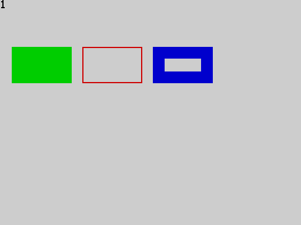

**See also** FRAME, INVERT, CPLOT, PLOT, LINE.

---

## BORDER

`BORDER n` -- **statement**

Sets the colour of the border. Only the low three bits of *n* count, so the colours repeat every eight:

| n | 0 | 1 | 2 | 3 | 4 | 5 | 6 | 7 |
|---|---|---|---|---|---|---|---|---|
| colour | black | blue | red | magenta | green | cyan | yellow | white |

```basic ex=kw.border.1
BORDER 2
PAUSE 25
BORDER 7
PRINT "border"
```
```output ex=kw.border.1
border
```

**See also** INK, PAPER.

---

## BRIGHT

`BRIGHT n` -- **statement**

Turns the bright (extra intensity) attribute on for everything printed or drawn next. Only the low bit of *n* counts: `BRIGHT 1` is on, `BRIGHT 0` off; `BRIGHT 2` is **off**.

```basic ex=kw.bright.1
BRIGHT 1
CLS
a = ATTR(0, 0)
BRIGHT 0
CLS
b = ATTR(0, 0)
PRINT a
PRINT b
```
```output ex=kw.bright.1
120
56
```

(`CLS` paints the whole screen with the colours in force; `ATTR` then reports them. 120 is 56, the default paper 7 and ink 0, plus 64 for bright.)

**See also** FLASH, INK, PAPER, INVERSE, OVER.

---

## CALL

`CALL name(expression)` -- **statement**

Runs the procedure *name* (see PROC), giving it the value of *expression* as its one parameter. When the procedure ends, the program carries on after the `CALL`.

```basic ex=kw.call.1
CALL hello(5)
CALL hello(6)
END
PROC hello(n):
  PRINT "n = "; n
ENDP
```
```output ex=kw.call.1
n = 5
n = 6
```

**Notes.**

* A procedure always takes exactly one value, even if you do not need it: `CALL beep_twice(0)`.
* A procedure may call itself (see PROC).
* `CALL` to a name that is not a procedure is a compile error (an undefined label gives `SYNTAX ERROR`). A known limitation: `CALL` of an ordinary *label* is accepted, jumps there and runs on without ever returning (accepted defect Q-24); always `CALL` procedures only.

**See also** PROC, ENDP, GOTO, DEF FN.

---

## CHR$

`CHR$(n)` -- **function**

A string of one character: the character whose code is *n* (0 to 255). Any other value stops the program with a run-time error.

```basic ex=kw.chr.1
PRINT CHR$(72) + CHR$(105)
PRINT CODE(CHR$(200))
```
```output ex=kw.chr.1
Hi
200
```

See the [character set](07_appendices.md#appendix-c-the-character-set) for the characters that exist. `CHR$(144)` to `CHR$(164)` are the 21 [user-defined characters](04_concepts.md#user-defined-characters), which you define with `POKE`.

**See also** CODE, STR$.

---

## CIRCLE  [package: shapes]

`CIRCLE x, y, radius` -- **statement**

Draws a circle with its centre at pixel *x*, *y*. Needs the **shapes** package. See [Part 5](05_packages.md#the-shapes-package).

*With the shapes package loaded (`LOAD "SHAPES" EXT`):*

```basic ex=kw.circle.1 pkg=shapes shot=circle_fill rows=3
INK 1
CIRCLE 128, 96, 60
INK 2
CIRCLE 128, 96, 30
FILL 128, 96
INK 0
PRINT "done"
```
```output ex=kw.circle.1
done
```

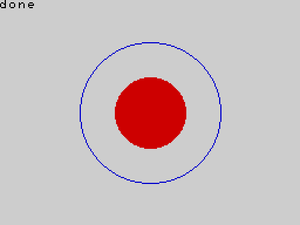

**See also** FILL, PLOT, LINE.

---

## CLEAR

`CLEAR` -- **statement**

Sets every variable back to 0 (numbers) or "" (strings) and removes the contents of ordinary arrays. The program stays as it is. In a `FOR` loop, `CLEAR` also ends the loop (so a later `NEXT` is a run-time error). The Array Store and any loaded package are not touched.

```basic ex=kw.clear.1
x = 5
PRINT x
CLEAR
PRINT x
```
```output ex=kw.clear.1
5
0
```

After `CLEAR`, an ordinary array is empty and its elements can no longer be used (an index is out of range). Typed after a colon on the editor's last line, `: CLEAR` clears the variables kept from the last run (see the concept [Sessions](04_concepts.md#sessions)).

**See also** RUN, NEW, DIM.

---

## CLS

`CLS` -- **statement**

Clears the text area of the screen, paints it with the current ink, paper, bright and flash colours, and puts the printing position at the top left (row 0, column 0).

```basic ex=kw.cls.1
PRINT "gone"
CLS
PRINT "fresh"
```
```output ex=kw.cls.1
fresh
```

**See also** AT, INK, PAPER.

---

## CODE

`CODE(a$)` -- **function**

The character code of the first character of *a$*, or 0 if *a$* is empty.

```basic ex=kw.code.1
PRINT CODE("A")
PRINT CODE("abc")
PRINT CODE("")
PRINT CODE(" ")
```
```output ex=kw.code.1
65
97
0
32
```

**See also** CHR$, VAL, LEN.

---

## COS

`COS(angle)` -- **function**

The cosine of an angle given in **degrees** (not radians); fractions of a degree are allowed. The result is a floating-point number.

```basic ex=kw.cos.1
PRINT COS(60)
PRINT COS(0)
```
```output ex=kw.cos.1
0.5000
1.0000
```

**See also** SIN, TAN, RAD, DEG, PI.

---

## CPLOT  [package: graphics]

`CPLOT x, y` -- **statement**

Plots a coarse "big pixel": a 4 x 4 block of ordinary pixels on a grid of **64 columns by 48 rows**. *x* is 0 to 63 and *y* 0 to 47, counted from the top left (larger values are treated as the last column or row). Needs the **graphics** package: type `LOAD "GRAPHICS" EXT` first. See [Part 5](05_packages.md#the-graphics-package).

A diagonal line across the whole screen, drawn one big pixel at a time:

*With the graphics package loaded (`LOAD "GRAPHICS" EXT`):*

```basic ex=kw.cplot.1 pkg=graphics shot=cplot_line
INK 2
FOR x = 0 TO 63
  CPLOT x, DIV(x * 47, 63)
NEXT x
```

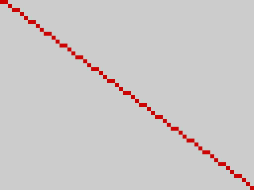

**See also** PLOT, BLOCK.

---

## DEF FN

`DEF FN name(parameter) = expression` -- **statement**

Defines a one-line function with one numeric parameter. You use it with `FN` inside an expression: `FN name(argument)`. The name may be as long as any other name. The definition itself does nothing when it is reached; it may be anywhere in the program, even after the places that use it.

```basic ex=kw.deffn.1
DEF FN sq(x) = x * x
PRINT FN sq(7)
PRINT FN sq(1.5)
y = 3
PRINT FN sq(y + 1)
```
```output ex=kw.deffn.1
49
2.2500
16
```

The body can use the program's variables (their value **when the function is called**) and other functions:

```basic ex=kw.deffn.2
DEF FN a(x) = x + 1
DEF FN b(x) = FN a(x) * 2
n = 10
DEF FN plus(k) = k + n
PRINT FN b(3)
PRINT FN plus(1)
n = 20
PRINT FN plus(1)
```
```output ex=kw.deffn.2
8
11
21
```

**Notes.**

* The function and its parameter are numbers; a function cannot return a string, and cannot be given one.
* Defining the same function name twice is a compile error.
* `DEF FN` cannot be typed as an immediate statement (after a colon on the last editor line).

**See also** FN, PROC.

---

## DEG

`DEG(r)` -- **function**

Converts an angle from radians to degrees.

```basic ex=kw.deg.1
PRINT DEG(PI())
PRINT DEG(1)
```
```output ex=kw.deg.1
180.0000
57.2958
```

**See also** RAD, PI, SIN.

---

## DIM

`DIM name(size)`, `DIM name$(size)`, `DIM name$(size, width)` -- **statement**

Declares an array. *size* is the number of elements, and it must be a plain whole number in the program (not a variable or a sum). The elements are numbered **from 0**: `DIM a(5)` has `a(0)` to `a(4)`.

* A **numeric** array holds whole numbers from -32768 to 32767, two bytes each. Storing a fraction or a number outside that range is a run-time error.
* A **string** array `name$(size)` holds strings of up to **15** characters. `name$(size, width)` gives each element `width` bytes, so it holds `width - 1` characters: `DIM n$(10, 32)` holds 31 characters.
* Every element starts as 0 or "".

```basic ex=kw.dim.1
DIM a(5)
FOR i = 0 TO 4
  a(i) = i * i
NEXT i
PRINT a(3)
PRINT DIMN(a)
```
```output ex=kw.dim.1
9
5
```

```basic ex=kw.dim.2
DIM n$(3)
n$(0) = "123456789012345"
n$(1) = "1234567890123456789"
PRINT n$(0)
PRINT n$(1)
PRINT LEN(n$(1))
```
```output ex=kw.dim.2
123456789012345
123456789012345
15
```

The second line is cut to the 15 characters an element can hold. With a width:

```basic ex=kw.dim.3
DIM w$(2, 32)
w$(0) = "1234567890123456789012345678901"
PRINT w$(0)
PRINT LEN(w$(0))
```
```output ex=kw.dim.3
1234567890123456789012345678901
31
```

**Errors.**

| Mistake | What happens |
|---|---|
| index below 0 or at/above *size* | run-time error (RUNTIME ERROR) |
| `a(2) = 40000` or `a(2) = 1.5` | run-time error |
| a variable as the size (`DIM a(n)`) | compile error (SYNTAX ERROR) |
| a size of 0 | compile error |
| `DIM` of a name twice in one program | compile error |
| not enough memory | run-time error (OUT OF MEMORY) |

**Notes.**

* An array lives in the main memory, or -- if it does not fit there -- in the 2 KB overflow area (segment 2). A single array must fit entirely in one of them: with an empty program the largest numeric array has 4063 elements, the largest string array 508 elements of 15 characters (254 of 31). See [Limits](07_appendices.md#appendix-d-limits).
* An array has **one** dimension.
* A numeric array and a scalar variable can share a name: `x` and `x(1)` are different things.
* An array saved with `SAVE ... ARRAY` and loaded with `LOAD ... ARRAY` is kept in the **Array Store**; a `DIM` of the same name and size in the program then uses it (see [Array Store](04_concepts.md#array-store)).

**See also** DIMN, CLEAR, FREE, the concept [Arrays](04_concepts.md#arrays).

---

## DIMN

`DIMN(name)` -- **function**

The size an array was declared with: `DIMN(a)` after `DIM a(5)` is 5.

```basic ex=kw.dimn.1
DIM scores(12)
PRINT DIMN(scores)
PRINT DIMN(scores) - 1
```
```output ex=kw.dimn.1
12
11
```

**Notes.** `DIMN` works on **numeric** arrays only. `DIMN` of a string array is a compile error: keep the size in a variable if you need it. (This is a limitation of the release; the earlier description of `DIMN(a$)` was wrong.)

**See also** DIM.

---

## DIV

`DIV(a, b)` -- **function**

The whole-number part of *a* divided by *b*, rounded toward zero. Fractions are cut off first. Dividing by zero stops the program with a run-time error. (`DIV` is written like a function, not between its operands.)

```basic ex=kw.div.1
PRINT DIV(17, 5)
PRINT DIV(-7, 2)
PRINT DIV(20, 4)
```
```output ex=kw.div.1
3
-3
5
```

**See also** MOD, INT, the operator `/`.

---

## ELSE

`ELSE` -- **part of** `IF`

Starts the part of a block `IF` that is run when the condition is false. See IF.

---

## END

`END` -- **statement**

Stops the program. Reaching the last line does the same, so `END` is needed only to stop before the end -- typically before the procedures that follow the main program. Variables are kept (see the concept [Sessions](04_concepts.md#sessions)).

```basic ex=kw.end.1
PRINT "start"
CALL work(1)
END
PROC work(n):
  PRINT "working"
ENDP
```
```output ex=kw.end.1
start
working
```

**See also** STOP, PROC.

---

## ENDIF

`ENDIF` -- **part of** `IF`

Closes a block `IF`. See IF.

---

## ENDP

`ENDP` -- **part of** `PROC`

Ends a procedure; the program returns to the statement after the `CALL`. See PROC.

---

## EXIT FOR

`EXIT FOR` -- **statement**

Leaves the innermost `FOR` loop at once, carrying on after its `NEXT`. The loop variable keeps the value it had.

```basic ex=kw.exit.1
FOR i = 1 TO 10
  IF i = 4 THEN
    EXIT FOR
  ENDIF
  PRINT i
NEXT i
PRINT "i = "; i
```
```output ex=kw.exit.1
1
2
3
i = 4
```

**Notes.** `EXIT FOR` outside a `FOR` loop is a compile error. `EXIT FOR` after a `GOTO` out of the loop is fine; there may be at most a handful of `EXIT FOR` statements waiting in one loop (see [Limits](07_appendices.md#appendix-d-limits)).

**See also** FOR, NEXT, GOTO.

---

## EXT

`SAVE "name" EXT`, `LOAD "name" EXT` -- **part of** `SAVE` / `LOAD`

Saves or loads a **package**: `LOAD "SHAPES" EXT` adds the statements `CIRCLE` and `FILL` to the language. See [Part 5](05_packages.md) and the commands SAVE and LOAD.

---

## FILL  [package: shapes]

`FILL x, y` -- **statement**

Floods the area around pixel *x*, *y* with the current ink colour, spreading in every direction until it meets pixels that are already set (a line, a circle, any outline). The area must be closed: if the outline has a gap, the colour spills out through it. Needs the **shapes** package: type `LOAD "SHAPES" EXT` first. See [Part 5](05_packages.md#the-shapes-package).

A house drawn with `LINE`, then filled:

*With the shapes package loaded (`LOAD "SHAPES" EXT`):*

```basic ex=kw.fill.1 pkg=shapes shot=fill_house
INK 1
LINE 70, 150 TO 70, 90
LINE 70, 90 TO 128, 40
LINE 128, 40 TO 186, 90
LINE 186, 90 TO 186, 150
LINE 186, 150 TO 70, 150
INK 2
FILL 128, 110
```

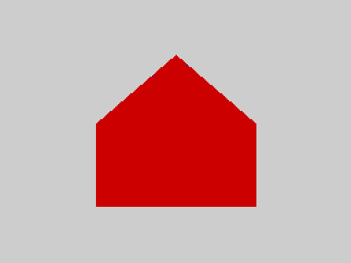

**See also** CIRCLE, BLOCK, LINE.

---

## FLASH

`FLASH n` -- **statement**

Makes what is printed next flash (its ink and paper swap about twice a second). Only the low bit of *n* counts: `FLASH 1` on, `FLASH 0` off.

```basic ex=kw.flash.1
FLASH 1
CLS
a = ATTR(0, 0)
FLASH 0
CLS
b = ATTR(0, 0)
PRINT a
PRINT b
```
```output ex=kw.flash.1
184
56
```

(184 is 56 plus 128 for flash.)

**See also** BRIGHT, INK, PAPER.

---

## FN

`FN name(expression)` -- **part of** an expression

Calls a function defined with `DEF FN`. See DEF FN.

---

## FOR

`FOR variable = start TO limit [STEP step]` ... `NEXT [variable]` -- **statement**

Repeats the statements between `FOR` and `NEXT`. The variable is set to *start*, the statements run, and at `NEXT` the *step* (1 if you leave `STEP` out) is added; the loop goes round again while the variable has not gone past *limit*. The limit and step are worked out once, when the loop starts.

```basic ex=kw.for.1
FOR i = 1 TO 3
  PRINT i
NEXT i
PRINT "after: "; i
```
```output ex=kw.for.1
1
2
3
after: 4
```

After a normal finish the variable holds the first value **past** the limit (4 here).

A negative step counts down:

```basic ex=kw.for.2
FOR i = 3 TO 1 STEP -1
  PRINT i
NEXT i
PRINT i
```
```output ex=kw.for.2
3
2
1
0
```

If *start* is already beyond *limit* in the direction of the step, the loop **does not run at all**:

```basic ex=kw.for.3
FOR i = 3 TO 1
  PRINT i
NEXT i
PRINT "after"
```
```output ex=kw.for.3
after
```

Loops nest, and `NEXT` may leave out the variable name (it closes the innermost loop):

```basic ex=kw.for.4
FOR i = 1 TO 2
  FOR j = 1 TO 2
    PRINT i * 10 + j
  NEXT
NEXT
```
```output ex=kw.for.4
11
12
21
22
```

**Whole-number and fractional loops.** If the start, limit and step are all whole numbers the loop counts with whole numbers. If any of them is a fraction, the loop is a floating-point loop: the step is **added each time**, and the result keeps the rounding errors of floating-point arithmetic, so the number of times round the loop for a fractional step is only as exact as the arithmetic (the 25 loops of the qualification test were all exact, but do not rely on it). When the count matters, use a whole-number loop and divide inside it:

```basic ex=kw.for.5
FOR x = 0 TO 1 STEP 0.25
  PRINT x
NEXT x
```
```output ex=kw.for.5
0
0.2500
0.5000
0.7500
1.0000
```

(The first value is the whole number 0, so it prints without decimals.)

```basic ex=kw.for.6
FOR k = 0 TO 4
  PRINT k / 4
NEXT k
```
```output ex=kw.for.6
0
0.2500
0.5000
0.7500
1
```

**Notes.**

* `STEP 0` never moves the variable; the loop runs until BREAK or `EXIT FOR`.
* Jumping out of a loop with `GOTO` is allowed; jumping **into** one is not (the `NEXT` then stops the program with a run-time error).
* A `FOR` with no matching `NEXT` is a compile error, and so is a `NEXT` for a different variable than the innermost open `FOR`.
* Any loop variable name may be used, including a long one.
* A `FOR`/`NEXT` pass with nothing inside costs about 1100 to 1200 T-states: roughly 3 000 empty passes per second. See the concept [Speed](04_concepts.md#speed).

**See also** NEXT, STEP, TO, EXIT FOR, GOTO.

---

## FRAME  [package: graphics]

`FRAME x0, y0, x1, y1` -- **statement**

Draws the outline of a rectangle between two opposite corners (given in any order), in the current ink. Needs the **graphics** package: type `LOAD "GRAPHICS" EXT` first. See [Part 5](05_packages.md#the-graphics-package).

Six nested frames, each in the next colour:

*With the graphics package loaded (`LOAD "GRAPHICS" EXT`):*

```basic ex=kw.frame.1 pkg=graphics shot=frame_nest
FOR i = 0 TO 5
  INK i + 1
  FRAME 20 + i * 14, 20 + i * 10, 235 - i * 14, 170 - i * 10
NEXT i
```

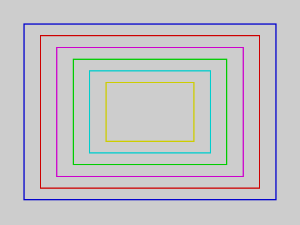

**See also** BLOCK, INVERT, LINE.

---

## FREE

`FREE()`, `FREE(1)` -- **function**

`FREE()` is the number of bytes still free in the main memory pool, which the program text, the variables and the arrays share. `FREE(1)` is the number of bytes free in the 2 KB overflow area (segment 2) that arrays use when they do not fit in the main pool, and where the Array Store lives.

```basic ex=kw.free.1
PRINT FREE(1)
DIM a(100)
PRINT FREE(1)
```
```output ex=kw.free.1
2048
2048
```

(`FREE()` itself depends on the program: a short program on an empty machine leaves about 8100 bytes, and a numeric array costs two bytes per element.)

**See also** DIM, the concept [Memory](04_concepts.md#memory).

---

## GOTO

`GOTO label` -- **statement**

Continues the program at the line `label:`. A **label** is a line consisting of a name followed by a colon; `GOTO` can only go to labels (there are no line numbers).

```basic ex=kw.goto.1
n = 0
again:
n = n + 1
PRINT n
IF n < 3 THEN GOTO again
PRINT "finished"
```
```output ex=kw.goto.1
1
2
3
finished
```

The label may come before or after the `GOTO`:

```basic ex=kw.goto.2
GOTO skip
PRINT "never printed"
skip:
PRINT "here"
```
```output ex=kw.goto.2
here
```

**Notes.**

* A label may not be a keyword (`out:` is an error: `OUT` is a statement). Names that merely begin with a keyword (`tomato`, `format`) are fine.
* `GOTO` may jump out of a `FOR` loop or a procedure. It may not jump **into** the middle of a loop: the loop's `NEXT` then fails with a run-time error. A label inside a procedure belongs to the procedure's code and should only be reached by `CALL`.
* A `GOTO` to a label that does not exist is a compile error (nothing runs).
* Typed after a colon on the editor's last line, `: GOTO label` runs the program from that label using the variables kept from the last run (see [Sessions](04_concepts.md#sessions)).

**See also** IF, CALL, the concept [Labels](04_concepts.md#labels).

---

## GRAB  [package: sprite]

`GRAB slot, row, col, width, height` -- **statement**

Copies a rectangle of the screen -- both the pixels and the colours -- into a sprite *slot* (0 to 7). The rectangle starts at character cell *row*, *col* and is *width* by *height* character cells (each from 1 to 4). The picture stays on the screen; the copy is kept until you `GRAB` into that slot again. Needs the **sprite** package: type `LOAD "SPRITE" EXT` first. See [Part 5](05_packages.md#the-sprite-package).

Draw a red diamond on yellow in the top left, grab it, clear the screen to a blue background, and show two copies of it:

*With the sprite package loaded (`LOAD "SPRITE" EXT`):*

```basic ex=kw.grab.1 pkg=sprite shot=sprite_two
INK 2
PAPER 6
LINE 23, 16 TO 31, 24
LINE 31, 24 TO 23, 31
LINE 23, 31 TO 16, 24
LINE 16, 24 TO 23, 16
LINE 16, 24 TO 31, 24
GRAB 0, 2, 2, 2, 2
GRAB 1, 2, 2, 2, 2
INK 7
PAPER 1
CLS
SHOW 0, 8, 6
SHOW 1, 8, 20
```

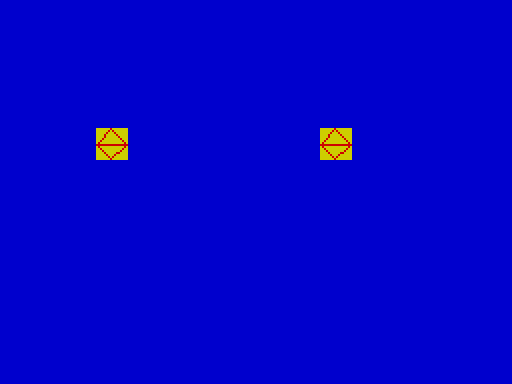

**See also** SHOW, HIDE, MOVE.

---

## HIDE  [package: sprite]

`HIDE slot` -- **statement**

Removes a shown sprite, restoring the screen exactly as it was underneath it. Hiding a sprite that is not shown is a run-time error. Needs the **sprite** package: type `LOAD "SPRITE" EXT` first.

The same picture as under `SHOW`, but the sprite is hidden again at the end: the background is whole, with no hole where the sprite was.

*With the sprite package loaded (`LOAD "SPRITE" EXT`):*

```basic ex=kw.hide.1 pkg=sprite shot=sprite_hide
INK 2
PAPER 6
LINE 23, 16 TO 31, 24
LINE 31, 24 TO 23, 31
LINE 23, 31 TO 16, 24
LINE 16, 24 TO 23, 16
GRAB 0, 2, 2, 2, 2
INK 0
PAPER 5
CLS
FOR r = 0 TO 22
  AT r, 0
  PRINT "###############################";
NEXT r
SHOW 0, 9, 14
PAUSE 25
HIDE 0
```

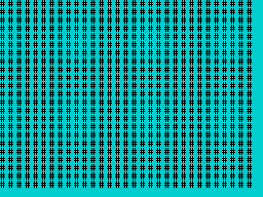

**See also** SHOW, MOVE, GRAB.

---

## IF

`IF condition THEN` ... [`ELSE` ...] `ENDIF` `IF condition THEN GOTO label` -- **statement**

Chooses what to do. In the **block** form, `THEN` is the last thing on its line; the statements that follow, up to `ELSE` or `ENDIF`, run when the *condition* is true (not 0), and those between `ELSE` and `ENDIF` run when it is false. Every block `IF` is closed by `ENDIF`.

```basic ex=kw.if.1
score = 75
IF score > 100 THEN
  PRINT "WELL DONE"
ELSE
  IF score > 50 THEN
    PRINT "GOOD"
  ELSE
    PRINT "TRY AGAIN"
  ENDIF
ENDIF
```
```output ex=kw.if.1
GOOD
```

The only **one-line** form is `IF condition THEN GOTO label`:

```basic ex=kw.if.2
x = 1
IF x = 1 THEN GOTO done
PRINT "skipped"
done:
PRINT "end"
```
```output ex=kw.if.2
end
```

A condition is any number: 0 is false and anything else (including a fraction) is true. Comparisons give 1 or 0, so `IF a > 3 THEN` and `IF (a > 3) <> 0 THEN` mean the same.

**Notes.**

* There is no `ELSEIF`; write `ELSE`, a new `IF`, and one more `ENDIF`.
* A one-line `IF x THEN PRINT "y"` is a compile error: write the block form.
* Blocks nest.
* A missing `ENDIF`, or an `ELSE`/`ENDIF` with no `IF`, is a compile error.

**See also** AND, OR, NOT, GOTO, the concept [Truth and comparisons](04_concepts.md#truth-and-comparisons).

---

## IN

`IN(port)` -- **function**

Reads one byte from an input port. *port* is the full 16-bit port address: the high byte also selects which keyboard half-row is read, as on the Spectrum (`IN(65278)` reads the row with CAPS SHIFT, `IN(32766)` the row with SPACE). Joystick and keyboard bits are active low.

```basic ex=kw.in.1
k = IN(65278)
PRINT k >= 0
PRINT k <= 255
```
```output ex=kw.in.1
1
1
```

**See also** OUT, INKEY$, STICK, PEEK.

---

## INK

`INK n` -- **statement**

Sets the ink (foreground) colour used for printing and drawing from now on. Only the low three bits of *n* count, so the colours repeat every eight:

| n | 0 | 1 | 2 | 3 | 4 | 5 | 6 | 7 |
|---|---|---|---|---|---|---|---|---|
| colour | black | blue | red | magenta | green | cyan | yellow | white |

```basic ex=kw.ink.1
INK 2
PAPER 6
CLS
PRINT ATTR(0, 0)
```
```output ex=kw.ink.1
50
```

Colour changes affect what is **printed or drawn afterwards**; to repaint the whole screen, use `CLS` after the change. A fraction is cut off (`INK 2.5` is 2).

**See also** PAPER, BRIGHT, FLASH, INVERSE, OVER, BORDER, ATTR.

---

## INKEY$

`INKEY$()` -- **function**

The key being held down right now, as a one-character string, or the empty string "" if no key is down. It does not wait for a key.

```basic ex=kw.inkey.1
a$ = INKEY$()
PRINT LEN(a$)
```
```output ex=kw.inkey.1
0
```

A typical loop waits for a key:

```basic ex=kw.inkey.2
count = 0
wait:
count = count + 1
IF INKEY$() = "" AND count < 20 THEN GOTO wait
PRINT "released after "; count
```
```output ex=kw.inkey.2
released after 20
```

**See also** INPUT, STICK, PAUSE.

---

## INPUT

`INPUT variable` `INPUT "prompt"; variable` `INPUT "prompt", variable` -- **statement**

Waits for you to type something and press ENTER, and stores it in *variable*. A **numeric** variable takes a number (fractions are fine, up to 20 characters; anything that is not a number gives 0, and text after a number is ignored: `12abc` gives 12). A **string** variable (`a$`) takes up to 31 characters. What you type is shown on the screen as you type it. If you give a prompt, it is printed first, with nothing between it and your answer.

```basic ex=kw.input.1 keys="42\n"
INPUT n
PRINT n + 1
```
```output ex=kw.input.1
42
43
```

```basic ex=kw.input.2 keys="Ann\n"
INPUT "Name? "; n$
PRINT "Hello, "; n$
```
```output ex=kw.input.2
Name? Ann
Hello, Ann
```

```basic ex=kw.input.3 keys="3.75\n"
INPUT "Value? "; v
PRINT v * 2
```
```output ex=kw.input.3
Value? 3.75
7.5000
```

`INPUT` has **no editing**: DELETE and the cursor keys are ignored, so a character typed by mistake cannot be taken back (here the keys were `a`, `b`, DELETE, `c`, ENTER, and the answer is `abc`):

```basic ex=kw.input.4 keys="ab\x08c\n"
INPUT t$
PRINT t$
```
```output ex=kw.input.4
abc
abc
```

**Notes.**

* Whether you separate the prompt from the variable with `;` or with `,` makes no difference.
* Only a plain variable can be read into. `INPUT a(1)` -- an array element -- is a compile error; read into a variable and then store it.
* ENTER on its own gives 0 or "".
* Only printable characters are accepted; every other key (DELETE, the cursor keys) is ignored.

**See also** INKEY$, VAL, the concept [Input](04_concepts.md#input).

---

## INT

`INT(n)` -- **function**

*n* with its fraction cut off, **toward zero**. (Sinclair BASIC rounds down instead, so `INT(-3.5)` is -4 there but -3 here.) For a whole number the result is the number itself.

```basic ex=kw.int.1
PRINT INT(3.7)
PRINT INT(-3.7)
PRINT INT(7 / 2)
PRINT INT(5)
```
```output ex=kw.int.1
3
-3
3
5
```

To round to the nearest whole number, add a half first: `INT(x + 0.5)` for positive *x*.

**See also** DIV, MOD, ABS.

---

## INVERSE

`INVERSE n` -- **statement**

When *n* is 1, what is printed next has its ink and paper colours swapped. Only the low bit counts.

```basic ex=kw.inverse.1
INVERSE 1
CLS
PRINT ATTR(0, 0)
```
```output ex=kw.inverse.1
7
```

(The default paper 7 and ink 0 become ink 7 on paper 0: 7 = 0 x 8 + 7.)

**See also** INK, PAPER, OVER.

---

## INVERT  [package: graphics]

`INVERT x0, y0, x1, y1` -- **statement**

Flips every pixel of a rectangle: set pixels become clear and clear pixels become set, whatever `OVER` is. Doing it twice puts the picture back. Needs the **graphics** package: type `LOAD "GRAPHICS" EXT` first. See [Part 5](05_packages.md#the-graphics-package).

A solid block, with a second rectangle inverted across its corner -- the part over the block becomes empty, the part outside it becomes solid:

*With the graphics package loaded (`LOAD "GRAPHICS" EXT`):*

```basic ex=kw.invert.1 pkg=graphics shot=invert_overlap
INK 1
BLOCK 40, 40, 140, 110
INVERT 100, 80, 200, 150
```

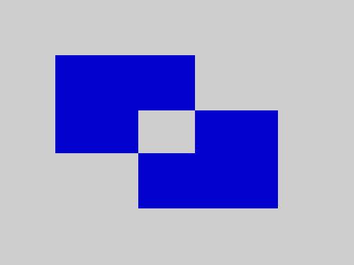

**See also** BLOCK, FRAME, OVER.

---

## LEFT$

`LEFT$(a$, n)` -- **function**

The first *n* characters of *a$*. If *n* is larger than the length you get the whole string; `n` of 0 (or less) gives "".

```basic ex=kw.left.1
PRINT LEFT$("abcdef", 2)
PRINT LEFT$("abcdef", 99)
PRINT LEN(LEFT$("abcdef", 0))
```
```output ex=kw.left.1
ab
abcdef
0
```

**See also** RIGHT$, MID$, LEN.

---

## LEN

`LEN(a$)` -- **function**

The number of characters in *a$* (0 to 31).

```basic ex=kw.len.1
PRINT LEN("hello world")
PRINT LEN("")
PRINT LEN(STR$(12345))
```
```output ex=kw.len.1
11
0
5
```

**See also** CODE, LEFT$, MID$.

---

## LINE

`LINE x0, y0 TO x1, y1` -- **statement**

Draws a straight line between two pixels, in the current ink. *x* runs 0 to 255 from the left and *y* 0 to 191 **from the top** (this differs from Sinclair BASIC, where *y* counts up from the bottom). Coordinates off the screen are moved to the nearest edge.

```basic ex=kw.line.1 shot=line_box rows=2
INK 1
LINE 20, 30 TO 235, 30
LINE 235, 30 TO 235, 170
LINE 235, 170 TO 20, 170
LINE 20, 170 TO 20, 30
INK 2
LINE 20, 30 TO 235, 170
INK 0
PRINT POINT(20, 100)
PRINT POINT(120, 100)
```
```output ex=kw.line.1
1
0
```

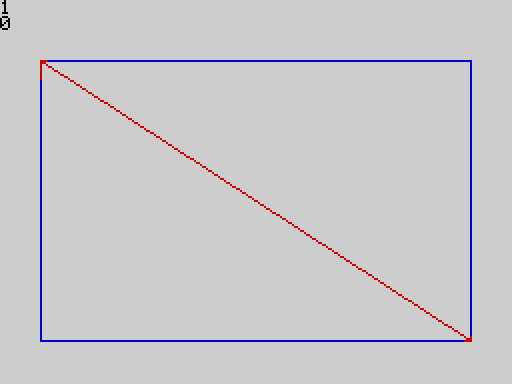

**See also** PLOT, POINT, CIRCLE, CLS.

---

## LIST

`LIST` -- **command**

Typed on the editor's empty last line. Shows the program from its first line, keywords in bold, 23 lines at a time. When the screen is full it waits for a key and then shows the next page; BREAK (CAPS SHIFT + SPACE) at a full page stops the listing. At the end of the program it waits for a key and returns to the editor.

```keys ex=kw.list.1
PRINT "Hello"
FOR i = 1 TO 3
  PRINT i
NEXT i
LIST
```
```screen ex=kw.list.1
PRINT "Hello"
FOR i = 1 TO 3
  PRINT i
NEXT i
```

**See also** RUN, NEW, the concept [The editor](04_concepts.md#the-editor).

---

## LLIST  [package: printer]

`LLIST` -- **statement**

Prints the program, one program line per printed line (a long line wraps at 32 characters), on the ZX Printer. Needs the **printer** package; without it `LLIST` is not known and the program fails to compile. See [Part 5](05_packages.md#the-printer-package).

*With the printer package loaded (`LOAD "PRINTER" EXT`):*

```basic ex=kw.llist.1 pkg=printer
PRINT "listing"
LLIST
```

**See also** LPRINT, LIST.

---

## LOAD

`LOAD "name"` `LOAD ""` `LOAD "name" ARRAY array` `LOAD "name" EXT` -- **command**

Reads from tape what `SAVE` wrote:

| Command | Loads |
|---|---|
| `LOAD "name"` | the program called *name* -- and, if it was saved with `ALL`, the variables and arrays that went with it |
| `LOAD ""` | the next program on the tape, whatever its name |
| `LOAD "name" ARRAY a` | one array, into the Array Store (the program is not touched) |
| `LOAD "name" EXT` | a package (see [Part 5](05_packages.md)) |

```basic ex=kw.load.1
PRINT "from tape"
```
```tape ex=kw.load.1
SAVE "first"                           [SAVED]
power on
LOAD ""                                [LOADED]
```

The result is shown on the status line: `LOADED`, or `LOAD FAILED`, `BAD TAPE VERSION`, `NO VARIABLES`, `ABORTED`. Details are under SAVE and in the concept [Tapes](04_concepts.md#tapes).

**See also** SAVE, VERIFY.

---

## LOWER$

`LOWER$(a$)` -- **function**

*a$* with its capital letters changed to lower case.

```basic ex=kw.lower.1
PRINT LOWER$("Hello, WORLD 1")
```
```output ex=kw.lower.1
hello, world 1
```

**See also** UPPER$.

---

## LPRINT  [package: printer]

`LPRINT expression` -- **statement**

Prints one number or string on the ZX Printer, wrapping at 32 characters. Needs the **printer** package; without it, `LPRINT` is a compile error. Only **one** item may follow `LPRINT` (not a list), and a number is printed as a whole number. See [Part 5](05_packages.md#the-printer-package).

*With the printer package loaded (`LOAD "PRINTER" EXT`):*

```basic ex=kw.lprint.1 pkg=printer
LPRINT "hello"
LPRINT 42
PRINT "sent"
```
```output ex=kw.lprint.1
sent
```

Without the package:

```basic ex=kw.lprint.2 err=ce:32
LPRINT "hello"
```

**See also** LLIST, PRINT.

---

## MID$

`MID$(a$, start, length)` -- **function**

*length* characters of *a$*, starting at character number *start*. The first character is number 1. A *start* below 1 counts as 1; a *length* that runs past the end gives what is left; a *start* beyond the end gives "".

```basic ex=kw.mid.1
PRINT MID$("abcdef", 3, 2)
PRINT MID$("abcdef", 3, 99)
PRINT LEN(MID$("abcdef", 10, 2))
PRINT MID$("abcdef", -1, 3)
```
```output ex=kw.mid.1
cd
cdef
0
abc
```

V2 has no `a$(i TO j)` slicing; `MID$` does that job.

**See also** LEFT$, RIGHT$, LEN.

---

## MOD

`MOD(a, b)` -- **function**

The remainder of *a* divided by *b*, with the sign of *a* (truncating division). Fractions are cut off first. `b` of 0 stops the program with a run-time error.

```basic ex=kw.mod.1
PRINT MOD(17, 5)
PRINT MOD(-10, 3)
PRINT MOD(10, -3)
PRINT MOD(20, 4)
```
```output ex=kw.mod.1
2
-1
1
0
```

**See also** DIV, INT.

---

## MODE  [package: mode]

`MODE m` -- **statement**

Selects the video mode: `MODE 0` is the normal mode and `MODE 1` the TS2068's high-resolution mode. Any other value is a run-time error. Needs the **mode** package. See [Part 5](05_packages.md#the-mode-package).

*With the mode package loaded (`LOAD "MODE" EXT`):*

```basic ex=kw.mode.1 pkg=mode
MODE 1
MODE 0
PRINT "back to normal"
```
```output ex=kw.mode.1
back to normal
```

**See also** ULAPLUS, PALETTE.

---

## MOVE  [package: sprite]

`MOVE slot, row, col` -- **statement**

Moves a shown sprite to a new character cell: the screen under the old position is restored, and the sprite is drawn at the new one. Moving a sprite that is not shown is a run-time error. Needs the **sprite** package: type `LOAD "SPRITE" EXT` first.

The sprite is shown at the left and moved, step by step, across the striped background to the right; the picture shows where it ends up, and the background it passed over is intact:

*With the sprite package loaded (`LOAD "SPRITE" EXT`):*

```basic ex=kw.move.1 pkg=sprite shot=sprite_move
INK 2
PAPER 6
LINE 23, 16 TO 31, 24
LINE 31, 24 TO 23, 31
LINE 23, 31 TO 16, 24
LINE 16, 24 TO 23, 16
GRAB 0, 2, 2, 2, 2
INK 0
PAPER 5
CLS
FOR r = 0 TO 22
  AT r, 0
  PRINT "###############################";
NEXT r
SHOW 0, 9, 2
FOR c = 3 TO 26
  MOVE 0, 9, c
  PAUSE 1
NEXT c
```

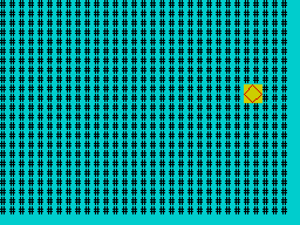

**See also** SHOW, HIDE, GRAB.

---

## NEW

`NEW` -- **command**

Typed on the editor's empty last line. Wipes the program, the variables kept from the last run, the Array Store, and any loaded package, and starts a clean machine.

```keys ex=kw.new.1
PRINT "one"
PRINT "two"
NEW
```
```screen ex=kw.new.1
...
LINE 1/0
```

(The bottom line says: line 1 of an empty program.) There is no confirmation: `NEW` cannot be undone.

**See also** RUN, CLEAR, LOAD.

---

## NEXT

`NEXT [variable]` -- **part of** `FOR`

Ends the body of a `FOR` loop and adds the step. See FOR.

---

## NOT

`NOT value` -- **operator**

1 if *value* is 0, otherwise 0. `NOT` is a logical operator (no bit patterns). It binds more loosely than the comparisons, so `NOT a = 4` means `NOT (a = 4)`; use brackets for anything else.

```basic ex=kw.not.1
a = 5
PRINT NOT 0
PRINT NOT 5
PRINT NOT a = 4
PRINT NOT NOT 3
```
```output ex=kw.not.1
1
0
1
1
```

**See also** AND, OR.

---

## OR

*a* `OR` *b* -- **operator**

True (1) when *a* or *b* (or both) is true; otherwise 0. Like `AND`, it is a logical operator giving 0 or 1, and it **stops as soon as the answer is known**: if *a* is true, *b* is not evaluated. `OR` binds more loosely than `AND`.

```basic ex=kw.or.1
a = 5
PRINT a < 3 OR a > 4
PRINT 0 OR 7
PRINT 0 OR 0
```
```output ex=kw.or.1
1
1
0
```

**See also** AND, NOT.

---

## OUT

`OUT port, value` -- **statement**

Writes the low byte of *value* to an output port. *port* is the full 16-bit port address.

```basic ex=kw.out.1
OUT 254, 2
PRINT "red border"
```
```output ex=kw.out.1
red border
```

(Port 254 is the ULA: bits 0 to 2 set the border colour. `BORDER` is the safe way to do this.)

**See also** IN, POKE, BORDER, SOUND.

---

## OVER

`OVER n` -- **statement**

When *n* is 1, printing and drawing **exclusive-OR** with what is already on the screen: drawing a pixel that is already set clears it, and printing a character over itself erases it. `OVER 0` returns to normal. Only the low bit counts.

```basic ex=kw.over.1 rows=6
PLOT 10, 100
OVER 1
PLOT 10, 100
OVER 0
PRINT POINT(10, 100)
PRINT "A"
AT 1, 0
OVER 1
PRINT "A"
OVER 0
AT 4, 0
PRINT "end"
```
```output ex=kw.over.1
0


end
```

(The second `PLOT` cleared the pixel the first one set, and the second `PRINT "A"` erased the first: row 1 is empty again.)

**See also** INVERSE, INVERT, PLOT.

---

## PALETTE  [package: mode]

`PALETTE index, value` -- **statement**

Writes *value* to ULAplus palette entry *index* (0 to 63). Needs the **mode** package and a machine or emulator with ULAplus. An index of 64 or more is a run-time error. See [Part 5](05_packages.md#the-mode-package).

*With the mode package loaded (`LOAD "MODE" EXT`):*

```basic ex=kw.palette.1 pkg=mode
ULAPLUS 1
PALETTE 0, 255
ULAPLUS 0
PRINT "palette set"
```
```output ex=kw.palette.1
palette set
```

**See also** ULAPLUS, MODE.

---

## PAPER

`PAPER n` -- **statement**

Sets the paper (background) colour for what is printed or drawn next; `CLS` paints the whole screen with it. The colours are those of `INK`; only the low three bits of *n* count.

```basic ex=kw.paper.1
PAPER 6
INK 2
CLS
PRINT ATTR(5, 5)
```
```output ex=kw.paper.1
50
```

**See also** INK, BRIGHT, FLASH, BORDER, CLS.

---

## PAUSE

`PAUSE n` -- **statement**

Waits for *n* frames (one frame is one display interrupt: 1/50 s in the qualification emulator; a real TS2068 is expected to run at 60 a second, which has not been measured) and goes on. `PAUSE 0` waits for a key to be pressed. BREAK ends a long pause.

```basic ex=kw.pause.1
PRINT "wait"
PAUSE 50
PRINT "done"
```
```output ex=kw.pause.1
wait
done
```

The measured cost is 69 700 T-states per frame count: `PAUSE 100` took 6 978 474 T-states on the emulator, 2.0 seconds at the emulator's 50 frames per second.

**See also** BEEP, INKEY$.

---

## PEEK

`PEEK(address)` -- **function**

The byte (0 to 255) stored at an address (0 to 65535). Reading the ROM works; writing it (with `POKE`) does nothing.

```basic ex=kw.peek.1
POKE 23296, 65
PRINT PEEK(23296)
PRINT PEEK(0)
```
```output ex=kw.peek.1
65
243
```

(Address 0 is the first byte of the ROM: 243 is the Z80 instruction `DI`.)

**Notes.** An address of 65536 or more is a run-time error. Addresses can be written as decimal numbers above 32767 (`PEEK(65535)`).

**See also** POKE, USR, the [memory map](07_appendices.md#appendix-e-memory-map).

---

## PI

`PI()` -- **function**

The number pi, 3.14159265... (written with brackets, like every function).

```basic ex=kw.pi.1
PRINT PI()
PRINT 2 * PI()
```
```output ex=kw.pi.1
3.1416
6.2832
```

**See also** RAD, DEG, SIN, COS.

---

## PLOT

`PLOT x, y` -- **statement**

Sets one pixel, in the current ink colour. The screen is 256 pixels wide and 192 high; *x* counts from the left (0 to 255) and *y* **from the top** (0 to 191). Values outside the screen are moved to the nearest edge, and a fraction is cut off.

A dotted sine wave across the screen:

```basic ex=kw.plot.1 shot=plot_wave
INK 1
FOR x = 0 TO 255
  PLOT x, 96 - INT(70 * SIN(x * 360 / 256))
NEXT x
```

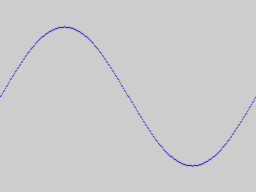

The wave starts at its middle height at the left edge (y = 96) and rises *up* the screen for positive sine values, because y counts down from the top. Note that this is different from Sinclair BASIC, where `PLOT 0,0` is at the **bottom** left.

```basic ex=kw.plot.2 rows=3
PLOT 300, 100
PLOT -5, 100
PRINT POINT(255, 100)
PRINT POINT(0, 100)
```
```output ex=kw.plot.2
1
1
```

(Off-screen coordinates are moved to the nearest edge, so those two points land on the right and left edges.)

**See also** POINT, LINE, INK, OVER, CPLOT, CIRCLE.

---

## POINT

`POINT(x, y)` -- **function**

1 if the pixel at *x*, *y* is set (ink), 0 if it is clear (paper). Coordinates are as for `PLOT`, and off-screen values are moved to the nearest edge.

This program draws a small shape and then *reads it back* with `POINT`, printing a `#` for every set pixel and a `.` for every clear one:

```basic ex=kw.point.1 shot=point_readback rows=8
LINE 100, 100 TO 107, 107
LINE 107, 100 TO 100, 107
FOR y = 100 TO 107
  a$ = ""
  FOR x = 100 TO 107
    IF POINT(x, y) = 1 THEN
      a$ = a$ + "#"
    ELSE
      a$ = a$ + "."
    ENDIF
  NEXT x
  PRINT a$
NEXT y
```
```output ex=kw.point.1
#......#
.#....#.
..#..#..
...##...
...##...
..#..#..
.#....#.
#......#
```

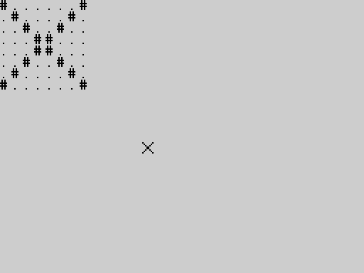

**See also** PLOT, ATTR.

---

## POKE

`POKE address, value` -- **statement**

Stores a byte in memory: the **low byte** of *value*, so `POKE a, 300` stores 44 and `POKE a, -1` stores 255. A fraction is cut off. *address* is 0 to 65535; above that is a run-time error. Writing to the ROM does nothing.

```basic ex=kw.poke.1
POKE 23296, 300
PRINT PEEK(23296)
POKE 23296, -1
PRINT PEEK(23296)
```
```output ex=kw.poke.1
44
255
```

**Warning.** `POKE` can overwrite the memory the system itself uses -- the program, the variables, the screen handler -- and so crash the machine. Use the addresses in the [memory map](07_appendices.md#appendix-e-memory-map) that are free.

**See also** PEEK, USR, OUT, and for designing your own characters with `POKE` the concept [User-defined characters](04_concepts.md#user-defined-characters).

---

## PRINT

`PRINT [item [separator item]... [separator]]` -- **statement**

Shows values on the screen, starting at the printing position. An *item* is a number or a string (anything that can follow `=` in an assignment). The *separator* between items is

* `;` -- the next item follows immediately, with nothing between;
* `,` -- the next item starts at the next **zone**: columns 0 and 16 (two zones per 32-column row).

A `;` or `,` at the end of the statement keeps the printing position on the line, so that the next `PRINT` carries on from there. Otherwise the position moves to the start of the next line. `PRINT` by itself prints an empty line.

```basic ex=kw.print.1
PRINT "A"; "B"
PRINT "A", "B"
PRINT 1; 2; 3
PRINT
PRINT "x";
PRINT "y"
```
```output ex=kw.print.1
AB
A               B
123

xy
```

How numbers look:

* A whole number is shown as it is.
* Any other number -- a fraction, or a number that does not fit the whole-number range (-32768 to 32767) -- is shown with **four decimal places** (rounded; very small values show as 0.0000).

```basic ex=kw.print.2
PRINT 7 / 2
PRINT 6 / 2
PRINT 1 / 3
PRINT 65535
PRINT 123456789 * 10
PRINT -0.5
PRINT 0.1 + 0.2
```
```output ex=kw.print.2
3.5000
3
0.3333
65535.0000
1234567890.0000
-0.5000
0.3000
```

A line longer than the screen is wrapped; when the text reaches the bottom of the screen, the screen **scrolls up**:

```basic ex=kw.print.3
FOR i = 1 TO 30
  PRINT i
NEXT i
```
```output ex=kw.print.3
8
9
10
11
12
13
14
15
16
17
18
19
20
21
22
23
24
25
26
27
28
29
30
```

**Notes.**

* Position (`AT`, `TAB`) and colour (`INK`, `PAPER`, ...) are separate statements, used before `PRINT`; they are not items of `PRINT`.
* The text area is 23 rows of 32 columns; the bottom row of the screen (row 23) is reserved for the status line.
* `PRINT` to a printer is `LPRINT` (package printer).
* A string constant longer than 31 characters is a compile error.

**See also** AT, TAB, INK, CLS, STR$, LPRINT, the concept [Numbers](04_concepts.md#numbers).

---

## PROC

`PROC name(parameter):` ... `ENDP` -- **statement**

Defines a **procedure**: a named piece of program that you run with `CALL`. It has exactly one parameter, which gets the value passed by `CALL`. The statements run until `ENDP`, and then the program returns to the statement after the `CALL`.

When the program runs into a `PROC` ... `ENDP` in its ordinary flow, it skips over it, so procedures can be placed anywhere; most programs put them after an `END`.

For example:

```basic ex=kw.proc.2
CALL squareof(7)
CALL squareof(12)
END
PROC squareof(n):
  PRINT n; " squared is "; n * n
ENDP
```
```output ex=kw.proc.2
7 squared is 49
12 squared is 144
```

The parameter is a **copy**: the procedure may change it without affecting anything outside. A variable of the same name is hidden while the procedure runs and is restored when it returns. Every other variable of the program is shared, so a procedure can use and change it:

```basic ex=kw.proc.3
n = 100
total = 0
CALL add(5)
CALL add(7)
PRINT total
PRINT n
END
PROC add(n):
  total = total + n
  n = 0
ENDP
```
```output ex=kw.proc.3
12
100
```

A procedure may call itself. Here is the factorial pattern, which prints from 1 up:

```basic ex=kw.proc.4
CALL countdown(5)
END
PROC countdown(n):
  IF n > 1 THEN
    CALL countdown(n - 1)
  ENDIF
  PRINT n
ENDP
```
```output ex=kw.proc.4
1
2
3
4
5
```

**Notes.**

* A procedure always has one parameter. To pass nothing, give it a dummy value (`CALL setup(0)`); to pass several things, use variables.
* A procedure cannot return a value: put it in a variable, or use `DEF FN` for one-line calculations.
* Recursion is limited by memory: a procedure with one parameter can call itself about 670 deep with an empty program (see [Limits](07_appendices.md#appendix-d-limits)).
* A `PROC` with no `ENDP` is a compile error; so is a `PROC` inside an immediate statement.

**See also** CALL, ENDP, DEF FN, END, the concept [Procedures](04_concepts.md#procedures).

---

## RAD

`RAD(d)` -- **function**

Converts an angle from degrees to radians.

```basic ex=kw.rad.1
PRINT RAD(180)
PRINT RAD(90)
```
```output ex=kw.rad.1
3.1416
1.5708
```

**See also** DEG, PI, SIN.

---

## RANDOMISE

`RANDOMISE n` -- **statement**

Sets the starting point of the random number sequence of `RND`. The same *n* always gives the same sequence, which is useful for repeatable tests. A program that wants different numbers each time must give `RANDOMISE` something that changes (a value read from the keyboard timing, say); `RANDOMISE` with no number is a compile error.

```basic ex=kw.randomise.1
RANDOMISE 5
a = RND(1000)
RANDOMISE 5
b = RND(1000)
PRINT a = b
PRINT a
```
```output ex=kw.randomise.1
1
2
```

**See also** RND.

---

## REM

`REM text` -- **statement**

A remark. Everything from `REM` to the end of the line is ignored (even a `:`), so a remark can end a line after other statements.

```basic ex=kw.rem.1
REM this whole line is ignored : PRINT "no"
x = 1 : REM and so is this
PRINT x
```
```output ex=kw.rem.1
1
```

**Notes.** The apostrophe `'` is not a comment character in V2 (it is a compile error).

---

## RIGHT$

`RIGHT$(a$, n)` -- **function**

The last *n* characters of *a$*; the whole string if *n* is larger than its length.

```basic ex=kw.right.1
PRINT RIGHT$("abcdef", 2)
PRINT RIGHT$("abcdef", 99)
```
```output ex=kw.right.1
ef
abcdef
```

**See also** LEFT$, MID$.

---

## RND

`RND(n)` -- **function**

A random whole number from 0 to *n* - 1. (`RND(6)` is 0, 1, 2, 3, 4 or 5.) With *n* below 1 the result is 0.

```basic ex=kw.rnd.1
RANDOMISE 7
FOR i = 1 TO 3
  PRINT RND(6)
NEXT i
PRINT RND(1)
PRINT RND(0)
```
```output ex=kw.rnd.1
3
1
0
0
0
```

To roll a die: `RND(6) + 1`.

**See also** RANDOMISE.

---

## RUN

`RUN` -- **command**

Typed on the editor's empty last line. Compiles the **whole** program, and, if there is no error, runs it with fresh variables. If the compiler finds a mistake, nothing runs: the message appears on the status line, and when you press a key the cursor goes to the line where the error was found.

When the program ends it leaves its output on the screen and waits for a key; the key returns you to the editor. If the program stops with a run-time error, what it had printed stays on the screen and the message appears on the bottom line.

```keys ex=kw.run.1
PRINT "HELLO"
x = 3
PRINT x * 2
RUN
```
```screen ex=kw.run.1
HELLO
6
```

```keys ex=kw.run.2
PRINT 1 +
PRINT 2
RUN
```
```screen ex=kw.run.2
PRINT 1 +
PRINT 2
RUN
...
SYNTAX ERROR
```

**See also** LIST, NEW, CLEAR, STOP, the concept [Sessions](04_concepts.md#sessions).

---

## SAVE

`SAVE "name"` `SAVE "name" ALL` `SAVE "name" ARRAY array` `SAVE "name" EXT` -- **command**

Writes to tape (or the emulator's tape output). *name* is up to 10 characters.

| Command | Writes |
|---|---|
| `SAVE "name"` | the program |
| `SAVE "name" ALL` | the program **and** the variables and arrays it has now, and the Array Store |
| `SAVE "name" ARRAY a` | one array |
| `SAVE "name" EXT` | the package currently loaded (`NO PACKAGE` if none) |

Each ends by showing `SAVED` on the status line. `SAVE ... ALL` lets you stop work and carry on later: after the `LOAD`, `: PRINT x`, `: GOTO label` and the rest see the saved values. The variables come back only on the same ROM version, with the same package (if any) loaded first; otherwise the program loads and the message says `NO VARIABLES`.

**Notes.**

* `SAVE ... ALL`, `LOAD` and `VERIFY` of an ALL tape pause for **about 2.4 seconds** before the tones start (the program's identity check is calculated first).
* If a very large program plus its overflow arrays cannot be laid out for saving, `SAVE ... ALL` says `OUT OF MEMORY`; `SAVE "name"` still works.
* A tape written by this version cannot be loaded by earlier V2 ROMs; V1 and stock Spectrum tapes are refused with `BAD TAPE VERSION`.

```basic ex=kw.save.1
x = 5
y$ = "hello"
z = 2.5
```
```tape ex=kw.save.1
RUN
: x = x + 1
SAVE "demo" ALL                        [SAVED]
power on
LOAD "demo"                            [LOADED]
: PRINT x
6
: PRINT y$
hello
: PRINT z
2.5000
```

**See also** LOAD, VERIFY, the concept [Tapes](04_concepts.md#tapes).

---

## SGN

`SGN(n)` -- **function**

The sign of *n*: -1, 0 or 1.

```basic ex=kw.sgn.1
PRINT SGN(-7)
PRINT SGN(0)
PRINT SGN(0.5)
```
```output ex=kw.sgn.1
-1
0
1
```

**See also** ABS.

---

## SHOW  [package: sprite]

`SHOW slot, row, col` -- **statement**

Draws a grabbed sprite at character cell *row*, *col*, remembering the screen underneath so that `HIDE` or `MOVE` can restore it. The slot must have been grabbed (`GRAB`) and must not already be shown. Needs the **sprite** package: type `LOAD "SPRITE" EXT` first. See `GRAB` for a complete example.

A sprite is drawn on top of whatever is there, colours and all. Here one sprite is shown on a striped background:

*With the sprite package loaded (`LOAD "SPRITE" EXT`):*

```basic ex=kw.show.1 pkg=sprite shot=sprite_show
INK 2
PAPER 6
LINE 23, 16 TO 31, 24
LINE 31, 24 TO 23, 31
LINE 23, 31 TO 16, 24
LINE 16, 24 TO 23, 16
GRAB 0, 2, 2, 2, 2
INK 0
PAPER 5
CLS
FOR r = 0 TO 22
  AT r, 0
  PRINT "###############################";
NEXT r
SHOW 0, 9, 14
```

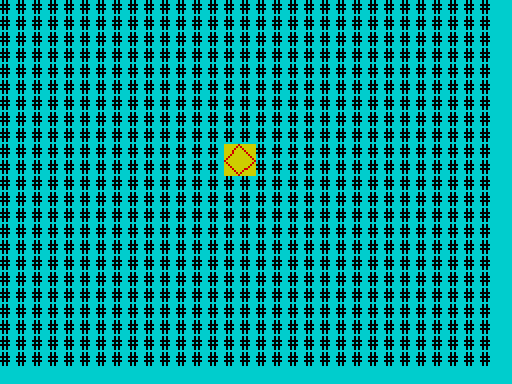

Errors (all run-time): a slot above 7, a row above 23 or column above 31, a slot that was never grabbed, a slot that is already shown, or a sprite that would not fit on the screen at that position.

**See also** GRAB, HIDE, MOVE.

---

## SIN

`SIN(angle)` -- **function**

The sine of an angle in **degrees**.

```basic ex=kw.sin.1
PRINT SIN(30)
PRINT SIN(90)
PRINT SIN(0.5)
```
```output ex=kw.sin.1
0.5000
1.0000
0.0087
```

**See also** COS, TAN, RAD, DEG, PI.

---

## SOUND

`SOUND register, value` -- **statement**

Writes *value* (0 to 255) to a register of the AY-3-8912 sound chip. The chip makes three tones and a noise, and keeps playing while the program goes on, until you silence it.

*register* is the register number as the chip knows it, and must be **1 to 16**: any other number is a run-time error. (Register 0, the fine pitch of channel A, therefore cannot be set from BASIC.)

| Register | Holds |
|---|---|
| 1 | channel A pitch, coarse (the low 4 bits) |
| 2, 3 | channel B pitch, fine and coarse |
| 4, 5 | channel C pitch, fine and coarse |
| 6 | noise pitch |
| 7 | mixer: which tones and noise are on (a bit set = *off*) |
| 8, 9, 10 | volume of channels A, B, C (0 to 15) |
| 11, 12, 13 | volume envelope |

```basic ex=kw.sound.1
SOUND 7, 62
SOUND 1, 1
SOUND 8, 10
PAUSE 50
SOUND 8, 0
PRINT "silent again"
```
```output ex=kw.sound.1
silent again
```

This switches channel A's tone on (mixer 62 turns on only tone A), sets its pitch and volume, waits a second, and silences it. Pitch is the **period**: the larger the number, the lower the note.

**Notes.** The register numbering was read from the ROM and checked on the emulator (the number is sent to the chip unchanged); whether it matches the original TS2068 BASIC `SOUND` on real hardware has not been tested.

**See also** BEEP, OUT.

---

## SQR

`SQR(n)` -- **function**

The square root of *n*. A negative *n* stops the program with a run-time error. The result is a floating-point number.

```basic ex=kw.sqr.1
PRINT SQR(16)
PRINT SQR(2)
PRINT SQR(0)
```
```output ex=kw.sqr.1
4.0000
1.4142
0.0000
```

**See also** ABS, INT.

---

## STEP

`STEP value` -- **part of** `FOR`

Gives the amount a `FOR` loop adds each time round. See FOR.

---

## STICK

`STICK(n)` -- **function**

Reads joystick *n* (1 or 2) through the sound chip's input port. Any other *n* is a run-time error. `STICK(1)` gives a number from 0 to 15, one bit per direction switch (a bit is 1 while its switch is closed; 0 means nothing is pressed). `STICK(2)` gives 0 or 1 -- a hardware limitation of the machine's second joystick connection, not of BASIC.

```basic ex=kw.stick.1
j = STICK(1)
PRINT j >= 0 AND j <= 15
k = STICK(2)
PRINT k >= 0 AND k <= 1
```
```output ex=kw.stick.1
1
1
```

**Notes.** The joystick reading was not tried with a real joystick (hardware not tested).

**See also** INKEY$, IN.

---

## STOP

`STOP` -- **statement**

Stops the program, like `END`. Variables are kept (see [Sessions](04_concepts.md#sessions)), so you can look at them with `: PRINT x` and carry on with `: GOTO label`.

```basic ex=kw.stop.1
PRINT "a"
STOP
PRINT "b"
```
```output ex=kw.stop.1
a
```

**See also** END, BREAK (the concept [BREAK](04_concepts.md#break)).

---

## STR$

`STR$(n)` -- **function**

The number *n* as a string, spelled exactly as `PRINT` would show it.

```basic ex=kw.str.1
PRINT STR$(5) + "!"
PRINT STR$(-2.5)
PRINT STR$(0)
PRINT LEN(STR$(100))
```
```output ex=kw.str.1
5!
-2.5000
0
3
```

**See also** VAL, CHR$, PRINT.

---

## TAB

`TAB col` -- **statement**

Moves the printing position to column *col* of the current row (0 is the left edge). The column is taken modulo 32. Used before `PRINT`, as `AT` is.

```basic ex=kw.tab.1
TAB 10
PRINT "tab10"
TAB 40
PRINT "Z"
```
```output ex=kw.tab.1
          tab10
        Z
```

(Column 40 is 40 - 32 = 8.)

**See also** AT, PRINT.

---

## TAN

`TAN(angle)` -- **function**

The tangent of an angle in **degrees**. `TAN(90)` and the other odd multiples of 90 stop the program with a run-time error.

```basic ex=kw.tan.1
PRINT TAN(45)
PRINT TAN(0)
```
```output ex=kw.tan.1
1.0000
0.0000
```

**See also** SIN, COS, RAD.

---

## THEN

`THEN` -- **part of** `IF`

Follows the condition of an `IF`. See IF.

---

## TO

`TO` -- **part of** `FOR` and `LINE`

Separates the start from the limit in `FOR`, and the two end points in `LINE`.

---

## ULAPLUS  [package: mode]

`ULAPLUS n` -- **statement**

Turns the ULAplus colour extension off (0) or on (1) on hardware that has it. Any other value is a run-time error. Needs the **mode** package. See [Part 5](05_packages.md#the-mode-package) and `PALETTE`.

*With the mode package loaded (`LOAD "MODE" EXT`):*

```basic ex=kw.ulaplus.1 pkg=mode
ULAPLUS 1
ULAPLUS 0
PRINT "ok"
```
```output ex=kw.ulaplus.1
ok
```

**See also** PALETTE, MODE.

---

## UPPER$

`UPPER$(a$)` -- **function**

*a$* with its small letters changed to capitals.

```basic ex=kw.upper.1
PRINT UPPER$("Hello, world 1")
```
```output ex=kw.upper.1
HELLO, WORLD 1
```

**See also** LOWER$.

---

## USR

`USR(address)` -- **function**

Runs the machine-code routine that starts at *address*, and gives its result as a number from 0 to 65535.

The routine's contract:

* It is entered with `CALL`, so it must end with `RET`.
* On entry **HL** holds the address (as it does for any `JP (HL)`).
* It returns its result in **HL** -- this differs from Sinclair BASIC, which returns it in BC.
* It may destroy any register: `AF`, `BC`, `DE`, `HL`, `IX` and the alternate set. The interpreter's own `IY` is saved and restored by the ROM. The stack pointer must be as it was at entry.
* Interrupts must be left enabled (the keyboard, BREAK and `PAUSE` rely on them).
* It must not touch memory that the system uses: see the [memory map](07_appendices.md#appendix-e-memory-map).

```basic ex=kw.usr.1
REM machine code at 23296: LD HL,777 / RET
POKE 23296, 33
POKE 23297, 9
POKE 23298, 3
POKE 23299, 201
PRINT USR(23296)
```
```output ex=kw.usr.1
777
```

The next routine uses `IX`, `IY`, `BC`, `DE` and the alternate registers freely and still returns cleanly, and the program carries on:

```basic ex=kw.usr.2
REM LD IY,0 / LD IX,0 / EXX / LD BC,515 / LD DE,1029 / LD HL,7 / RET
POKE 23296, 253
POKE 23297, 33
POKE 23298, 0
POKE 23299, 0
POKE 23300, 221
POKE 23301, 33
POKE 23302, 0
POKE 23303, 0
POKE 23304, 217
POKE 23305, 1
POKE 23306, 3
POKE 23307, 2
POKE 23308, 17
POKE 23309, 5
POKE 23310, 4
POKE 23311, 33
POKE 23312, 7
POKE 23313, 0
POKE 23314, 201
x = USR(23296)
PRINT x
PRINT "alive"
FOR i = 1 TO 3
  PRINT i
NEXT i
```
```output ex=kw.usr.2
7
alive
1
2
3
```

**Notes.** A result of 32768 or more prints with four decimals (it is a floating-point number); use `MOD` or `DIV` on it if you need the bytes. A routine that does not end properly (no `RET`, a corrupted stack) crashes the machine: save your program first.

**See also** PEEK, POKE, the [memory map](07_appendices.md#appendix-e-memory-map).

---

## VAL

`VAL(a$)` -- **function**

The number at the start of *a$*. Leading spaces and a sign are allowed; the number may have a fraction; reading stops at the first character that cannot continue it. If there is no number, the result is 0.

```basic ex=kw.val.1
PRINT VAL("42")
PRINT VAL("3.5abc")
PRINT VAL("abc")
PRINT VAL("  -7")
PRINT VAL("1.5.2")
PRINT VAL("")
```
```output ex=kw.val.1
42
3.5000
0
-7
1.5000
0
```

**See also** STR$, INPUT.

---

## VERIFY

`VERIFY "name"` -- **command**

Compares the tape with what is in memory, without changing memory, and reports `VERIFIED` or `VERIFY FAILED`. `VERIFY` of a program saved with `ALL` also checks the saved variables, and, like `SAVE ... ALL`, takes about 2.4 seconds to get ready.

With the same program in memory, the tape verifies; change one character of the program and it does not:

```basic ex=kw.verify.1
PRINT "hello"
x = 7
```
```tape ex=kw.verify.1
SAVE "prog"                            [SAVED]
power on
store: PRINT "hello" ;; x = 7
VERIFY "prog"                          [VERIFIED]
```

```basic ex=kw.verify.2
PRINT "hello"
x = 7
```
```tape ex=kw.verify.2
SAVE "prog"                            [SAVED]
power on
store: PRINT "hello" ;; x = 8
VERIFY "prog"                          [VERIFY FAILED]
```

A tape written with `ALL` verifies against the program **and** its variables, when the program has been run to the same point:

```basic ex=kw.verify.3
x = 5
y$ = "hi"
```
```tape ex=kw.verify.3
RUN
SAVE "demo" ALL                        [SAVED]
power on
store: x = 5 ;; y$ = "hi"
RUN
VERIFY "demo"                          [VERIFIED]
```

**See also** SAVE, LOAD.

---
