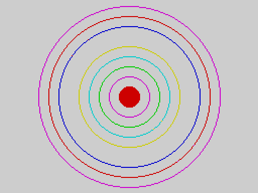
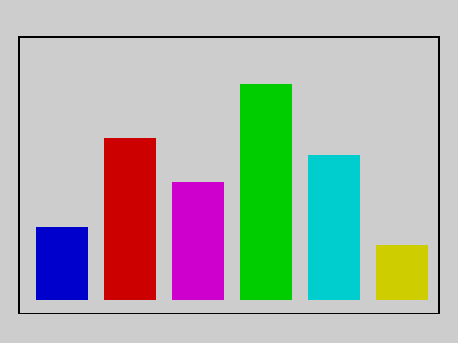

# Part 5 -- Packages

The V2 language that is built into the ROM is complete for programs, text, arrays, sound and simple graphics. Everything more specialised lives in **packages**: small programs on tape that add statements to the language. There are five:

| Package | Tape name | Size | Statements it adds |
|---|---|---|---|
| **mode** | `MODE` | 165 bytes | `MODE`, `ULAPLUS`, `PALETTE` |
| **sprite** | `SPRITE` | 834 bytes | `GRAB`, `SHOW`, `HIDE`, `MOVE` |
| **printer** | `PRINTER` | 345 bytes | `LPRINT`, `LLIST` |
| **shapes** | `SHAPES` | 1007 bytes | `CIRCLE`, `FILL` |
| **graphics** | `GRAPHICS` | 467 bytes | `CPLOT`, `BLOCK`, `FRAME`, `INVERT` |

## Loading a package

Type, on the editor's empty last line,

```
LOAD "SHAPES" EXT
```

and start the tape. The status line shows `LOADED`, and the new statements can be used from then on. Every example in this part (and every package example in [Part 3](03_keywords.md)) is run on the release ROM exactly like this: the package tape is played into the real tape loader, `LOAD ... EXT` is typed, and only then is the program run.

```basic ex=pkg.load.1
x = 1
```
```tape ex=pkg.load.1
package SHAPES
power on
LOAD "SHAPES" EXT                      [LOADED]
store: CIRCLE 128, 96, 40 ;; PRINT "drawn"
RUN
drawn
...
```

The rules:

* **One package at a time.** A package occupies a 1 KB window of memory. Loading another package **replaces** the first: its statements stop working.
* **`NEW` unloads the package** (and so does switching the machine off).
* Loading a package ends the current variable session (see [Sessions](04_concepts.md#sessions)).
* A statement of a package that is **not loaded** is a compile error: `RUN` shows `SYNTAX ERROR`, the cursor goes to the line when you press a key, and nothing runs. (`LPRINT` without its package is the same.)
* `SAVE "name" EXT` writes the package currently loaded back to tape; with none loaded it shows `NO PACKAGE`.
* A `SAVE ... ALL` tape remembers which package was loaded when it was written. Load the same package, **before** loading the ALL tape, or the variables will not come back (`NO VARIABLES`). See [Tapes](04_concepts.md#tapes).

Loading two packages in turn leaves only the second:

```basic ex=pkg.replace.1
x = 1
```
```tape ex=pkg.replace.1
package SHAPES
package GRAPHICS
power on
LOAD "SHAPES" EXT                      [LOADED]
LOAD "GRAPHICS" EXT                    [LOADED]
store: BLOCK 10, 40, 60, 70 ;; PRINT "block"
RUN
block
...
store: CIRCLE 128, 96, 40
RUN                                    [SYNTAX ERROR]
```

(The last `RUN` fails to compile: `CIRCLE` belongs to the shapes package, which the graphics package replaced. The status line then shows `SYNTAX ERROR`.)

```basic ex=pkg.new.1
x = 1
```
```tape ex=pkg.new.1
package SHAPES
power on
LOAD "SHAPES" EXT                      [LOADED]
SAVE "copy" EXT                        [SAVED]
NEW
SAVE "again" EXT                       [NO PACKAGE]
```

## Arguments

All package statements take **numbers**; `LPRINT` also takes a string. The arguments are whole numbers: a fraction is cut off. Only the **low eight bits** of each argument are used by the statements that take screen positions, so 256 acts as 0 and 300 as 44 -- keep your coordinates inside the ranges given below.

## Errors

A package statement that is given a bad argument stops the program with `RUNTIME ERROR`. The internal code differs by package:

| Package | Code | Cause |
|---|---|---|
| mode | 12 | `MODE` not 0 or 1 |
| mode | 13 | `ULAPLUS` not 0 or 1 |
| mode | 14 | `PALETTE` index 64 or more |
| sprite | 15 | slot 8 or more |
| sprite | 16 | row 24 or more, column 32 or more, or a width or height that is 0 or more than 4 |
| sprite | 17 | `SHOW` of a slot that was never grabbed |
| sprite | 18 | `SHOW` or `GRAB` of a sprite that is already shown |
| sprite | 19 | `HIDE` or `MOVE` of a sprite that is not shown |
| sprite | 20 | the sprite would not fit on the screen |

Argument mistakes are found when the statement runs, not when the program is compiled: `RUN` starts, and the program stops when it reaches the bad statement.

---

## The mode package

`LOAD "MODE" EXT` adds three statements for the TS2068's video hardware.

### MODE

`MODE 0` selects the normal screen; `MODE 1` selects the TS2068's second video mode, which this ROM (and the Timex manual it follows) calls **High Resolution Graphics**: the display hardware's port `$FF` is set to the value 2, and the second display file at `$6000` is used as 6144 colour attribute bytes, one per eight pixels across *per scan line* instead of one per 8 x 8 cell. Any other value for `MODE` is a run-time error. Switching to mode 1 first clears that second area (to the default colours); switching back to mode 0 leaves the screen as it was.

What mode 1 looks like on the screen was **not** examined: the documentation tests read the normal screen only, and nothing was tried on a real machine.

*With the mode package loaded (`LOAD "MODE" EXT`):*

```basic ex=pkg.mode.1 pkg=mode
MODE 1
PAUSE 25
MODE 0
PRINT "back to normal"
```
```output ex=pkg.mode.1
back to normal
```

```basic ex=pkg.mode.2 pkg=mode err=ve:12
MODE 2
```

### ULAPLUS and PALETTE

ULAplus is a hardware extension that gives 64 programmable colours. `ULAPLUS 1` turns it on and `ULAPLUS 0` off; `PALETTE index, value` writes *value* (0 to 255) to palette entry *index* (0 to 63). The statements only write to the ULAplus ports; on a machine without ULAplus they have no visible effect. They have **not been tried on real ULAplus hardware**.

*With the mode package loaded (`LOAD "MODE" EXT`):*

```basic ex=pkg.mode.3 pkg=mode
ULAPLUS 1
PALETTE 0, 255
ULAPLUS 0
PRINT "palette set"
```
```output ex=pkg.mode.3
palette set
```

```basic ex=pkg.mode.4 pkg=mode err=ve:14
PALETTE 64, 0
```

## The sprite package

`LOAD "SPRITE" EXT` adds four statements for moving pictures around the screen without disturbing the background. A **sprite** here is a rectangle of 1 to 4 by 1 to 4 **character cells** (8 x 8 pixels each), grabbed from the screen -- pixels and colours both -- into one of **8 slots** (numbered 0 to 7). Positions are in character cells: row 0 to 23, column 0 to 31.

| Statement | Does |
|---|---|
| `GRAB slot, row, col, width, height` | copies that part of the screen into the slot |
| `SHOW slot, row, col` | draws the slot's picture at that position, keeping what was under it |
| `MOVE slot, row, col` | puts the screen back where the sprite was, and draws it at the new position |
| `HIDE slot` | puts the screen back where the sprite was |

A slot can be shown once at a time, and a shown slot cannot be grabbed again until it is hidden. Switching the video mode (`MODE`) forgets which sprites are shown.

Here is a complete small animation: a diamond grabbed from the top left and moved in a rectangle around a background of hash signs, leaving the background undamaged. The picture shows the diamond in its last position.

*With the sprite package loaded (`LOAD "SPRITE" EXT`):*

```basic ex=pkg.sprite.1 pkg=sprite shot=sprite_tour
INK 2
PAPER 6
LINE 23, 16 TO 31, 24
LINE 31, 24 TO 23, 31
LINE 23, 31 TO 16, 24
LINE 16, 24 TO 23, 16
LINE 16, 24 TO 31, 24
GRAB 0, 2, 2, 2, 2
INK 0
PAPER 5
CLS
FOR r = 0 TO 22
  AT r, 0
  PRINT "###############################";
NEXT r
SHOW 0, 2, 2
FOR c = 3 TO 28
  MOVE 0, 2, c
NEXT c
FOR r = 3 TO 20
  MOVE 0, r, 28
NEXT r
FOR c = 27 TO 2 STEP -1
  MOVE 0, 20, c
NEXT c
```


Errors are listed above. In particular `MOVE` and `HIDE` of a sprite that is not shown stop the program:

*With the sprite package loaded (`LOAD "SPRITE" EXT`):*

```basic ex=pkg.sprite.2 pkg=sprite err=ve:19
PLOT 4, 4
GRAB 0, 0, 0, 1, 1
HIDE 0
```

*With the sprite package loaded (`LOAD "SPRITE" EXT`):*

```basic ex=pkg.sprite.3 pkg=sprite err=ve:18
PLOT 4, 4
GRAB 0, 0, 0, 1, 1
SHOW 0, 5, 5
SHOW 0, 6, 6
```

## The printer package

`LOAD "PRINTER" EXT` adds two statements for the ZX Printer (or a compatible printer on the same port).

* `LPRINT item` prints **one** number or string, wrapped at 32 characters. A number is printed as a whole number (a fraction is cut off, and values beyond the whole-number range are not reliable): to print a fraction or a big number, print `STR$(x)`.
* `LLIST` prints the program, one program line per printed line.

The printer is **not emulated** by the qualification emulator, so these statements are run but the printed paper has not been checked, and nothing here was tried with a real printer. As on the original machine, printing without a printer attached makes the program wait.

*With the printer package loaded (`LOAD "PRINTER" EXT`):*

```basic ex=pkg.printer.1 pkg=printer
LPRINT "hello"
LPRINT 42
LPRINT STR$(2.5)
PRINT "sent"
```
```output ex=pkg.printer.1
sent
```

Without the package, `LPRINT` and `LLIST` do not compile:

```basic ex=pkg.printer.2 err=ce:32
LPRINT "hello"
```

## The shapes package

`LOAD "SHAPES" EXT` adds `CIRCLE x, y, radius` and `FILL x, y`.

* `CIRCLE` draws the outline of a circle centred on pixel *x*, *y* in the current ink. *x* is 0 to 255 and *y* 0 to 191 from the top. The radius is in pixels; a circle that runs off the edge is clipped at it. A radius of 0 plots the centre point.
* `FILL` floods the closed area containing pixel *x*, *y* with the current ink, up to the outline. A gap in the outline lets the colour out into the rest of the screen.

Both draw in the current `INK`, `PAPER` (the colour of the cell the drawing touches), `BRIGHT`, `FLASH` and `OVER`.

*With the shapes package loaded (`LOAD "SHAPES" EXT`):*

```basic ex=pkg.shapes.1 pkg=shapes shot=shapes_target
FOR r = 10 TO 90 STEP 10
  INK MOD(r / 10, 7) + 1
  CIRCLE 128, 96, r
NEXT r
INK 2
FILL 128, 96
```



*With the shapes package loaded (`LOAD "SHAPES" EXT`):*

```basic ex=pkg.shapes.2 pkg=shapes rows=2
CIRCLE 128, 96, 40
PRINT POINT(168, 96)
PRINT POINT(128, 96)
```
```output ex=pkg.shapes.2
1
0
```

(The point 40 pixels right of the centre is on the circle; the centre itself is not.)

## The graphics package

`LOAD "GRAPHICS" EXT` adds four statements.

| Statement | Draws |
|---|---|
| `CPLOT x, y` | a 4 x 4-pixel block on a coarse 64 x 48 grid (*x* 0 to 63, *y* 0 to 47) |
| `BLOCK x0, y0, x1, y1` | a filled rectangle between two corners |
| `FRAME x0, y0, x1, y1` | the outline of that rectangle |
| `INVERT x0, y0, x1, y1` | the rectangle, with every pixel flipped (set becomes clear and clear becomes set) |

The corners of `BLOCK`, `FRAME` and `INVERT` may be given in either order. The pixel coordinates are as for `PLOT`. All four use the current ink and paper (and `BRIGHT` and `FLASH`); `INVERT` always exclusive-ORs, whatever `OVER` is.

A bar chart with `BLOCK` and `FRAME`:

*With the graphics package loaded (`LOAD "GRAPHICS" EXT`):*

```basic ex=pkg.graphics.1 pkg=graphics shot=graphics_bars
DIM h(6)
h(0) = 40
h(1) = 90
h(2) = 65
h(3) = 120
h(4) = 80
h(5) = 30
FOR i = 0 TO 5
  INK i + 1
  BLOCK 20 + i * 38, 167 - h(i), 48 + i * 38, 167
NEXT i
INK 0
FRAME 10, 20, 245, 175
```



`INVERT` twice gives back the original, which is how a cursor or a highlight bar is moved over a picture without redrawing it:

*With the graphics package loaded (`LOAD "GRAPHICS" EXT`):*

```basic ex=pkg.graphics.2 pkg=graphics rows=3
BLOCK 40, 40, 80, 60
a = POINT(60, 50)
INVERT 40, 40, 80, 60
b = POINT(60, 50)
INVERT 40, 40, 80, 60
c = POINT(60, 50)
PRINT a
PRINT b
PRINT c
```
```output ex=pkg.graphics.2
1
0
1
```
